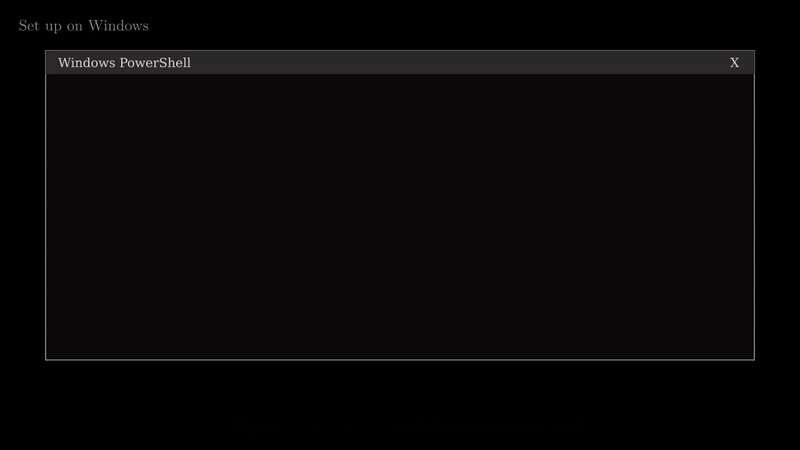
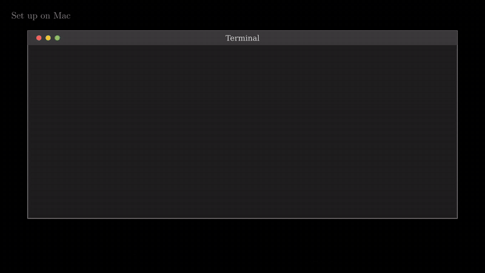
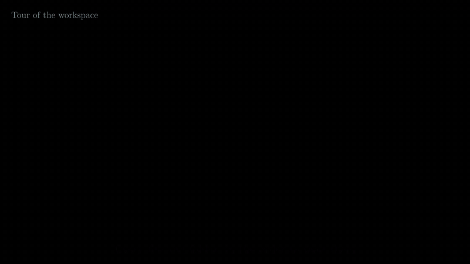

# Arm Robot Sorting Machine

## Authors

| Someone | Somethign |
|:---|:---|
| did something here  | did somethnig hre |
| empty | epmty |

---

## Set up the project

Do this once on each computer. It needs internet and about 2 minutes. The script installs the Python packages into a private `.venv` folder, runs the tests, and looks for cameras. It changes nothing outside the project folder. You need Python 3.10 or newer (3.13 is best); if it is missing, the script says how to install it.

Get the code first. This needs Git. New to Git? Follow GitHub's step-by-step guide to [install Git](https://github.com/git-guides/install-git) (Windows, Mac and Linux), then [set up Git](https://docs.github.com/en/get-started/git-basics/set-up-git) with your name and email. Check it works with `git --version`.

```text
git clone https://github.com/aerlab-deanza/Arm_Robot_Sorting_Machine.git
cd Arm_Robot_Sorting_Machine
```

### Windows



1. Open **PowerShell** in the project folder.
2. Run the setup script:

   ```powershell
   powershell -ExecutionPolicy Bypass -File .\setup.ps1
   ```

3. Wait for `Setup done.`
4. In every new PowerShell window, turn the environment on before you run the code:

   ```powershell
   .\.venv\Scripts\Activate.ps1
   ```

No Python? Run `winget install Python.Python.3.13`, open a new PowerShell, and run the script again.

### Mac



1. Open **Terminal** in the project folder.
2. Run the setup script:

   ```bash
   bash setup.sh
   ```

3. Wait for `Setup done.`
4. In every new Terminal window, turn the environment on before you run the code:

   ```bash
   source .venv/bin/activate
   ```

No Python? Run `brew install python@3.13` (needs [Homebrew](https://brew.sh)), open a new Terminal, and run the script again. The first time you run the camera, macOS asks to let Terminal use it. Click **Allow**.

### Check it works

With the environment on, this should print `passed`:

```text
python -m pytest tests -q
```

Use `-SkipTests` (Windows) or `--skip-tests` (Mac) after the script name to skip the tests during setup. Run the script again any time: it is safe, and it fixes a broken `.venv`. To start over, delete the `.venv` folder and run it again.

---

## Computer Vision
### Documents

A short tour of the folders and files. Then the guides: click a path to open the file on GitHub.



Check `computer_vision_pipeline.md` to see how the pipeline finds the tray and the caps, step by step, with animations.

[docs/computer_vision_pipeline.md](docs/computer_vision_pipeline.md)

Check `documentation.md` to catch up with our findings and the progress of the project.

[docs/documentation.md](docs/documentation.md)

Check `task_delegation.md` to see what is left to do: the 3 open tasks, with steps and how to check you are done.

[docs/task_delegation.md](docs/task_delegation.md)

Check `arm_vision.md` to see how we model the arm's shape from a camera: research, method and results, with animations.

[docs/arm_vision.md](docs/arm_vision.md)

## Overview of 2 Primary Tasks we will work on

**Task 1: Tray Localization + Object Detection + Color Detection** (the whole pipeline in about 50 seconds). Each step has its own animation in the pipeline guide.


**Task 2: Curvature & Coordinates Detection:** [CLICK HERE](docs/animations/arm_vision_explained.mp4) (the video is 12 minute). The same video is split into short animations, one per part, in the [docs/arm_vision.md](docs/arm_vision.md).


### Folder map

<pre>
Arm_Robot_Sorting_Machine/
+-- <a href="vision/">vision/</a>                        Python code that runs on the PC
|   +-- <a href="vision/tray_object_pipeline.py">tray_object_pipeline.py</a>    Entry point: runs all steps, shows windows, prints cap positions
|   +-- <a href="vision/camera.py">camera.py</a>                  Opens the USB camera or the network stream
|   +-- <a href="vision/tray.py">tray.py</a>                    Finds, steadies, locks and straightens the tray
|   +-- <a href="vision/caps.py">caps.py</a>                    Finds caps by color and steadies their boxes
|   +-- <a href="vision/arm_vision.py">arm_vision.py</a>              Finds the arm's backbone curve from a camera picture
|   +-- <a href="vision/shape_models.py">shape_models.py</a>           Curve models of the tendon arm
+-- <a href="firmware/TrayObjectDetection/">firmware/TrayObjectDetection/</a>  Sketch for the AMB82-Mini camera board (Arduino)
+-- <a href="firmware/AMB82Pipeline/">firmware/AMB82Pipeline/</a>            The whole pipeline in C++ on the AMB82-Mini (Arduino IDE)
+-- <a href="firmware/tray_cap_core/">firmware/tray_cap_core/</a>            The shared C++ pipeline code (edit here, then run firmware/sync_core.py)
+-- <a href="firmware/ESP32CamPipeline/">firmware/ESP32CamPipeline/</a>      Same pipeline on an ESP32-CAM (not used: we have no ESP32-CAM)
+-- <a href="docs/">docs/</a>                          Guides, findings and the open tasks
|   +-- <a href="docs/images/">images/</a>                    Screenshots and GIFs used by the guides
|   +-- <a href="docs/animations/">animations/</a>                Scripts that make the GIFs (Manim)
+-- <a href="tests/">tests/</a>                         Automatic checks: python -m pytest tests
+-- <a href="setup.ps1">setup.ps1</a>                      One-step setup for Windows (see Set up the project)
+-- <a href="setup.sh">setup.sh</a>                       One-step setup for Mac
+-- <a href="requirements.txt">requirements.txt</a>               Python packages for the vision code
+-- <a href="AGENTS.md">AGENTS.md</a>                      Instructions for AI coding agents
+-- <a href="README.md">README.md</a>                      This file
</pre>

### How the code fits together

1. **Camera.** The AMB82-Mini streams video over the network (RTSP). A USB or laptop camera works too. `camera.py` opens either one and gives the program one picture (frame) at a time.
2. **Tray.** `tray.py` finds the black tray in the picture, keeps its outline steady, locks it, and straightens it into a top-down view.
3. **Caps.** `caps.py` finds red, blue and purple caps, and keeps their boxes steady.
4. **Output.** `tray_object_pipeline.py` shows six windows and prints one JSON line per second with each cap's color and position as a fraction of the tray (`u` across, `v` down, 0 to 1). The "Rectified tray / detected objects" window also shows how many caps were found. It does not give robot millimeters yet. See [what is left to do](docs/task_delegation.md).

```text
camera  ->  camera.py  ->  tray.py  ->  caps.py  ->  tray_object_pipeline.py
```

### Important files

- [tray_object_pipeline.py](vision/tray_object_pipeline.py) - Entry point. Shows the windows and prints the cap positions on the PC.
- [camera.py](vision/camera.py) - Opens the USB camera or network stream.
- [tray.py](vision/tray.py) - Finds, steadies, locks and straightens the tray.
- [caps.py](vision/caps.py) - Finds caps by color and steadies their boxes.
- [requirements.txt](requirements.txt) - Python packages used by the vision script.
- [setup.ps1](setup.ps1) and [setup.sh](setup.sh) - Set up the environment in one step (Windows and Mac).

### Commands

Run from the project folder with the environment on. Windows and Mac use the same commands.

**Cap detection: USB camera**
```powershell
python vision/tray_object_pipeline.py --camera-index 0
```

**Cap detection: laptop camera**
```powershell
python vision/tray_object_pipeline.py --camera-index 1
```

**Cap detection: AMB82-Mini network stream** (change the IP if the camera's changes)
```powershell
python vision/tray_object_pipeline.py --url rtsp://192.168.0.25:554
```

**Search for the tray only inside a rectangle** (left, top, right, bottom, as fractions of the picture)
```powershell
python vision/tray_object_pipeline.py --camera-index 0 --tray-region 0.05,0.28,0.95,0.97
```

**Freeze the USB camera's auto white balance and exposure**
```powershell
python vision/tray_object_pipeline.py --camera-index 0 --lock-camera
```

**No windows: one JSON line per frame** (stop with Ctrl+C)
```powershell
python vision/tray_object_pipeline.py --camera-index 0 --no-gui
```

**Arm shape: one picture**
```powershell
python vision/arm_vision.py --image path/to/arm.png
```

**Arm shape: recorded video**
```powershell
python vision/arm_vision.py --video arm.mp4
```

**Arm shape: live camera**
```powershell
python vision/arm_vision.py --camera-index 0
```

**Arm shape: set the arm base (pixels)**
```powershell
python vision/arm_vision.py --camera-index 0 --base 300 420
```

**Arm shape: use only part of the picture (x y width height)**
```powershell
python vision/arm_vision.py --video arm.mp4 --crop 0 0 640 480
```

**Arm shape: also save the raw camera video**
```powershell
python vision/arm_vision.py --camera-index 0 --record arm_raw.avi
```

**Arm shape: no window, JSON only**
```powershell
python vision/arm_vision.py --image path/to/arm.png --no-gui
```
