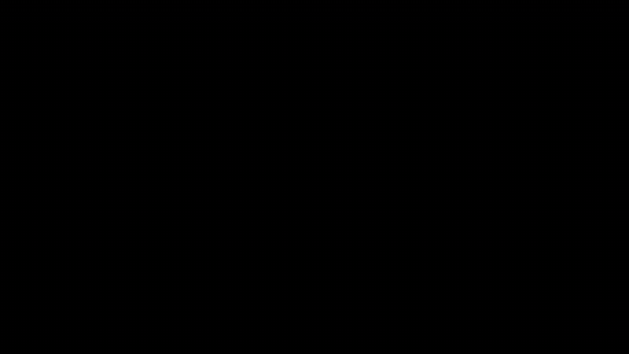
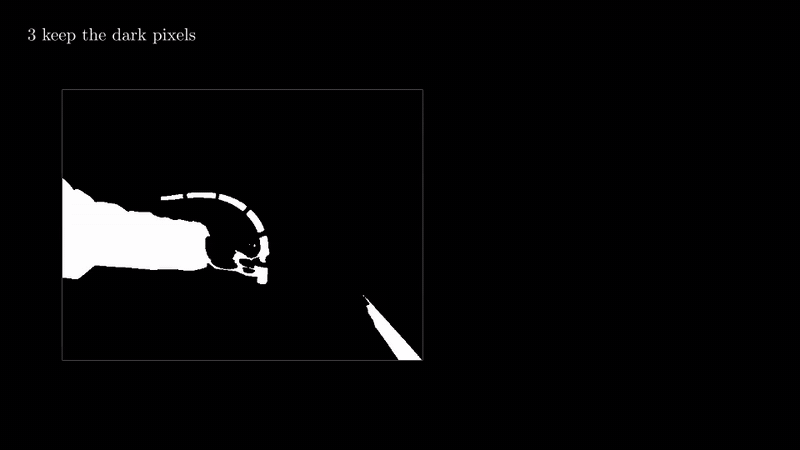
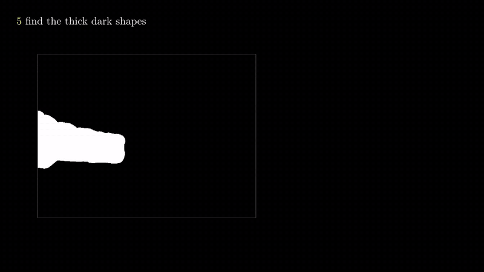
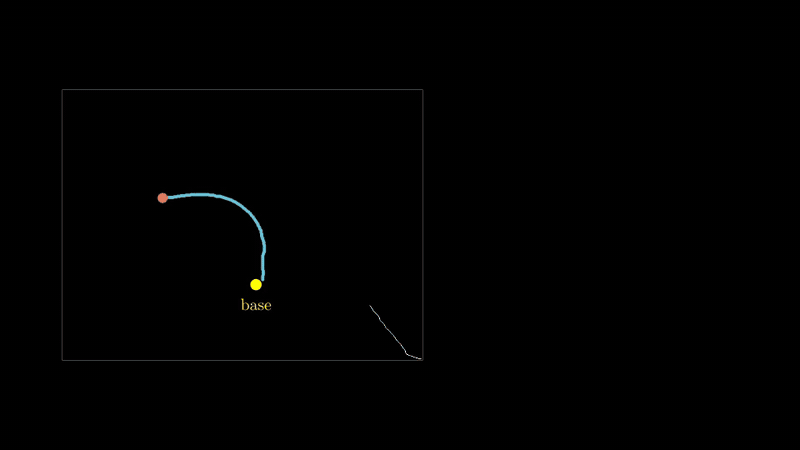
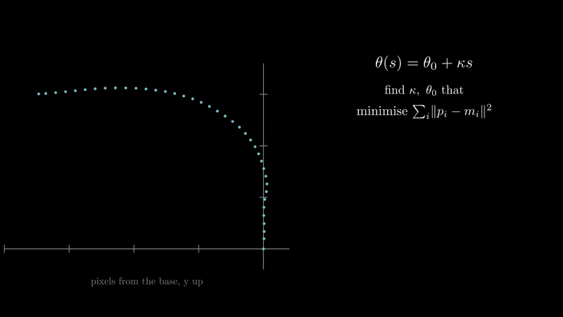

# Modeling: backbone curve of the tendon arm from a camera

## Task

Black tendon arm (1 bending section, under 30 cm) in front of a white wall. One camera records it. From the video, get in real time (>= 15 fps):

- the **backbone curve** (the middle line of the arm) in the x-y plane
- the **tip position**, target accuracy a few mm
- the **curvature**

Plain arm, no markers. Vision to shape only (sensing). The model is not used to predict from tendon input.


The real picture is messy: a sleeve as dark as the arm, and white clips that cut the arm into pieces.


## Answer in short

1. **Segment + trace + fit is enough.** The arm is dark, the wall is white. Threshold, walk along the arm, fit a curve. No learning needed.
2. **Use PCC as the main output.** One section = one arc: `kappa` (curvature), base angle, length. Easy to explain, easy to use later.
3. **Also fit a curvature that changes along the arm** (`k(s) = c0 + c1*u + c2*u^2`). Gravity and tendon friction make a real arm deviate from a perfect arc. The fit RMS tells you when PCC is wrong.
4. **Cosserat rod is not needed for vision-only sensing.** It is a physics model (forces to shape). It becomes useful when you want to predict the shape from tendon tension, or to correct the camera with physics. A planar version is in `shape_models.py` for later.
5. **The few mm goal is a camera problem, not a model problem.** See "Accuracy" below.

## Explaining Videos

**Why one arc (PCC)?** A curve can be described with a few numbers.


**What the tendon does.** Pulling the string bends the arm, so the curvature also tells how far the string moved.


**Why also a flexible curve?** A real arm sags under gravity, so it is not a perfect arc.


Not used: IMU-based and stereo self-organizing-map methods (need extra hardware or two cameras).


PCC or Cosserat? It depends on the job.



## Pipeline (`arm_vision.py`)


1. `segment_arm`: dark AND neutral-coloured pixels (skin, even in shadow, is reddish and is dropped). Thick dark areas (jacket) are cut away. The white clips split the arm, so gaps are closed.
2. `trace_centerline`: skeleton of the mask, then the longest path through it (shadow branches are shorter and dropped). Ends are pushed out by the arm half-width. Gives ordered backbone points base to tip.
3. `fit_pcc`: least squares fit of one arc (kappa, base angle) to those points.
4. `fit_poly_curvature`: same with `k(s)` a polynomial (order 2).
5. `estimate_shape`: all of it on one frame, returns tip, backbone, kappa, fit error.

Speed on this PC: about 45 ms per frame on 640x480 camera video (about 20 fps).

On a real 448-frame recording (arm straight and bent, a sleeve, a hand and a laptop in the picture, base clicked): arm found in 441 frames, all used, tip jump between frames 1 px median, 12 px at the 99th percentile, 21 px worst. Tests recover curvature within 0.0008 /px and tip within 12 px on a 300 px arm (`python -m pytest tests/test_modeling.py`).


### Watch each step

**Step 1: `segment_arm`.** Which pixels are the arm? First idea: take the biggest dark blob. It fails, because the biggest blob is the sleeve.


Turn the picture into brightness and keep the dark pixels.


Drop reddish pixels (skin), then find the thick dark shapes with an opening.



Cut the thick shapes away, then close the gaps the white clips leave.



**Step 2: `trace_centerline`.** Skeleton of the mask, then the longest path from the base. The farthest point is the tip.


Shadow branches are shorter and lose. Skeleton ends are pushed out by half the arm width.



**Step 3: `fit_pcc`.** Fit one arc to the backbone points. Try every curvature: the best one is the bottom of the error bowl.


**Step 4: `fit_poly_curvature`.** Let the curvature change along the arm. One arc is the special case.



**Step 5: `estimate_shape`.** Origin at the base, x right, y up. Picture rows grow downward, so y flips sign.


**Steady the numbers: `ShapeSmoother`.** Each frame gives a slightly different tip. Blend with the past and skip bad frames.


**Recap.**


## How to run

Run from the repo root. Needs numpy, OpenCV, scipy and scikit-image. `setup.ps1` / `setup.sh` install them all.

```powershell
python vision/arm_vision.py --image path\to\arm.png     # one picture, no camera
python vision/arm_vision.py --video arm.mp4             # recorded video
python vision/arm_vision.py --camera-index 0            # live camera
python vision/arm_vision.py --image arm.png --no-gui    # no window, JSON only
python vision/arm_vision.py --camera-index 0 --record arm_raw.avi   # also save the raw camera video
python vision/arm_vision.py --video arm.mp4 --crop 0 0 640 480       # use only part of the picture
python vision/arm_vision.py --camera-index 0 --base 300 420          # fixed arm base (pixels)
python -m pytest tests/test_modeling.py                           # tests
```

- **Base:** in the window version, click the arm base in the first picture, then press a key. Or pass `--base X Y`. With a base, the arm is the dark shape that starts there, so a sleeve, laptop or cable cannot win. Without a base, the longest thin dark shape is used (less safe).
- **Record the camera, not the screen.** A screen recording of the program window has the green/yellow/red drawings burned into the pixels, and they break the detection. Use `--record` to save the raw camera picture, then test with `--video`.
- A screen recording also has black borders. Cut them with `--crop`.
- Numbers on screen are steadied over frames (`ShapeSmoother`): bad frames (hand joined the arm, arm length jumps) are skipped and the last good values held.

- A window shows the traced backbone (green), the PCC arc (yellow) and the tip (red). Image: press any key to close. Video/camera: press `q`.
- Each frame prints one JSON line: `{"frame", "found", "tip", "kappa", "rms_px"}`. `tip` is x, y (y up) from the base. `kappa` is in 1/mm. For the first 30 good frames the lines say `"calibrating": true` and have no `tip` yet: the program measures the scale (`px_per_mm`) from the arm length.

**No camera and no photo: make a fake arm picture**

```powershell
python -c "import sys; sys.path[:0]=['vision','tests']; import cv2; from test_modeling import draw_arm; cv2.imwrite('fake_arm.png', draw_arm(0.006)[0])"
python vision/arm_vision.py --image fake_arm.png
```

Change `0.006` to bend it differently (negative = other side, `0` = straight).

**Real photos**

- Arm must be dark on a bright wall. Nothing else dark touching it.
- Base is the lowest dark point by default. If it is not, call from Python: `estimate_shape(frame, base_xy=(x, y))`.
- Scale: set `ARM_LENGTH_MM` at the top of `vision/arm_vision.py` (now 300). The program finds pixels per mm by itself (median arm length of the first 30 good frames, or the one frame for `--image`). Keep the camera still. `estimate_shape(frame, px_per_mm=...)` still takes a scale if you call it yourself.

## Cosserat / PCC simulation (`shape_models.py`)

- `pcc_points`: one constant-curvature arc.
- `poly_curvature_points`: curvature changing along the arm.
- `cosserat_planar_static`: planar rod, bending stiffness EI, tendon moment T*d, gravity. Without gravity it reduces exactly to PCC (tested). With gravity the tip sags.

Use it to generate fake arm shapes for testing the vision code, and later to compare real shapes to physics.

## Accuracy: what stands between us and a few mm


- **Pixel to mm scale.** Done from `ARM_LENGTH_MM`. Weak point: the measured length changes when the arm bends (about 300-325 px on the test video), so the scale can be off by a few percent. A ruler in the picture would be more exact.
- **Camera must look straight at the wall.** Tilt or wide-angle distortion adds mm of error. Calibrate the lens (OpenCV checkerboard) and keep the camera still.
- **Arm must stay in the wall plane.** Rotating the base moves the arm out of plane. The 2D curve then shrinks. Rotate only when measuring is not needed, or fix the base angle.
- **Pick a base point.** Pass `base_xy` (pixels) when the base is not the lowest dark point (hands, cables, objects touching the arm in the picture will break the segmentation).
- **Lighting.** Even light, no shadow on the wall, otherwise the shadow joins the arm mask.
- **Resolution.** If the arm spans 400 px for 300 mm, 1 px = 0.75 mm. A few mm needs the arm to fill the picture.

## Open points

How to check the tip against a ruler:


- Test on a real recording of the arm. Only drawn pictures were tested.
- Fit error (`rms_px`) vs a real ruler measurement of the tip.
- Decide if a learned model (MoSS style) is ever needed. Only if the classic method fails on real video.

## Files

| File | What |
| --- | --- |
| `vision/arm_vision.py` | Camera/video/image to backbone, tip, curvature. Includes `ShapeSmoother`. |
| `vision/shape_models.py` | PCC, variable curvature, planar Cosserat rod. |
| `tests/test_modeling.py` | Drawn-picture tests. |

## Sources

- Webster & Jones 2010, IJRR 29(13): https://doi.org/10.1177/0278364910368147
- Vision based shape estimation for continuum robots: https://www.researchgate.net/publication/4041601_Vision_based_shape_estimation_for_continuum_robots
- Pedari et al., spatial shape estimation, tendon arm: https://www.semanticscholar.org/paper/Spatial-Shape-Estimation-of-a-Tendon-Driven-Robotic-Pedari-Parvaresh/0d12ca25ab213b21f40ce89d83c4467a5b404824
- Rucker & Webster 2011: https://www.researchgate.net/publication/224248314_Statics_and_Dynamics_of_Continuum_Robots_With_General_Tendon_Routing_and_External_Loading
- Rod models in continuum and soft robot control, review: https://arxiv.org/abs/2407.05886
- Marker-free shape registration: https://arxiv.org/abs/2405.15336
- MoSS monocular shape sensing: https://www.cs.toronto.edu/~cshentu/pdf/MoSS_RAL.pdf
- Polynomial curvature estimation: https://arxiv.org/abs/2210.08427
