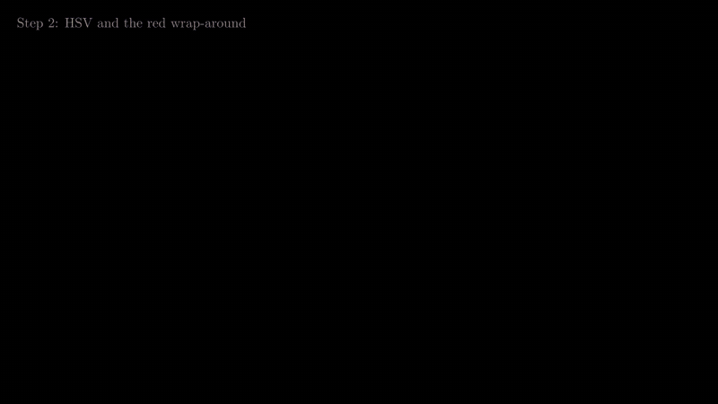
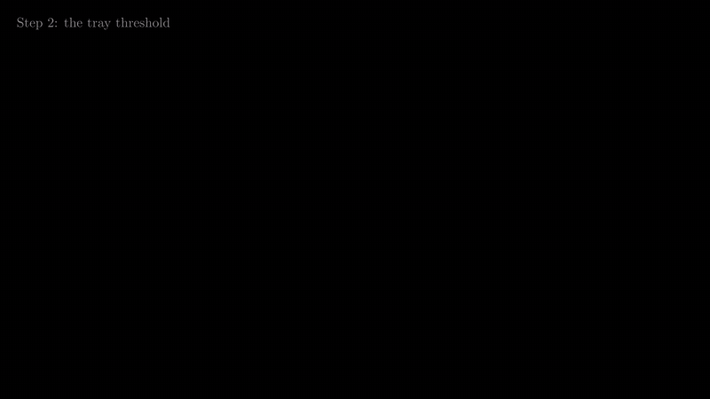
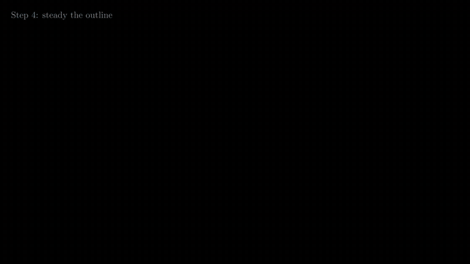
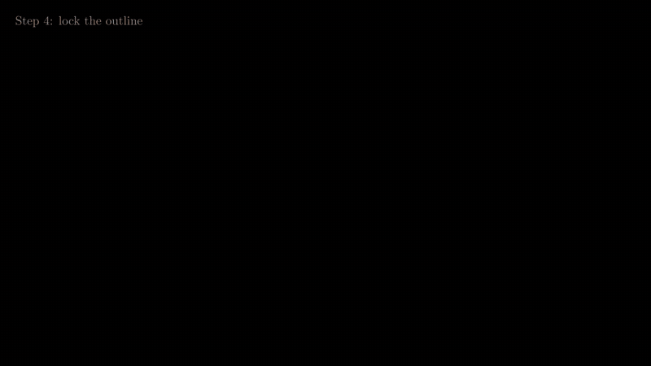
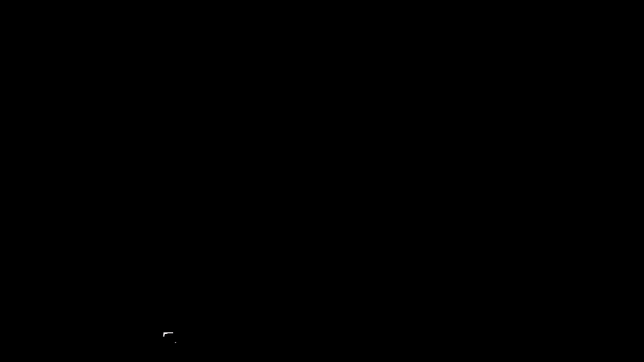
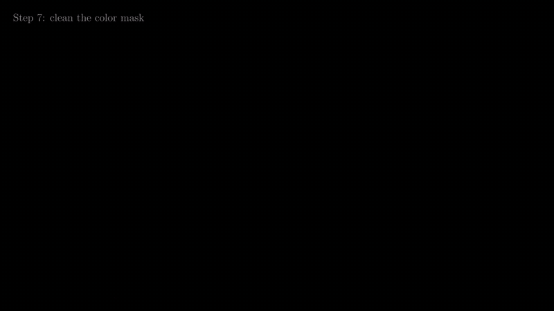
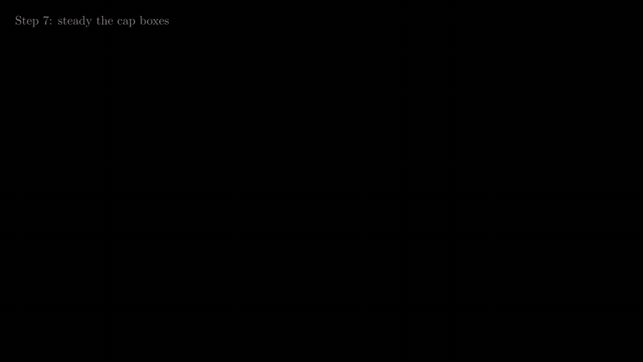
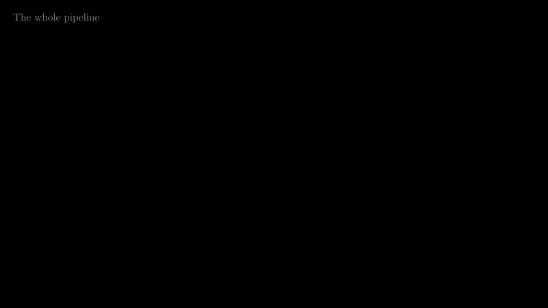

# Current Computer Vision Pipeline

Current steps. The code is in [tray_object_pipeline.py](../vision/tray_object_pipeline.py) (entry point), [camera.py](../vision/camera.py), [tray.py](../vision/tray.py) and [caps.py](../vision/caps.py). For experiments and setup decisions, see [findings](documentation.md).

The PC pipeline starts from `vision/tray_object_pipeline.py`. It works with an RTSP stream or a USB camera.

```text
Read image → find tray → steady and lock outline → make mask → straighten view → find objects → steady boxes → report positions
```

The examples below show the current black tray with red and purple objects.

Each step has a short looping animation, with the explanation written in under the picture. The real camera screenshots appear inside the animations.


## 1. Read a camera frame

**Technique: OpenCV `VideoCapture`.** It reads a live video one image at a time. Each image is a frame.

**Why:** The other steps need an image to process.


**Learn (beginner-friendly):**
- [Capture video from a camera in Python (GeeksforGeeks)](https://www.geeksforgeeks.org/python-opencv-capture-video-from-camera/): short, shows the read-a-frame loop.
- [Getting and setting pixels (PyImageSearch)](https://pyimagesearch.com/2021/01/20/opencv-getting-and-setting-pixels/): an image is a grid of numbers.

## 2. Find the tray by color

**Algorithms:**

- **BGR-to-HSV (`cvtColor`)** changes how colors are stored. This makes color and brightness easier to check separately.
- **Color thresholding (`inRange`)** marks dark, low-saturation pixels. Hue is ignored because black has no stable hue.
- **Morphological closing (`morphologyEx`)** fills small gaps in the mask.

**Why:** Separate the tray from the table and background.

Why HSV instead of red, green, blue, and why red needs two ranges:



The pass/fail test on each pixel:



**Learn (beginner-friendly):**
- [HSL and HSV (Wikipedia)](https://en.wikipedia.org/wiki/HSL_and_HSV): the color wheel pictures show what hue, saturation and value mean.
- [Image segmentation using color spaces (Real Python)](https://realpython.com/python-opencv-color-spaces/): why HSV beats RGB for picking a color.
- [OpenCV and Python color detection (PyImageSearch)](https://pyimagesearch.com/2014/08/04/opencv-python-color-detection/): `inRange` step by step.
- [Morphological operations (PyImageSearch)](https://pyimagesearch.com/2021/04/28/opencv-morphological-operations/): erosion, dilation, opening, closing with pictures.

White = selected dark pixels. Black = ignored pixels. Objects leave holes in the tray threshold. Other dark surfaces may also pass; step 3 checks their shape.

Default limits: brightness 0-85, saturation 0-130. Adjust for the lighting.

## 3. Turn tray pixels into an outline

**Algorithms:**

- **Contour detection (`findContours`)** traces the edge of each white region. These outlines are candidates for the tray.
- **Convex hull (`convexHull`)** wraps a smooth outer shape around a region. It fills small inward dents.
- **Polygon approximation (`approxPolyDP`)** reduces an outline to a few corner points. The program looks for four corners.
- **Minimum-area rectangle (`minAreaRect`)** finds the smallest rotated rectangle around a region. It helps when the tray edge is uneven.

The program checks each candidate’s size and shape, then estimates the tray corners.


Here, the green outline follows the tray. This is a successful tray detection.

If the program says “TRAY NOT FOUND,” check the threshold and outline before using object positions.

**Why:** The mask marks pixels. The outline gives the corners needed to locate and straighten the tray.

**Learn (beginner-friendly):**
- [Contour detection using OpenCV (LearnOpenCV)](https://learnopencv.com/contour-detection-using-opencv-python-c/): what a contour is, with pictures.
- [OpenCV shape detection (PyImageSearch)](https://pyimagesearch.com/2016/02/08/opencv-shape-detection/): `approxPolyDP` turns an outline into corners.

## 4. Steady the outline across frames

**Techniques:**

- **Exponential moving average (EMA)** blends new corners with old ones. This reduces jitter.
- **Jump rejection** keeps the old outline if a new one moves too far.
- **Repeated-frame confirmation** accepts a large move after several similar detections. The tracker also keeps the last outline through brief misses.

**Why:** Lighting and camera noise make corners jump around.



First detection starts a 1.25-second countdown ("LOCALIZE TRAY" on screen). Keep your hand out of the tray. The program uses the latest detection after the countdown, then smooths corner changes. This timer does not detect hands.

The tracker keeps the last outline through up to 8 missed frames. Large jumps need 3 similar detections.

**Lock the outline (`TrayLock`).** Glare can still bend the outline. So once the outline stays still for 0.75 seconds, it **locks**: it turns cyan, the screen says `TRAY LOCKED`, and glare can't move it anymore.



- A hand or the arm hiding the tray doesn't unlock it.
- It unlocks by itself only if the same-sized tray shows up clearly somewhere else for about 1 second. That means the tray really moved. Glare changes the tray's shape, so it doesn't count.
- Press `r` to find the tray again at any time.
- The "did it move?" check is simple for now. [Task 4](task_delegation.md) (`check_outline`) can replace it.

**Learn (beginner-friendly):**
- [Exponential smoothing (Wikipedia)](https://en.wikipedia.org/wiki/Exponential_smoothing): the "blend new with old" idea. Our `new_outline_weight` is the smoothing factor.

## 5. Make the tray mask

**Techniques:**

- **Polygon filling (`fillConvexPoly`)** fills the area inside the tray corners with white.
- **Binary masking (`bitwise_and`)** keeps the image where the mask is white. It blacks out the rest.

**Why:** See which area the program selected. This is a check for you: step 6 straightens the tray from its four corners, not from this picture.



**Learn (beginner-friendly):**
- [Image masking with OpenCV (PyImageSearch)](https://pyimagesearch.com/2021/01/19/image-masking-with-opencv/): draw a white shape, keep only what is inside it.

The filled mask covers the tray and objects. No holes at the objects. Its border follows the tracked tray corners, with no added padding. It is shown in the "Tray mask" window.

The tray-only view keeps the tray and objects. Pixels outside the tray become black. It is shown in the "Image restricted to tray" window.

## 6. Straighten the tray view

**Algorithms:**

- **Perspective transform (homography, `getPerspectiveTransform`)** calculates how the four tray corners map to a rectangle.
- **Perspective warping (`warpPerspective`)** applies that mapping to make a top-down view.

**Why:** The tray looks skewed when viewed at an angle. Straightening makes positions easier to compare.


**Learn (beginner-friendly):**
- [4 point perspective transform (PyImageSearch)](https://pyimagesearch.com/2014/08/25/4-point-opencv-getperspective-transform-example/): the same trick we use, from 4 corners to a top-down view.
- [Homography examples (LearnOpenCV)](https://learnopencv.com/homography-examples-using-opencv-python-c/): the idea behind the transform.

The skewed tray becomes a rectangle. See the detection view in step 7.

## 7. Find and filter colored objects

**Algorithms and filters:**

- **HSV thresholding (`inRange`)** marks red, blue, and purple pixels. Blue means dark blue only: on our camera, glare on the dark tray looks light blue.
- **Brightness floor that follows the tray.** The camera's color balance drifts: the black tray has looked yellowish, and later navy blue (as blue as a blue cap). So each frame, the program measures the tray's typical brightness. A pixel only counts as a cap color if it's at least 25 brighter than the tray.
- **Morphological opening** removes small specks.
- **Morphological closing** joins small gaps in a colored region.
- **Contour detection (`findContours`)** traces each region. The program measures its size and center.
- **Area and aspect-ratio filters** remove regions that are too small or too long and narrow.
- **Overlap suppression** removes smaller boxes mostly inside larger boxes. This helps avoid duplicates.
- **Object tracking over frames (`ObjectTracker`)** keeps boxes steady. Each frame is checked from scratch, so camera noise and glare make boxes jump or blink. The tracker:
  - matches each object to the same-color object from the last frame (the nearest one),
  - shows an object only after it's seen in 3 of the last 5 frames, so one-frame specks never show,
  - keeps showing it through a missed frame or two, so it doesn't blink,
  - draws the middle value (median) of its last 5 boxes, so one bad frame doesn't move it.
  - Cost: a new or removed cap shows up or disappears about 3 frames late. A moving cap's box trails it by ~2 frames.

**Why:** Find the project’s bright objects without training a model.

Why the tray is black:


Cleaning the color mask:



Duplicate boxes and the center of each region:


**Learn (beginner-friendly):**
- [Morphological operations (PyImageSearch)](https://pyimagesearch.com/2021/04/28/opencv-morphological-operations/): removes specks, fills gaps.
- [Contour detection using OpenCV (LearnOpenCV)](https://learnopencv.com/contour-detection-using-opencv-python-c/): turns each white region into a box and a center.
- [OpenCV and Python color detection (PyImageSearch)](https://pyimagesearch.com/2014/08/04/opencv-python-color-detection/): picking red, blue and purple with `inRange`.

Steady boxes: the tracker shows a cap only after it is seen in 3 of the last 5 frames:



The green boxes mark objects (after tracking). Blue dots mark their color-region centers. The colored-object mask window shows the raw mask of each frame, before tracking, so it can still flicker.

The combined color mask selects the objects as white. The tray stays black.

## 8. Report positions

**Technique: coordinate normalization.** Divide the object center by the tray image width and height. This gives `(u, v)` values from `0` to `1`.

**Why:** Positions are comparable across image sizes.


Values describe the tray image, not robot coordinates in millimeters. No height, grip angle, or arm commands yet.

## Recap and next steps

The whole pipeline in about 50 seconds, from camera picture to cap color and position:



What's still needed before the robot can pick. Details in [pipeline limits](limitation.md).


