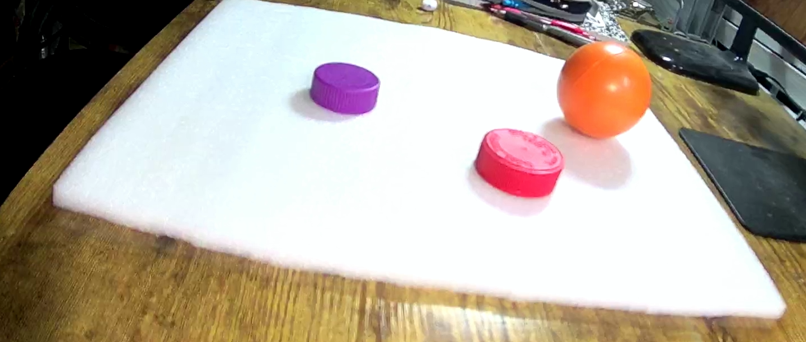
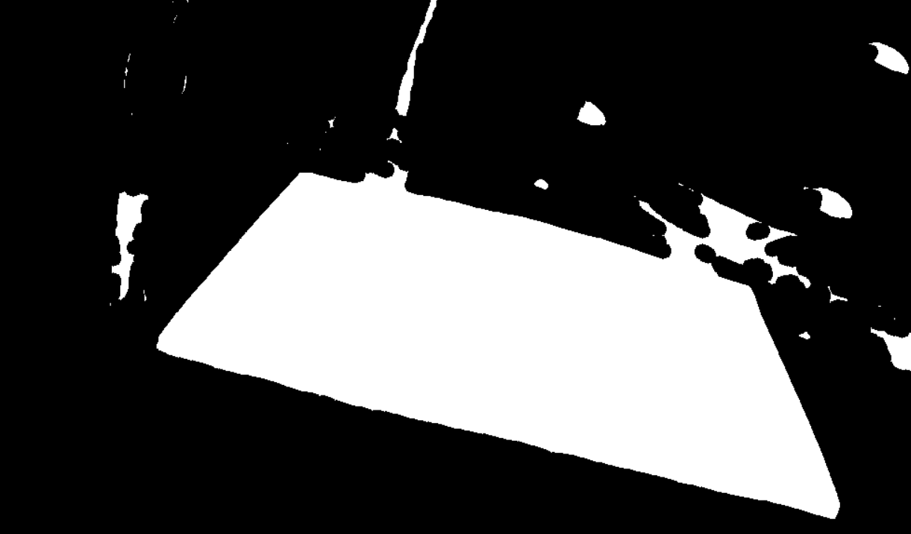
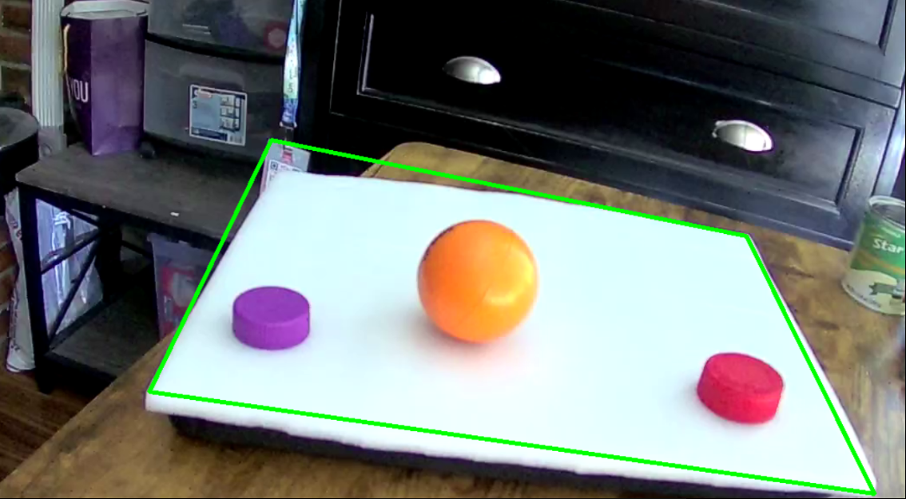
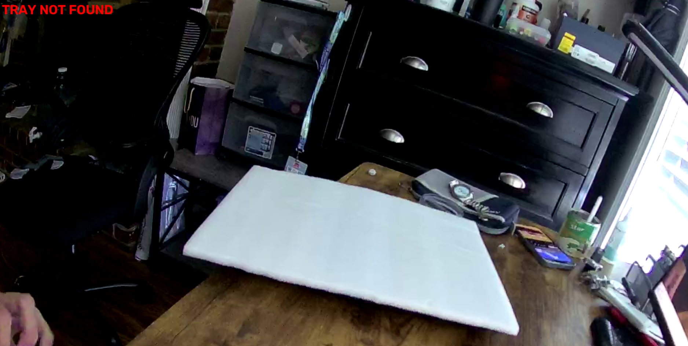
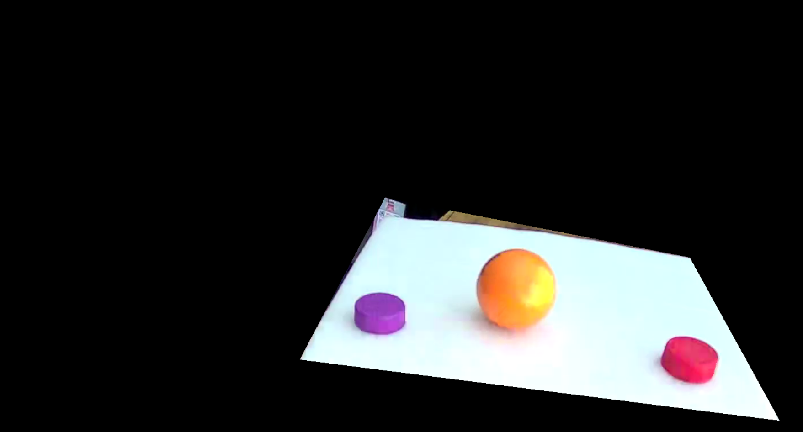
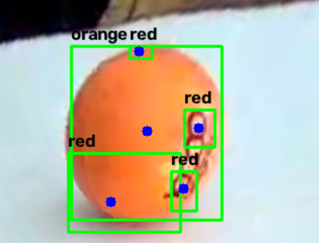
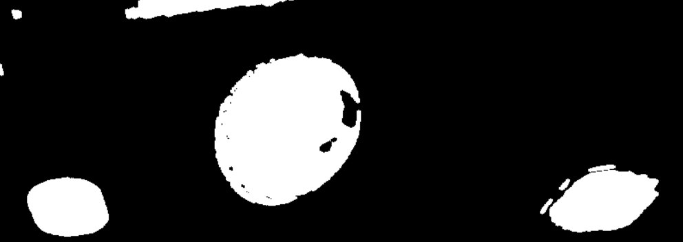
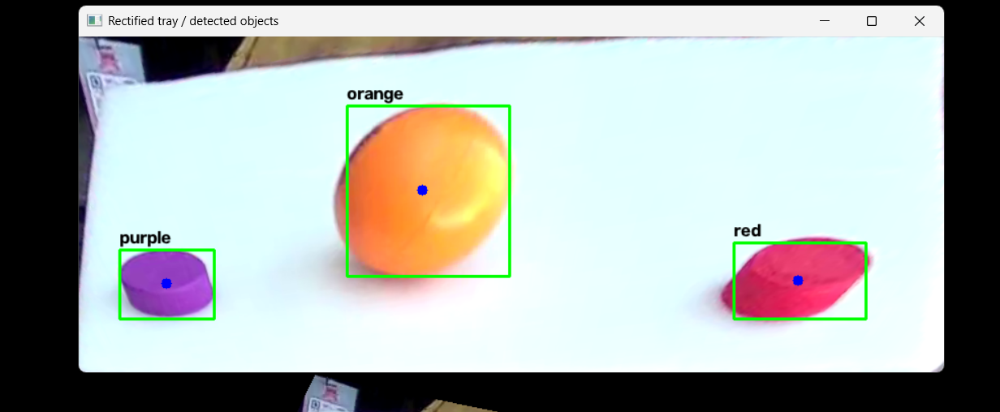

# Computer Vision Pipeline - Guideline

This guide shows how the camera image becomes object positions.

The PC pipeline is `vision/tray_object_pipeline.py`. It works with an RTSP stream or a USB camera.

```text
Read image → find tray → steady outline → make mask → straighten view → find objects → report positions
```

Example camera view:



## 1. Read a camera frame

**Technique: OpenCV `VideoCapture`.** It reads a live video one image at a time. Each image is a frame.

**Why:** The other steps need an image to process.

**Alternatives:** Read a saved video. Use FFmpeg, GStreamer, or the camera maker’s software.

**Learn:** [OpenCV VideoCapture](https://docs.opencv.org/4.x/d8/dfe/classcv_1_1VideoCapture.html)

## 2. Find the tray by color

**Algorithms:**

- **BGR-to-HSV (`cvtColor`)** changes how colors are stored. This makes color and brightness easier to check separately.
- **Color thresholding (`inRange`)** marks pixels within the tray’s color range.
- **Morphological closing (`morphologyEx`)** fills small gaps in the mask.

**Why:** Separate the tray from the table and background.

**Alternatives:** Threshold colors in Lab. Find edges with Canny. Put an ArUco marker on the tray. A trained segmentation model can find trays by appearance, but needs training images and more computing power.

**Learn:** [HSV thresholding](https://docs.opencv.org/4.x/da/d97/tutorial_threshold_inRange.html), [morphology](https://docs.opencv.org/4.x/d9/d61/tutorial_py_morphological_ops.html), [ArUco markers](https://docs.opencv.org/4.x/d5/dae/tutorial_aruco_detection.html)

White pixels are selected. Black pixels are ignored. The small white patches outside the tray are false detections.



## 3. Turn tray pixels into an outline

**Algorithms:**

- **Contour detection (`findContours`)** traces the edge of each white region. These outlines are candidates for the tray.
- **Convex hull (`convexHull`)** wraps a smooth outer shape around a region. It fills small inward dents.
- **Polygon approximation (`approxPolyDP`)** reduces an outline to a few corner points. The program looks for four corners.
- **Minimum-area rectangle (`minAreaRect`)** finds the smallest rotated rectangle around a region. It helps when the tray edge is uneven.

The program checks each candidate’s size and shape, then estimates the tray corners.

Here, the green outline follows the tray. This is a successful tray detection.



This example shows a failure: the tray is visible, but the program says “TRAY NOT FOUND.” Check the mask and outline before using object positions.



**Why:** The mask marks pixels. The outline gives the corners needed to locate and straighten the tray.

**Alternatives:** Use Canny and Hough lines to find straight edges. Use ArUco markers to find known tray points.

**Learn:** [Finding contours](https://docs.opencv.org/4.x/df/d0d/tutorial_find_contours.html), [contour features](https://docs.opencv.org/4.x/dd/d49/tutorial_py_contour_features.html)

## 4. Steady the outline across frames

**Techniques:**

- **Exponential moving average (EMA)** blends new corners with old ones. This reduces jitter.
- **Jump rejection** keeps the old outline if a new one moves too far.
- **Repeated-frame confirmation** accepts a large move after several similar detections. The tracker also keeps the last outline through brief misses.

**Why:** Lighting and camera noise make corners jump around.

**Alternatives:** Use a simple moving average or a Kalman filter. A Kalman filter can estimate the tray between detections, but takes more setup.

**Learn:** [OpenCV Kalman filter](https://docs.opencv.org/4.x/dd/d6a/classcv_1_1KalmanFilter.html)

## 5. Make the tray mask

**Techniques:**

- **Polygon filling (`fillConvexPoly`)** fills the area inside the tray corners with white.
- **Binary masking (`bitwise_and`)** keeps the image where the mask is white. It blacks out the rest.

**Why:** Focus later steps on the tray. See which area the program selected.

**Alternatives:** Use the color mask, a polygon from marker positions, or a segmentation model’s mask.

**Learn:** [OpenCV drawing and filled shapes](https://docs.opencv.org/4.x/d6/d6e/group__imgproc__draw.html)

The tray-only view keeps the tray and objects. Pixels outside the tray become black.



## 6. Straighten the tray view

**Algorithms:**

- **Perspective transform (homography, `getPerspectiveTransform`)** calculates how the four tray corners map to a rectangle.
- **Perspective warping (`warpPerspective`)** applies that mapping to make a top-down view.

**Why:** The tray looks skewed when viewed at an angle. Straightening makes positions easier to compare.

**Alternatives:** Use a crop if the camera looks straight down. Use an affine transform for simpler angle changes. Camera calibration can map pixels to the flat work surface.

**Learn:** [OpenCV geometric transforms](https://docs.opencv.org/4.x/da/d54/group__imgproc__transform.html)

## 7. Find and filter colored objects

**Algorithms and filters:**

- **HSV thresholding (`inRange`)** marks red, orange, and purple pixels.
- **Morphological opening** removes small specks.
- **Morphological closing** joins small gaps in a colored region.
- **Contour detection (`findContours`)** traces each region. The program measures its size and center.
- **Area and aspect-ratio filters** remove regions that are too small or too long and narrow.
- **Overlap suppression** removes smaller boxes mostly inside larger boxes. This helps avoid duplicates.

**Why:** Find the project’s bright objects without training a model.

**Alternatives:** Train a YOLO detector to recognize object types, even when colors vary. Use YOLO instance segmentation to outline each object. Custom models need example images.

**Learn:** [Morphology](https://docs.opencv.org/4.x/d9/d61/tutorial_py_morphological_ops.html), [contours](https://docs.opencv.org/4.x/df/d0d/tutorial_find_contours.html), [YOLO detection](https://docs.ultralytics.com/tasks/detect), [YOLO segmentation](https://docs.ultralytics.com/tasks/segment)

This example shows several boxes on one orange ball. Overlap suppression reduces this kind of duplicate.



These black-and-white masks show the pixels selected for each object color.



After filtering, the program draws one box around each detected object.



## 8. Report positions

**Technique: coordinate normalization.** Divide the object center by the tray image width and height. This gives `(u, v)` values from `0` to `1`.

**Why:** Positions are comparable across image sizes.

**Alternatives:** Keep pixel positions. Use camera calibration to convert pixels to table or robot coordinates. The Python script reports tray positions; it does not move the arm.
