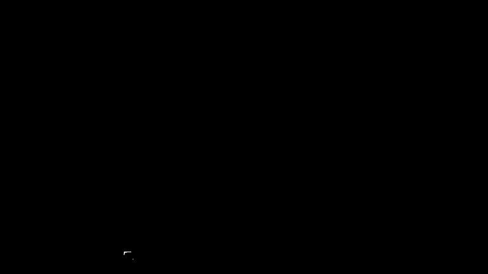

# Current Computer Vision Pipeline

Current steps in [tray_object_pipeline.py](../vision/tray_object_pipeline.py). For experiments and setup decisions, see [findings](documentation.md).

The PC pipeline is `vision/tray_object_pipeline.py`. It works with an RTSP stream or a USB camera.

```text
Read image → find tray → steady outline → make mask → straighten view → find objects → report positions
```

The examples below show the current black tray with red and purple objects.

Each step has a short looping animation, with the explanation written in under the picture. The real camera screenshots appear inside the animations.


## 1. Read a camera frame

**Technique: OpenCV `VideoCapture`.** It reads a live video one image at a time. Each image is a frame.

**Why:** The other steps need an image to process.


**Learn:** [OpenCV VideoCapture](https://docs.opencv.org/4.x/d8/dfe/classcv_1_1VideoCapture.html)

## 2. Find the tray by color

**Algorithms:**

- **BGR-to-HSV (`cvtColor`)** changes how colors are stored. This makes color and brightness easier to check separately.
- **Color thresholding (`inRange`)** marks dark, low-saturation pixels. Hue is ignored because black has no stable hue.
- **Morphological closing (`morphologyEx`)** fills small gaps in the mask.

**Why:** Separate the tray from the table and background.

Why HSV instead of red, green, blue, and why red needs two ranges:


The pass/fail test on each pixel:


**Learn:** [HSV thresholding](https://docs.opencv.org/4.x/da/d97/tutorial_threshold_inRange.html), [morphology](https://docs.opencv.org/4.x/d9/d61/tutorial_py_morphological_ops.html), [ArUco markers](https://docs.opencv.org/4.x/d5/dae/tutorial_aruco_detection.html)

White = selected dark pixels. Black = ignored pixels. Objects leave holes in the tray threshold. Other dark surfaces may also pass; step 3 checks their shape.

Default limits: brightness 0–85, saturation 0–130. Adjust for the lighting.

## 3. Turn tray pixels into an outline

**Algorithms:**

- **Contour detection (`findContours`)** traces the edge of each white region. These outlines are candidates for the tray.
- **Convex hull (`convexHull`)** wraps a smooth outer shape around a region. It fills small inward dents.
- **Polygon approximation (`approxPolyDP`)** reduces an outline to a few corner points. The program looks for four corners.
- **Minimum-area rectangle (`minAreaRect`)** finds the smallest rotated rectangle around a region. It helps when the tray edge is uneven.

The program checks each candidate’s size and shape, then estimates the tray corners.


Here, the green outline follows the tray. This is a successful tray detection.

If the program says “TRAY NOT FOUND,” check the threshold and outline before using object positions.

**Why:** The mask marks pixels. The outline gives the corners needed to locate and straighten the tray.

**Learn:** [Finding contours](https://docs.opencv.org/4.x/df/d0d/tutorial_find_contours.html), [contour features](https://docs.opencv.org/4.x/dd/d49/tutorial_py_contour_features.html)

## 4. Steady the outline across frames

**Techniques:**

- **Exponential moving average (EMA)** blends new corners with old ones. This reduces jitter.
- **Jump rejection** keeps the old outline if a new one moves too far.
- **Repeated-frame confirmation** accepts a large move after several similar detections. The tracker also keeps the last outline through brief misses.

**Why:** Lighting and camera noise make corners jump around.


First detection starts a 2-second countdown. Move your hand away. The program uses the latest detection after the countdown, then smooths corner changes. This timer does not detect hands.

The tracker keeps the last outline through up to 8 missed frames. Large jumps need 3 similar detections.

**Learn:** [OpenCV Kalman filter](https://docs.opencv.org/4.x/dd/d6a/classcv_1_1KalmanFilter.html)

## 5. Make the tray mask

**Techniques:**

- **Polygon filling (`fillConvexPoly`)** fills the area inside the tray corners with white.
- **Binary masking (`bitwise_and`)** keeps the image where the mask is white. It blacks out the rest.

**Why:** Focus later steps on the tray. See which area the program selected.



**Learn:** [OpenCV drawing and filled shapes](https://docs.opencv.org/4.x/d6/d6e/group__imgproc__draw.html)

The filled mask covers the tray and objects. No holes at the objects. Its border follows the tracked tray corners, with no added padding.

The tray-only view keeps the tray and objects. Pixels outside the tray become black.

## 6. Straighten the tray view

**Algorithms:**

- **Perspective transform (homography, `getPerspectiveTransform`)** calculates how the four tray corners map to a rectangle.
- **Perspective warping (`warpPerspective`)** applies that mapping to make a top-down view.

**Why:** The tray looks skewed when viewed at an angle. Straightening makes positions easier to compare.


**Learn:** [OpenCV geometric transforms](https://docs.opencv.org/4.x/da/d54/group__imgproc__transform.html)

The skewed tray becomes a rectangle. See the detection view in step 7.

## 7. Find and filter colored objects

**Algorithms and filters:**

- **HSV thresholding (`inRange`)** marks red, orange, and purple pixels.
- **Morphological opening** removes small specks.
- **Morphological closing** joins small gaps in a colored region.
- **Contour detection (`findContours`)** traces each region. The program measures its size and center.
- **Area and aspect-ratio filters** remove regions that are too small or too long and narrow.
- **Overlap suppression** removes smaller boxes mostly inside larger boxes. This helps avoid duplicates.

**Why:** Find the project’s bright objects without training a model.

Why the tray is black:


Cleaning the color mask:


Duplicate boxes and the center of each region:


**Learn:** [Morphology](https://docs.opencv.org/4.x/d9/d61/tutorial_py_morphological_ops.html), [contours](https://docs.opencv.org/4.x/df/d0d/tutorial_find_contours.html)

The green boxes mark objects. Blue dots mark their color-region centers.

The combined color mask selects the objects as white. The tray stays black.

## 8. Report positions

**Technique: coordinate normalization.** Divide the object center by the tray image width and height. This gives `(u, v)` values from `0` to `1`.

**Why:** Positions are comparable across image sizes.


Values describe the tray image, not robot coordinates in millimeters. No height, grip angle, or arm commands yet.

## Recap and next steps

The whole pipeline, step by step, on real screenshots:


What's still needed before the robot can pick. Details in [pipeline limits](limitation.md).


