# Computer Vision Findings

What went wrong while we built the camera program, why, and what we changed. Each section is one problem.

For how the program works step by step, see [current pipeline](computer_vision_pipeline.md). For run commands, see [README](../README.md#commands).

## Summary

| # | What we saw | What we changed | Status |
| --- | --- | --- | --- |
| 1 | Shadows on a white tray made boxes wrong | Use a black tray | Done |
| 2 | The program missed a tray it could see | Check the shape, not only the color | Done |
| 3 | Caps were cut out of the tray picture | Fill the whole outline | Done |
| 4 | Positions changed with the camera angle | Straighten the tray picture | Done |
| 5 | One ball got many boxes | Keep only the biggest of overlapping boxes | Done |
| 6 | The outline shook, and hands got in the way at the start | Smooth the corners, wait a moment at the start | Done |
| 7 | The camera did not always open | Try several ways to open it | Done |
| 8 | Glare moved the outline | Lock the outline once it is still | Done, see the limit |
| 9 | Boxes flickered | Show a cap only after it is seen a few times | Done |
| 10 | A hand was found as a red cap | Red must be strongly colored | Done |
| 11 | The tray wasn't found next to a white board | Ignore color for the tray, add a search box | Done, not tried live |
| 12 | A red cap was labeled purple | Strong colors in that shade count as red | Done, not tried live |
| 13 | Glare was found as a blue cap | Caps must be much brighter than the tray | Done, not tried live |
| 14 | Labels were too big and blurry | Size labels to their box, draw on a bigger picture | Done |

## Words used on this page

| Word | Meaning |
| --- | --- |
| Pixel | One tiny dot of a picture. |
| Frame | One picture from the camera. It sends many per second. |
| Brightness | How light a pixel is: 0 = black, 255 = white. |
| Color shade | Which color a pixel is (red, blue, ...). In the code: **hue**. |
| Colorfulness | How strong the color is: 0 = grey, 255 = full color. In the code: **saturation**. |
| Black-and-white tray picture | White where the pixel is dark enough to be tray. In the code: the **threshold**. |
| Outline | The four corners of the tray in the camera picture. |
| Straightened tray picture | The tray seen from straight above, as a rectangle. In the code: **rectified**. |
| Cap picture | White where a pixel has a cap color. In the code: the **color mask**. |
| Box | The green rectangle drawn around a found cap. |

## 1. Shadows on a white tray made boxes wrong

| Earlier: white tray | Now: black tray |
| --- | --- |
| 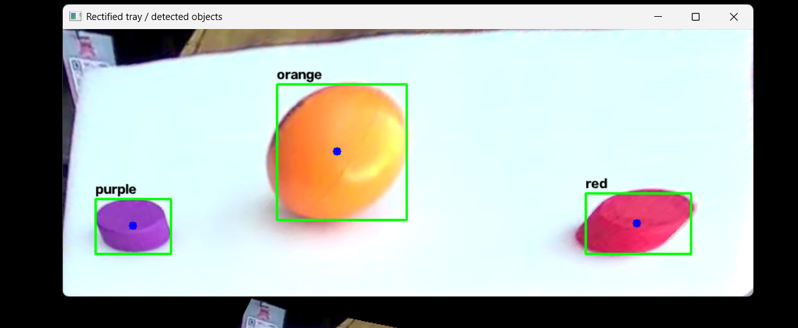 | 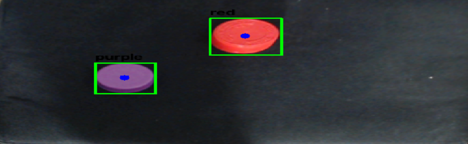 |
| 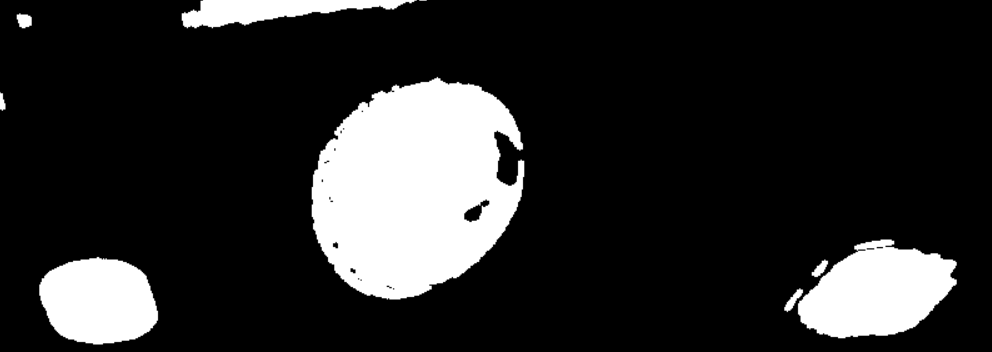 | 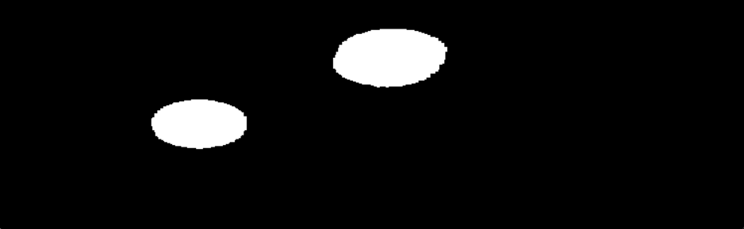 |

**What we saw:** On a white tray, caps cast colored shadows. The program counted the shadows as part of the cap, so boxes got too big.

**Why:** A white surface shows every shadow and reflection, and they have the cap's color.

**What we changed:** We use a black tray. Shadows disappear into it.

**Still not perfect:** The two pictures were taken with different caps and light, so they show the idea, not a measurement.

## 2. The program missed a tray it could see

| Earlier failure | Earlier success |
| --- | --- |
| 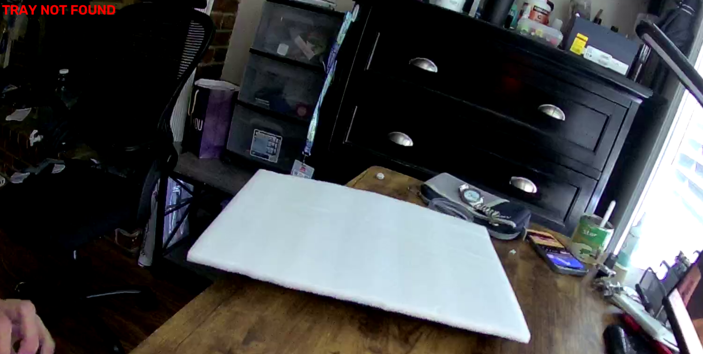 | 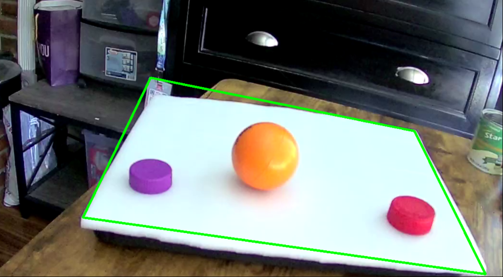 |

| Earlier: white tray picture | Now: black tray picture |
| --- | --- |
| 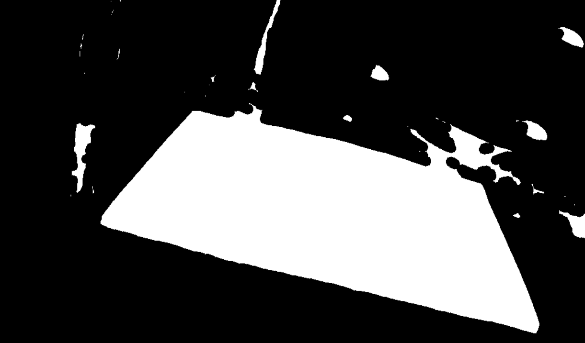 | 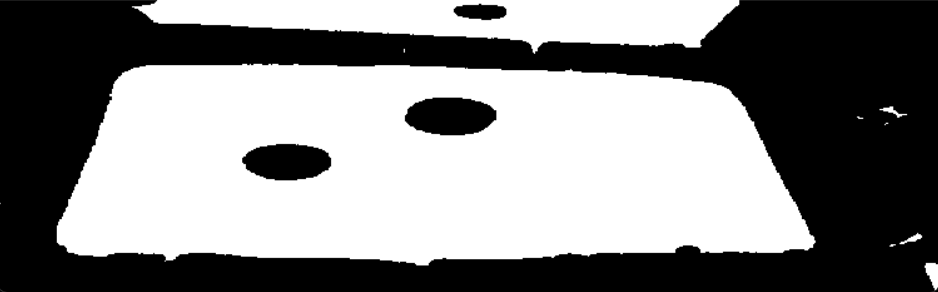 |

**What we saw:** The tray was clearly in the picture, but the program said "TRAY NOT FOUND".

**Why:** Other things in the room have the same color as the tray. Color alone can't tell which one is the tray. Also, a low camera angle makes the tray look very flat, and the program rejected flat shapes.

**What we changed:** After picking dark pixels, the program checks the shape: big enough, roughly a rectangle, four corners, not touching the picture's edge. Flatter shapes are allowed now.

**Still not perfect:** A green outline means the shape checks passed. It does not prove the corners are exactly right.

Details

- The allowed long side / short side ratio went from 5.5 to 8.
- The tray is found by brightness only. Color shade and colorfulness are ignored (see section 11).

## 3. Caps were cut out of the tray picture

| Black-and-white tray picture | Filled outline |
| --- | --- |
|  | 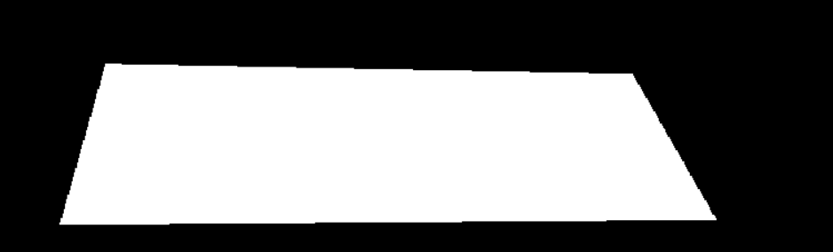 |

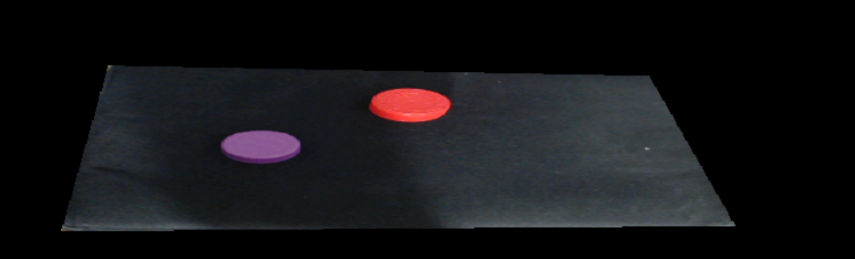

**What we saw:** Caps showed up as holes in the black-and-white tray picture.

**Why:** Caps are not dark, so they don't pass the "dark enough to be tray" test.

**What we changed:** We fill the whole area inside the four corners, then keep only the camera picture inside it. The caps stay, the room goes away.

## 4. Positions changed with the camera angle

| Before: camera view | After: straightened |
| --- | --- |
|  |  |

**What we saw:** From an angle, the tray looks like a trapezoid. A position in the camera picture doesn't say where the cap is on the tray.

**What we changed:** We stretch the four corners into a rectangle, as if the camera looked straight down. Positions are then fractions of the tray: `u` across, `v` down, 0 to 1.

**Still not perfect:** This is exact only for things lying on the tray. Things above the tray, like a cap on a tube, come out a little too far toward the edges.

Details

- OpenCV `getPerspectiveTransform` and `warpPerspective`.

## 5. One ball got many boxes

| Earlier: many boxes on one ball | Now: one box per object |
| --- | --- |
| 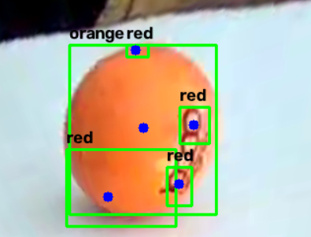 |  |

**What we saw:** One orange ball got several red and orange boxes.

**Why:** The ball has several shades. Different color tests picked different patches of it.

**What we changed:** Tiny specks and thin strips are dropped. When boxes overlap a lot, only the biggest is kept.

**Still not perfect:** Caps that touch each other can merge into one box. (In the demo, caps never touch.)

Details

- Smallest box side 12 pixels. A box may be at most 1.9 times as long as it is wide.
- Two boxes count as one if they overlap 30% or more, or if the smaller one is 75% covered.

## 6. The outline shook, and hands got in the way at the start

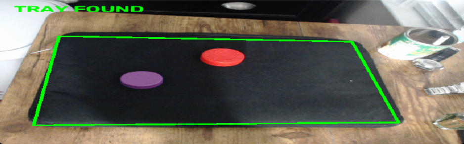

**What we saw:** The outline's corners jumped a little in every frame. And when the program started, a hand was often still over the tray.

**What we changed:**
- Each new outline is blended with the old one, so small jumps are smoothed out. A big jump is only accepted when a few frames agree on it.
- After the tray is first seen, the program waits a moment ("LOCALIZE TRAY") before using it. This gives you time to move your hand away.
- We once made the outline a bit bigger to keep tall objects inside it. We removed that again: the outline now follows the tray's corners exactly.

**Still not perfect:** The wait is only a timer. It does not check whether your hand is gone.

Details

- Blend: 28% new outline, 72% old. Up to 8 missed frames keep the old outline. A big jump needs 3 agreeing frames.
- The wait is 0.5 seconds (`--tray-settle-seconds`).

## 7. The camera did not always open

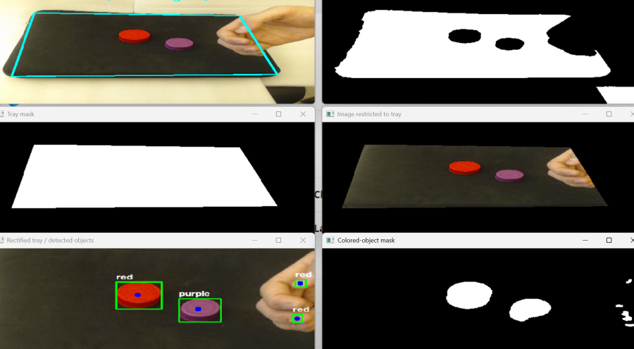

**What we saw:** Sometimes the camera window stayed black, showed the wrong camera, or timed out.

**Why:** Windows has several ways to open a USB camera, and some give black pictures at first. A network camera can have an address and still send no video.

**What we changed:** The program tries each way to open a USB camera and skips the ones that give black pictures. For the network camera it tries two connection types. Six windows, one per step, show what each step sees.

**Still not perfect:** Camera numbers differ between computers. On our setup: 0 = USB camera, 1 = laptop camera.

Details

- USB: DirectShow, then Media Foundation, then the default.
- Network camera (RTSP): TCP first, then UDP. A VLC relay worked as a fallback but did not fix every timeout.
- Camera 2 was once an OBS virtual camera, not a real one.
- The black-and-white tray picture is updated in every frame, so it never looks frozen.

## 8. Glare moved the outline

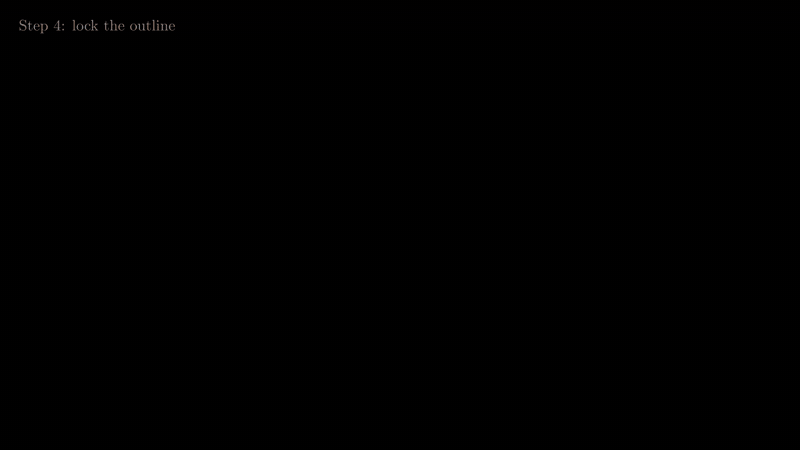

**What we saw:** Glare on the tray bent the outline, even with smoothing.

**What we changed:** Once the outline has been still for a moment, it **locks** (turns cyan, "TRAY LOCKED"). After that, glare and hands can't move it. It unlocks only if the whole tray really moves, or when you press `r`.

**Still not perfect:** The lock keeps whatever outline it locks, even a wrong one. Here a cable behind the tray made the outline too big, and the lock kept it. Press `r` to find the tray again. The real fix is [Task 1](task_delegation.md#task-1-make-the-tray-outline-ignore-cables).

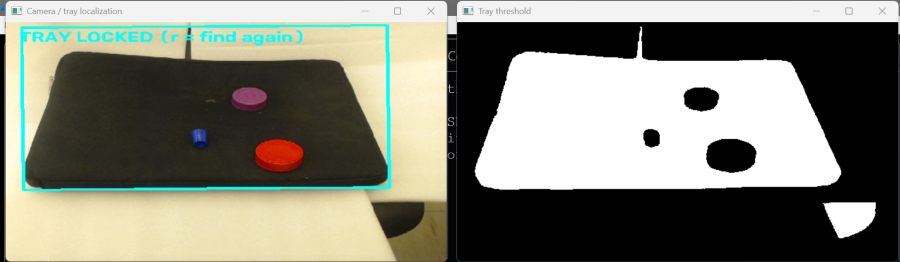

Details

- Locks after 0.75 seconds of moving less than 1.5% of the picture's diagonal.
- Unlocks when a same-size tray (sides within 15%) is seen moved more than 5% of the diagonal, in one place, for 1 second.
- While locked, the tray is searched only every 0.2 seconds (`--locked-check-seconds`).

## 9. Boxes flickered

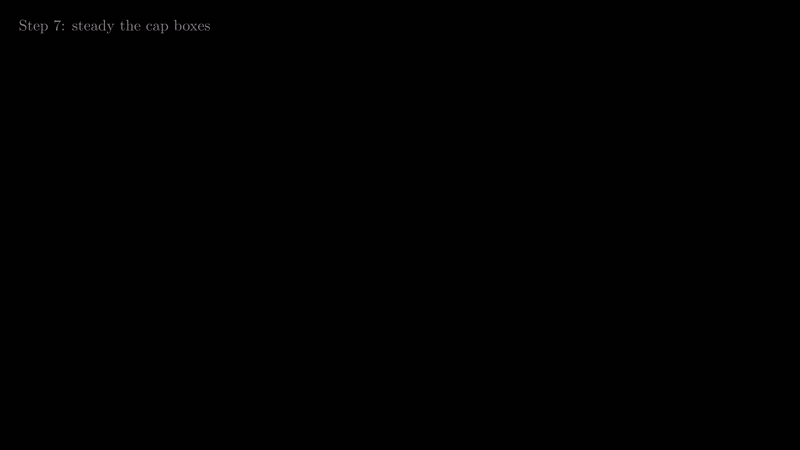

**What we saw:** Boxes jumped around and blinked on and off.

**Why:** Every frame is checked from scratch, and noise changes each frame a little.

**What we changed:** A cap is shown only after it is seen in most of the last few frames. Its box is the middle value of its last few boxes, so one bad frame doesn't move it.

**Still not perfect:** A new or removed cap shows up or disappears a few frames late.

Details

- Seen in 3 of the last 5 frames. The box and position are the median of the last 5.

## 10. A hand was found as a red cap

**Before:** two red boxes on the hand (right).

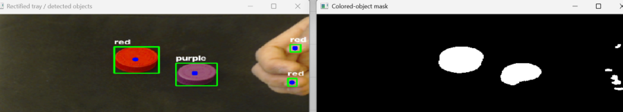

**After:** only the red and purple caps are found.

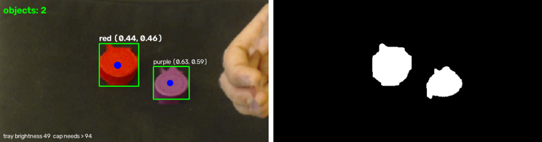

**What we saw:** A hand in shadow was found as a red cap.

**Why:** A shadowed hand has a reddish color shade, like the red cap. But its color is weak, and the cap's is strong.

**What we changed:** Red now has to be strongly colored.

**Still not perfect:** Pale pinkish red caps are not found any more. Use strongly colored caps.

Details

- Red needs colorfulness 150 or more (it was 50). The hand measured 60-200, the red cap 226-255.

## 11. The tray wasn't found next to a white board

**Before:** "TRAY NOT FOUND". The black-and-white tray picture (right) is full of holes and joined to the floor.

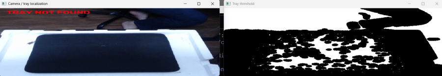

**After:** the tray is found and locked. The orange box is the search box.

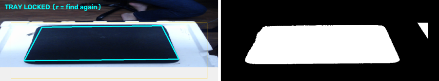

**What we saw:** "TRAY NOT FOUND", and the black-and-white tray picture was full of holes.

**Why:**
- The camera adjusts its colors for the very bright white board. That made our black tray look dark blue.
- The program only accepted grey-black pixels, so it threw most of the tray away.
- The dark floor behind the board touched the tray in the picture, so tray and floor looked like one big shape.

**What we changed:**
- Any dark pixel now counts as tray, whatever its color.
- You can give a search box around the tray. Everything outside it is ignored.

**Still not perfect:** Tried on this screenshot and on drawn pictures, not on the live camera. The corners found sit a little inside the tray's rounded corners.

Details

- The tray's brightness was 29-63 (dark enough). Its colorfulness was 137-177, but the old limit was 130, so only about 2% of it passed. Making the picture brighter or darker did not help.
- Colorfulness is no longer checked for the tray (`--tray-max-saturation` is 255).
- The search box: `--tray-region 0.05,0.28,0.95,0.97` (left, top, right, bottom, as fractions of the picture). Leave a few pixels of room around the tray: the box edge counts as the picture's edge.
- The "after" picture is today's code on the same screenshot, with a light strip added below, because the tray touched the bottom of the screenshot.

## 12. A red cap was labeled purple

**Before:** the red cap is labeled purple.

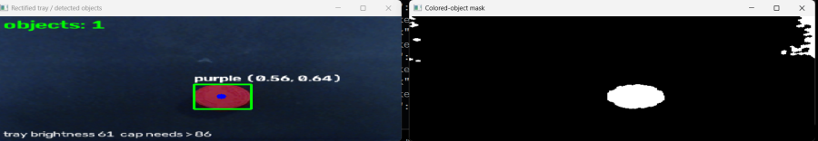

**After:** the cap is labeled red.

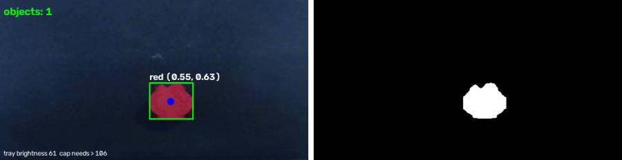

**What we saw:** A red cap was labeled purple.

**Why:** The camera's blue tint moved the red cap's color shade toward purple. The two shades now overlap.

**What we changed:** In the overlapping shades, a strongly colored pixel counts as red. Our purple cap is paler, so it stays purple.

**Still not perfect:** The purple cap was measured in other light, so the gap between them is small. Measuring the caps in the real light ([Task 2](task_delegation.md#task-2-measure-the-cap-colors)) is the real fix.

Details

- The red cap read shade 173, colorfulness about 194. Before the tint it read shade 5, colorfulness 253.
- Purple is shade 125-176, so 173 fell inside purple.
- Now shade 165-176 with colorfulness 170 or more counts as red. The purple cap read colorfulness 100-113.

## 13. Glare was found as a blue cap

The "before" picture of section 12 shows it too: the white patch in the top-right of the cap picture is glare.

**What we saw:** Glare in a corner of the tray was found as a blue cap.

**Why:** The tray looks dark blue to the camera. Where light shines on it, it is the same blue, only brighter. Caps had to be only a little brighter than the tray, and the glare was just bright enough.

**What we changed:**
- A cap must now be much brighter than the tray.
- Anything right at the edge of the tray picture is ignored. Glare shows up there, and caps are never there in the demo.
- `--lock-camera` stops a USB camera from changing its colors and brightness by itself.

**Still not perfect:** We have not measured how bright the blue cap is. If it is dim, it could be missed. `--lock-camera` may do nothing on some cameras.

Details

- The glare read shade 107, colorfulness 142, brightness 82-91. The tray's middle brightness was 61.
- Before: a cap pixel needed 61 + 25 = 86, right at the glare. Now it needs 61 + 45 = 106.
- Edge: objects whose center is within 4% of the tray picture's edge are ignored (`--object-edge-margin`).
- `--lock-camera`: after a short warm-up, the automatic white balance and exposure are turned off at their current values. To check it works, move something white into view: "tray brightness" in the window should stay the same.
- We also tried darkening a too-bright tray before looking for caps. It did not help, so we removed it.

## 14. Labels were too big and blurry

**Before:** text too big for a small picture.

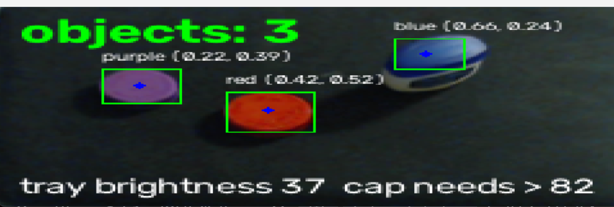

**Before:** blurry text.

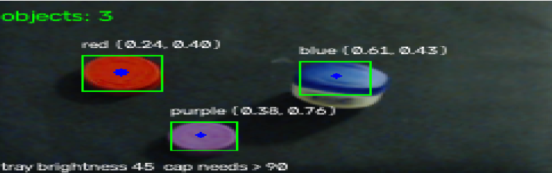

**After:** sharp text, each label sized to its box.

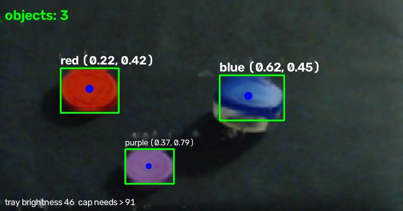

**What we saw:** On a small tray picture the text covered the tray, and all letters were blurry.

**Why:** Every label had the same size, whatever the cap's size. And the tray picture is small, so the text was drawn small and then blown up by the window.

**What we changed:** Each label's size follows its box. The picture is made bigger before any text is drawn, so the text is sharp.

Details

- A label is about 1.6 times as wide as its box, font size between 0.3 and 1.0. The box line and the center dot follow the box too.
- The picture is enlarged to at least 360 pixels on its shorter side (`MIN_VIEW_SIDE`). Finding the caps still uses the original size.

**About the "after" pictures** in sections 10, 12 and 14: they are today's code run on the same screenshots. The old boxes and text were painted out first, and each picture was squeezed back to its real shape (the preview window had stretched it sideways).

## 15. Why this approach, and what is left

**Why simple color rules:** they find our brightly colored caps without collecting and labeling hundreds of training pictures.

**What we get today:** each cap's color, and where it is as a fraction of the tray. No robot coordinates yet.

**Before the robot can pick:** the hardware team turns tray positions into arm positions. The open problems of the camera program are in [what is left to do](task_delegation.md).

**Separate path:** the AMB82-Mini camera board also has its own ready-made object detector. Our Python program does not use it.

Other ways we talked about but don't use:

| Way | What it would do |
| --- | --- |
| Another color system (Lab) | A different way to separate color from brightness. |
| Edge and line finding (Canny, Hough) | Find the tray's straight edges when its color is unreliable. |
| Printed corner markers (ArUco) | Square codes on the tray corners that the camera finds easily. |
| Other smoothing (moving average, Kalman filter) | Other ways to steady jumping positions. |
| A fixed crop | A simpler way to cut out the tray, if the camera never moves. |
| A trained detector (YOLO) | Learns what a cap looks like from many labeled pictures. Needs training data. |

Learn: [ArUco markers](https://docs.opencv.org/4.x/d5/dae/tutorial_aruco_detection.html), [Kalman filter](https://docs.opencv.org/4.x/dd/d6a/classcv_1_1KalmanFilter.html), [YOLO detection](https://docs.ultralytics.com/tasks/detect), [YOLO segmentation](https://docs.ultralytics.com/tasks/segment).
