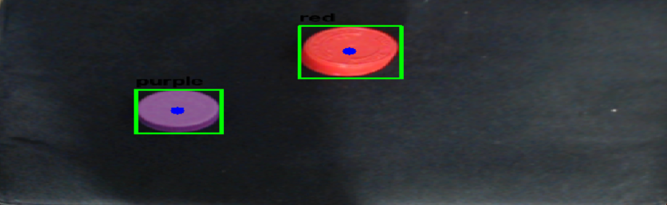
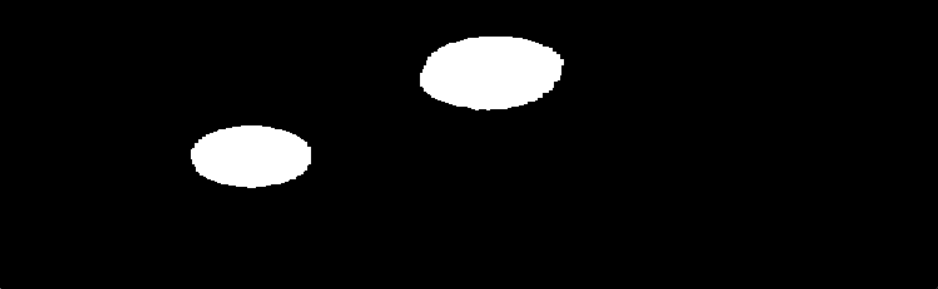
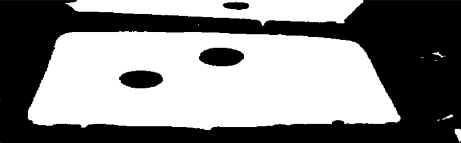
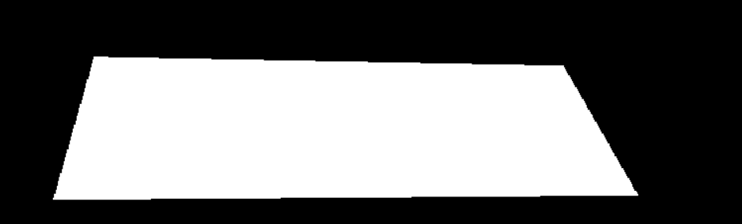
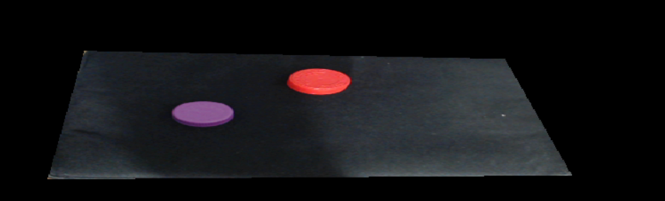
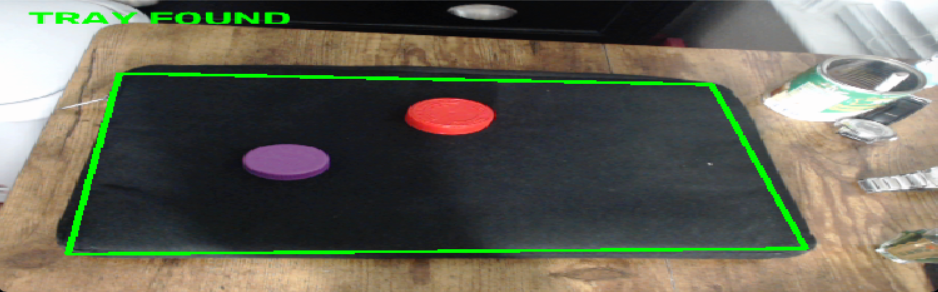

# Computer Vision Findings

Why we use the current setup. Images from our earlier trials and current run.

For the working steps, see [current pipeline](computer_vision_pipeline.md). For run commands, see [README](../README.md#commands).

## 1. Black tray: reduce shadow interference

| Earlier: white tray | Current: black tray |
| --- | --- |
|  |  |
| Shadows visible around the objects. | Objects stand out against the dark tray. |
|  |  |
| Gaps and extra selected pixels. | Two solid object regions. Background stays black. |

- **Problem:** Colored shadows or reflected color on a white tray can pass the color filter. A box may include them and its center may shift.
- **Decision:** Use a black tray. Shadows blend into the dark surface; fewer background pixels should pass the object color filter.
- **Limit:** Lighting and objects differ between these trials. The images show the change, not a measured improvement from tray color alone.

## 2. A visible tray can still fail detection

| Earlier failure | Earlier successful outline |
| --- | --- |
|  |  |
| Camera sees the tray. Program rejects it. | Program accepts four tray corners. |

| Earlier white-tray threshold | Current black-tray threshold |
| --- | --- |
|  |  |
| Bright background also gets selected. | Dark background can also get selected. |

- **Finding:** Color alone cannot identify the tray. Other surfaces can share its color.
- **Decision:** Check area, shape, four corners, and image borders after thresholding.
- **Lighting:** Earlier white tray looked yellow or blue under different lighting. Hue alone was unreliable. Current black-tray threshold ignores hue and selects dark, low-saturation pixels.
- **Camera angle:** A low angle makes the tray look shallow. We raised the allowed long-side/short-side ratio from 5.5 to 8.
- **Limit:** A green outline means the shape checks passed. It does not prove position accuracy.

## 3. Fill the outline before masking the image

| Raw color threshold | Filled tray mask |
| --- | --- |
|  |  |
| Objects leave holes. Outside patches remain. | Whole tray included. Outside patches removed. |

- **Problem:** Using the raw threshold as the final mask would remove colored objects too.
- **Decision:** Fill the four-corner outline, then keep the camera image inside it.
- **Result:** Keep tray and objects. Hide the surrounding room.

## 4. Straighten the angled view

| Before: tray-only camera view | After: rectified detection view |
| --- | --- |
|  |  |
| Tray appears skewed. | Four corners mapped to a rectangle. |

- **Decision:** Use a perspective transform before reporting object positions.
- **Reason:** Express positions relative to the tray, instead of the surrounding camera image.
- **Limit:** This mapping describes a flat surface. Tall objects can still give shifted positions.

## 5. One object can produce many boxes

| Earlier: many boxes on one ball | Current example: separate objects |
| --- | --- |
|  |  |
| Color patches treated as separate objects. | One box around each visible object. |

- **Problem:** One ball contains several shades. Red and orange filters can both select it.
- **Decision:** Remove small specks and narrow regions. Suppress smaller boxes that overlap larger ones.
- **Finding:** Duplicate color regions and shadows are separate problems. Black background helps with shadows; overlap suppression helps with duplicate boxes.
- **Limit:** The current image uses different objects. It does not prove the ball issue is fully solved. Touching objects may still merge.

## 6. Border movement, hands, and tall objects

- **Jitter:** New corner estimates moved between frames. We blend them with previous corners and reject sudden jumps until repeated.
- **Hands:** We added a 2-second wait after first finding the tray. Gives time to move hands away. Uses the latest detection afterward.
- **Padding trial:** We extended the mask around the sides and far edge to keep tall objects visible.
- **Current decision:** Removed that extension. Mask and green outline follow the tracked tray corners.
- **Tradeoff:** Tall objects near an edge can still be cropped. The timer does not check whether hands are gone.

## 7. Camera input and preview windows

- **USB camera:** Works without the AMB82-Mini. Camera indexes vary by machine. On our setup: 0 = USB, 1 = laptop.
- **Virtual camera:** Index 2 showed an OBS placeholder in an earlier trial. Opening a device does not prove it is the physical USB camera.
- **RTSP:** We saw timeouts even when the camera had an IP address. An IP address alone does not prove video is arriving.
- **VLC relay:** Tried as an alternative input. A listening HTTP port did not guarantee usable frames. Keep it as a fallback, not a confirmed fix for every timeout.
- **Preview windows:** All six views now open in a two-column grid. Makes each processing step easier to inspect.
- **Threshold refresh:** The threshold must update while the tray is found too. Otherwise it looks frozen beside the live views.

## 8. Why this approach, and what remains

- **Current choice:** OpenCV color filters and contours. Finds our bright objects without training images.
- **Separate firmware:** The AMB82-Mini sketch also has a pretrained YOLO detector and a fixed tray polygon. That is a separate path from the Python pipeline.
- **Current output:** Color and normalized tray position. No robot coordinates, height, grip angle, or movement commands.
- **Before picking:** Calibrate camera positions to the arm. Measure position error. Add stable target selection, controller communication, and pick confirmation.

Other approaches discussed, not used in the current Python pipeline:

| Approach | Why consider it |
| --- | --- |
| Lab color thresholds | Different way to separate color and brightness. |
| Canny edges and Hough lines | Find straight tray borders when color is unreliable. |
| ArUco markers | Identify known tray corners. |
| Moving average or Kalman filter | Other ways to steady position estimates. |
| Simple crop or affine transform | Simpler view correction when the camera angle allows it. |
| YOLO detection or segmentation | Recognize object types or outlines beyond fixed colors. Custom objects need training data. |

Learn: [ArUco markers](https://docs.opencv.org/4.x/d5/dae/tutorial_aruco_detection.html), [Kalman filter](https://docs.opencv.org/4.x/dd/d6a/classcv_1_1KalmanFilter.html), [YOLO detection](https://docs.ultralytics.com/tasks/detect), [YOLO segmentation](https://docs.ultralytics.com/tasks/segment).
