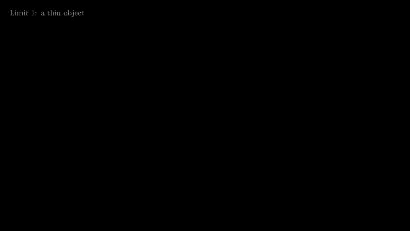
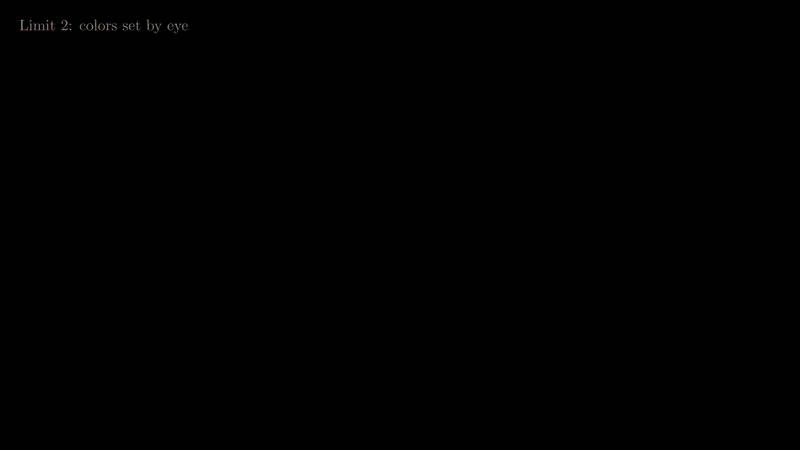
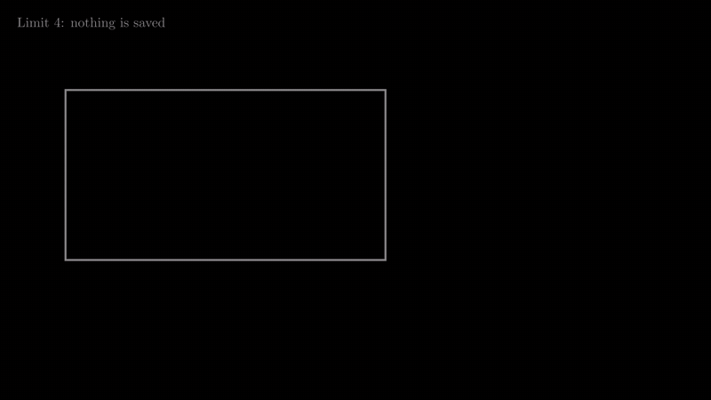

# Current Pipeline Limits

**Today:** the camera finds the tray and the red, blue and purple caps, and reports where they are.
**Not yet:** the results can still be wrong in four ways. Each one is below, with how to fix it.

This page explains what is still missing, in plain words. It covers the code in [vision/](../vision/). For how the program works step by step, see [current pipeline](computer_vision_pipeline.md). For why we chose this setup, see [findings](documentation.md).

Each problem below has three parts:

- **Problem:** what goes wrong today, and what it does to the results.
- **Fix:** what we need to build or change.
- **Done when:** how we check that the fix works. Anyone on the team can run the check.


Our setup rules for the demo:

- The tray is fixed in one place. It does not move.
- The tube rack is clamped in one place. It can't move or turn.
- The rack sits away from the edge of the tray.
- Tubes stand upright, one per slot in the rack. All tubes have the same length, so all caps are at the same height.
- The camera looks almost straight down at the tray.
- Caps are only red, dark blue, or purple. They are strongly colored, and they never touch each other.
- The robot arm is black, so it is never mistaken for a cap.
- A team member watches every run. Nobody puts a hand in the tray while it runs.

Problems already solved by these rules, and quick fixes, are not listed here. If we ever break a rule, its problem comes back.

## Overview

### How the camera system works, in 30 seconds

1. The camera takes a picture many times per second. Each picture is called a **frame**.
2. The program finds the black tray in the frame. Once the tray's outline stays still for a moment, the program **locks** it, so glare or a hand can't move it.
3. It straightens the tray into a top-down picture.
4. It looks for pixels that are red, blue, or purple. A **pixel** is one tiny dot of the picture.
5. Each group of same-colored pixels becomes a detected cap. The program draws a box around it and marks its middle.
6. It reports where that middle is, as a fraction of the tray. For example, "62% of the way across, 35% of the way down".

Most problems below are about steps 2, 4 and 6: getting the outline right, getting the colors right, and keeping the results.

### Words used on this page

| Word | Meaning |
| --- | --- |
| Frame | One picture from the camera. The camera sends many per second. |
| Pixel | One tiny dot in a picture. Each pixel has a color. |
| (u, v) | Where something is on the tray, as fractions. u = how far across (0 to 1), v = how far down (0 to 1). |
| Outline | The four corners of the tray in the camera picture. |
| Lock | The program stops changing the outline once it has stayed still. A locked outline is drawn in cyan. |
| Tray threshold | The black-and-white picture where white means "dark enough to be tray". The outline is made from it. |
| Hue, saturation, brightness | The three numbers of a color. Hue = which color. Saturation = how strong. Brightness = how light. The program picks caps by these numbers. |
| Calibration | Measuring something once, so the program can use the real numbers instead of guesses. |
| Tube | The test tube a cap sits on. The cap is tens of millimeters above the tray. |
| Record | One cap's information, written with fixed names, so every part of the system reads it the same way. |
| Log file | A file where every record is added as one line. |

## What is left to do

### 1. A thin object can make the tray outline wrong



**Demo: must fix.** A wrong outline makes every cap position wrong, and the lock keeps it wrong.

**Problem:**
- The program makes the outline from the "Tray threshold" picture. It wraps a shape around the white area, then picks four corners.
- A thin dark thing touching the tray, like a cable or a shadow, shows up as a spike in that picture.
- The spike counts as an extra corner. The four-corner check fails, so the program falls back to a bigger rectangle around everything. The outline is too big.
- If the outline locks like this, it stays wrong for the whole run.
- Every (u, v) is measured against this wrong outline.

**Fix:**

- **Keep only the four main corners.** Take the outline of the white area. While it has more than four corners, remove the one that sticks out the least. A spike is the least important corner, so it goes first. The four real corners stay.
- This needs no new settings, and a clean tray gives the same corners as before.
- It does **not** fix an object sitting right on a corner of the tray, because that really changes the outline.

**Done when:**
- The corner-picking change is built, and the existing tests still pass.
- **Test:** draw a tray with a thin cable, a thick object and a dark blob touching an edge. Then try the real tray with the real cable.
- **Pass:** the corners are within the corner error **(set)** of the true corners in every drawn picture, and the outline of the real tray hugs the tray.

### 2. Cap colors were set by eye



**Demo: must fix.** A missed cap, or a false one, is a wrong result.

**Problem:**
- The color ranges were set by looking at a few caps and trying numbers.
- A cap slightly outside the range is missed, or breaks into small specks. Pale pinkish red is one example.
- The limits are also tight on purpose, to keep out things that are not caps. A shadowed hand once showed up as red, so the red limit was raised, and that dropped paler reds.
- When the lights, the camera or the caps change, someone has to edit the code and guess again.

**Fix:**

- **Measure the real caps.** Show the straightened tray. For each color, click on the real caps. The program reads the pixels around each click and works out the range of hue, saturation and brightness that covers them.
- Save the ranges in a small file. The program loads it when it starts. Without the file, it uses today's ranges.
- Hue is a circle, so red needs care: it sits at both ends (near 0 and near 179).
- Run it again when the lights, the camera or the caps change. No code editing.
- A person reviews the saved numbers before they are used, because color ranges decide what counts as a cap.

**Done when:**
- The calibration tool and the colors file are built, and the program uses the file.
- **Test:** draw caps with known colors and check the measured ranges cover them and nothing else. Then calibrate with the real caps.
- **Pass:** every real cap is found, and an empty tray gives no false caps in a one-minute run (false caps allowed **(set)**).

### 3. A cap above the tray is measured in the wrong place


**Demo: must fix.** Positions can be off by tens of millimeters near the edges of the tray.

**Problem:**
- The program straightens the picture using the four corners of the tray. This is exact for anything lying **on the tray surface**.
- Our caps sit on tubes, tens of millimeters **above** the tray. The camera sees a raised cap pushed away from the middle of the picture, like a tall building leaning outward in a photo taken from above.
- Straightening keeps this push. The push is zero in the middle of the picture and grows towards the edges.
- A simulation (camera 350 mm above the tray, caps on 100 mm tubes) gave up to 40 mm of error across and 28 mm along at the tray's edges. With 60 mm tubes: 22 mm and 15 mm. For a cap lying on the tray the error was only 2 mm. This is a simulation, not a measurement of our camera.
- Every (u, v) of a cap on a tube is wrong by this amount. The tray corners and the rounding of their shape add small errors too.

**Fix:**

- **Calibrate at cap height.** All our caps sit on tubes of the same length, so they are all at the same height. They all have the same kind of error.
- Measure the real position of some rack slots with a ruler, as a fraction of the tray: millimeters from the tray's corner, divided by the tray's width (for u) or depth (for v). Use at least 4 slots, spread out, with corners included.
- Put one cap in each of those slots, one at a time. Read the (u, v) the program reports for each.
- Now we have pairs: "reported" and "real". `cv2.findHomography` finds the one correction that turns every reported position into the real one.
- Save the correction in a small file. The program applies it to the (u, v) of every cap.
- In the simulation, 4 slots brought the error from 22 to 40 mm down to under 1 mm everywhere on the tray, even with the camera tilted 10 degrees away from straight down.
- If the tube length changes, calibrate again.

**Done when:**
- The correction is saved in the repo, and the program applies it to every cap.
- **Test:** calibrate with 4 slots. Then put caps in 9 or more other slots across the tray (corners, edges, middle), and compare the reported positions with the ruler measurements. Also try a drawn test with a known error.
- **Pass:** every cap is within the position error **(set)** of its real position.

### 4. Detections are not saved



**Demo: should fix.** Nothing can be replayed, and other programs can't rely on the names.

**Problem:**
- The program prints one line of JSON per second on the screen (one per frame with `--no-gui`), but nothing is saved.
- We can't look back at a run, or compare the camera's positions with ruler measurements.
- Different parts of the system could use different names or a different order for the same values.

**Fix:**

- Turn each cap into a **record** with fixed names, and add each record as one line to a **log file**.
- Use the fields below, so everyone reads the same thing.

```json
{"frame": 1042, "time_ms": 1730000123456, "color": "red",
 "u": 0.412, "v": 0.688, "center_x": 206.0, "center_y": 151.4,
 "box": [190, 135, 32, 33], "area": 780}
```

| Field | What it means |
| --- | --- |
| `frame` | Which camera picture this came from |
| `time_ms` | When that picture was taken (milliseconds) |
| `color` | red, blue, purple, or `unknown` |
| `u`, `v` | Cap center as fractions of the tray (0 to 1) |
| `center_x`, `center_y` | Cap center in pixels, on the straightened tray picture |
| `box` | The box around the cap: x, y, width, height in pixels |
| `area` | Cap size in pixels |

**Done when:**
- Every detection is written to the log in the format above.
- **Test:** write three records and read them back.
- **Pass:** the log has one line per record, with exactly these fields.

## Numbers to agree on

The team agrees on these before testing.

| Number | What it means | Value |
| --- | --- | --- |
| Corner error | How far the tray corners may be from the true corners in the drawn tests | ___ pixels |
| Position error | How far a corrected cap may be from its real position | ___ mm |
| False caps | How many false caps are allowed on an empty tray in a one-minute run | ___ |

## What to do first

Who does what, with fake data and tests: [task delegation](task_delegation.md).

1. **Agree** on the numbers above. Measure the tray's width and depth, and the real position of the rack slots.
2. **Tray outline:** fix the thin-object problem (#1).
3. **Colors:** calibrate with the real caps, in the real lights (#2).
4. **Cap height:** calibrate the correction with caps in known slots (#3).
5. **Records:** save every detection to the log (#4).
