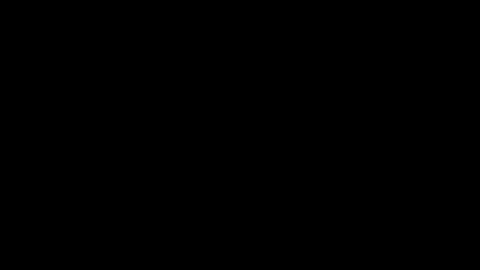

# Current Pipeline Limits

**Today:** the camera can find colored caps and show where they are.
**Not yet:** the robot arm can't pick them up on its own.

This page explains what is still missing, in plain words. It covers [tray_object_pipeline.py](../vision/tray_object_pipeline.py). For how the program works step by step, see [current pipeline](computer_vision_pipeline.md). For why we chose this setup, see [findings](documentation.md).

Each problem below has three parts:

- **Problem:** what goes wrong today, and what the robot would do because of it.
- **Fix:** what we need to build or change.
- **Done when:** how we check that the fix works. Anyone on the team can run the check.


Our setup rules for the demo:

- The tube rack is clamped in one place. It can't move or turn.
- The rack sits away from the edge of the tray.
- Tubes stand upright, one per slot in the rack.
- Caps are only red, blue, or purple.
- A team member watches every run, with the emergency stop button within reach. Nobody puts a hand in the tray while it runs.

Problems already solved by these rules, and quick fixes, are not listed here. If we ever break a rule, its problem comes back.

## Overview

### How the camera system works, in 30 seconds

1. The camera takes a picture many times per second. Each picture is called a **frame**.
2. The program finds the black tray in the picture.
3. It looks for pixels that are red, orange, or purple. A **pixel** is one tiny dot of the picture.
4. Each group of same-colored pixels becomes a detected cap. The program draws a box around it and marks its middle.
5. It reports where that middle is, as a fraction of the tray. For example, "62% of the way across, 35% of the way down".

The robot arm is not connected yet. Most problems below are about the gap between step 5 and a robot that can actually pick.

### Words used on this page

| Word | Meaning |
| --- | --- |
| Frame | One picture from the camera. The camera sends many per second. |
| Pixel | One tiny dot in a picture. Each pixel has a color. |
| (u, v) | Where something is on the tray, as fractions. u = how far across (0 to 1), v = how far down (0 to 1). |
| Millimeters (mm) | Real distance. The robot arm moves in millimeters, measured from its base. |
| Calibration | Measuring the camera once, so its picture positions can be turned into real millimeters. |
| Gripper | The robot's "hand": two fingers that close on the cap. |
| Slot map | A list of every rack slot's real position (x, y, z in mm), measured once with the robot. |
| Touch points | Spots the camera can see where the gripper is moved by hand, to match pixels with arm positions. |
| ArUco marker | A printed black-and-white square code. Cameras can find it quickly and reliably. |

## Determine the position of the object

### 1. The robot can't use the camera's positions yet


**Demo: must fix.** The arm can't move until positions are in its own millimeters.

**Problem:**
- The camera reports positions as fractions of the tray, like "62% across". The robot arm needs real distances in millimeters, measured from its own base. Nothing converts one into the other yet.
- The camera lens bends the picture slightly, like looking through a glass of water. Straight lines look a little curved, mostly near the edges. We haven't measured how much this shifts positions.
- The program only prints positions on the screen, once per second. It doesn't save them or send them anywhere the robot could read.
- If the robot moved using today's numbers, it would go to the wrong place.

**What the arm actually needs:**
- The grab point's **x, y, z in millimeters, measured from the center of the arm's base**. The arm's controller turns these into joint angles by itself.
- A distance alone isn't enough. "300 mm away" has no direction: it could be left, right, or straight ahead.
- A distance from the tray's center isn't enough either. The arm would also need to know where the tray's center is compared to itself.
- So the chain is: **pixels → position on the tray → position compared to the arm**. The last step is the one that's missing.
- To work efficiently, the arm also needs: how wide to open the gripper (the cap's width), a safe height to travel above the caps, where each color's bin is, and which cap to pick next (nearest first means less travel).

**Fix:** two parts that work together.


**Part 1: touch points (turn any pixel into arm millimeters).**
- The camera looks at the tray from an angle, so in the picture a square area looks squashed, like a trapezoid.
- Put 9 or more marks on a board resting on the tubes, so the marks are at the height of the cap tops. Spread them over the whole rack, corners included.
- Move the gripper by hand onto each mark. Write down two numbers for each mark: where the arm says it is (x, y in mm), and where the camera sees it (pixel). Each mark gives one **pair**.
- Four pairs are enough to work out exactly how the picture is squashed. OpenCV does this with one command (`cv2.findHomography`). Undo the squash, and any pixel becomes arm millimeters.
- More than four pairs means small mistakes in each one average out.
- The marks sit at cap-top height, so the formula already allows for how high the caps are. No extra height correction is needed for caps at that height.
- Calibrate the lens once first (photograph a printed checkerboard a few times), so the lens' slight bending is undone.

**Part 2: slot map (go to an exact, saved position).**
- The rack never moves, so each slot only needs measuring once. Move the gripper to every slot and save its x, y, z. This is the **slot map**.
- Around each slot, imagine a **catch circle** half as wide as the gap to the next slot.
- The camera then only has to say which catch circle a cap falls in. Even if part 1 is off by a little, the cap lands in the right circle, and the arm goes to that slot's exact saved position.
- **Parts 1 and 2 check each other.** If a cap falls outside every catch circle, something moved, such as the rack or the camera. Warn the person watching instead of picking.

Record every position in the format below, so the robot code, the test scripts, and people all read the same thing.

**How each position should be recorded:**

Use one shared map for all positions, so everyone means the same thing by "x = 212 mm":

- **Origin (zero point):** the center of the robot's base, at table height.
- **x:** forward, from the robot toward the rack.
- **y:** to the robot's left.
- **z:** up from the table.
- **Units:** millimeters for distance, milliseconds for time.

Send one record per cap, every time the camera takes a picture. Example:

```json
{"frame": 1042, "time_ms": 1730000123456, "slot": "B3",
 "color": "red", "color_confidence": 0.94,
 "x_mm": 212.4, "y_mm": -38.0, "z_mm": 96.0, "error_mm": 3.0,
 "tray_x_mm": 145.0, "tray_y_mm": 80.5, "calibration": "2026-10-26"}
```

| Field | What it means | Why it's needed |
| --- | --- | --- |
| `frame` | Which camera picture this came from | Ties every record to one moment |
| `time_ms` | When that picture was taken | The robot can ignore old positions |
| `slot` | Which rack slot the cap is in, like "B3" | The robot moves to that slot's saved position (part 2) |
| `color` | red, blue, purple, or `unknown` | Decides which bin it goes in |
| `color_confidence` | 0 to 1: how sure the color is | Low confidence → skip it, don't guess |
| `x_mm`, `y_mm`, `z_mm` | Position compared to the arm's base, from part 1 | Checks the slot, and is used if a cap isn't in a slot |
| `error_mm` | How far off this position might be, from the calibration test | The robot can refuse positions it can't trust |
| `tray_x_mm`, `tray_y_mm` | Position compared to the tray's top-left corner | Checking and debugging |
| `calibration` | Which calibration was used | After re-calibrating, old records are easy to spot |

Also save every record to a log file, one line each. The tests can then compare the camera's positions with ruler measurements, and we can replay what happened after a failed pick.

**Done when:**
- The lens calibration, the touch-point formula (part 1), and the slot map (part 2) are saved in the repo.
- Every detection is sent and logged in the format above.
- **Test:** put a cap in 9 or more rack slots spread across the tray (corners, edges, middle). Compare the recorded x, y, z with the slot map and a ruler.
- **Pass:** every cap is within the position tolerance **(set)** and matched to the right slot. Save the results table in the repo.

### 2. The robot arm can stop the camera from finding the tray



**Demo: must fix.** The arm sits behind the tray, facing the camera, so it is in the picture.

**Problem:**
- The program finds the tray by looking for the biggest **dark area** in the picture that's roughly rectangular. It does this in every frame.
- The arm stands behind the tray, on the far side from the camera. In the picture it appears right at the tray's far edge, and it covers more of the tray when it reaches in.
- **If the arm is dark** (black or grey), the program can't tell where the arm ends and the tray begins. The two join into one strange shape. The program then rejects it as "not a rectangle", or puts the tray corners in the wrong place. If the joined shape runs to the top edge of the picture, the program throws the whole tray away, because it ignores dark areas that touch the picture's edge.
- **If the arm is light or colored**, it covers part of the tray's edge. Over the middle of an edge this is fine: the outline stretches over the gap like a rubber band. But over a **corner**, the corner itself is hidden, and it gets placed in the wrong spot.
- **If the arm has red, blue, or purple parts** inside the tray outline, the program can mistake them for caps.
- When the tray isn't found, the program finds no caps at all. When its corners are wrong, every cap position is wrong too.

**Fix:**


- **Only take pictures while the arm is parked out of view.** Each pick becomes a loop:
  1. Park the arm outside the camera's view.
  2. Take a fresh picture. Find the tray and the caps in it. The arm isn't in the picture, so it can't spoil the outline.
  3. Compare the new tray outline with the last good one:
     - **About the same:** carry on.
     - **Moved, but still a clean rectangle:** the tray really moved. Use the new outline, and warn the person watching, because the rack is supposed to be clamped.
     - **Bent or missing a piece:** something is covering it. Keep the last good outline, and don't pick until the outline is clean again.
  4. Move the arm, pick, and go back to step 1.
- This way a moving tray is noticed at the next picture. The saved outline only fills in while the tray is briefly covered.
- **If the arm can't always leave the view**, put a printed square code (an **ArUco marker**) on each tray corner. The program finds the markers in every frame instead of the dark area, so a moving tray is followed live, and the arm covering one corner doesn't matter much.
- **Make the arm easy to tell apart:** cover the parts that enter the picture in a light, matte color that is neither dark like the tray nor a cap color, for example white or light grey tape.

**Done when:**
- Pictures are only used while the arm is parked, and the outline check (step 3) is built.
- **Test:** park the arm, then slide the tray a few centimeters. Also hold the arm over one tray corner.
- **Pass:** a moved tray is noticed at the next picture. A covered corner never changes the saved outline. No part of the arm is ever reported as a cap.

### 3. Objects near the tray's edge can bend its outline


**Demo: must fix.** Caps, hands, and shadows near the edge change where the program thinks the tray is.

**Problem:**
- Inside the tray, caps mostly don't matter. The program stretches a "rubber band" around the dark area, which bridges small bites taken out of the edge.
- **A cap on or across the tray's edge** covers part of the border. If it sits on a corner, that corner is placed in the wrong spot, and so is every position worked out from it.
- **Something dark right next to the tray**, like a dark cap, a shadow, a hand, or a dark cable, joins onto the tray's dark area. The rubber band stretches around it, so the outline bulges out and the corners shift.
- **While something is being moved** across the tray, the picture blurs and the outline can change from frame to frame.

**Fix:**


- **Check the outline's shape against the real tray.** Measure the tray's real length and width once. If a new outline's shape or size is noticeably different **(set)**, reject it and keep the last good one. This catches both bites and bulges.
- **Only accept a new outline when the picture is still**, not while something is being moved across the tray. Compare the last few frames: if the outline keeps changing, wait.
- **Keep the edges clear:** draw a safe zone on the tray, and keep caps, cables, and the rack inside it. The rack rule already covers the caps.
- **If objects will often sit near the edges**, use ArUco markers on the corners (see #2). Markers don't care what color is nearby.

**Done when:**
- The shape check and the "picture is still" check are built.
- **Test:** put a cap on each tray corner; put a dark object touching each side; slide a cap across the edge while the program runs.
- **Pass:** the tray outline stays within the allowed drift **(set)** of the true tray in every case. If it can't, the program refuses to pick and says why.

## Numbers to agree on

The team agrees on these before testing.

| Number | What it means | Value |
| --- | --- | --- |
| Position tolerance | How far off a position can be and the gripper still grabs the cap | ___ mm |
| Outline drift | How far a new tray outline may differ from the last good one before it counts as "moved" or "bent" | ___ pixels |
| Shape difference | How different a new outline's length-to-width ratio may be from the real tray's before it's rejected | ___ % |

## What to do first

Who does what, with fake data and tests: [task delegation](task_delegation.md).

For the supervised demo:

1. **Agree** on the numbers above. Measure the tray's real length and width.
2. **Positions:** calibrate the lens, do the touch-point calibration, and measure the slot map (#1). Record every position in the shared format (#1).
3. **Arm:** take pictures only with the arm parked, and compare each new tray outline with the last good one (#2).
4. **Edges:** add the shape check and the "picture is still" check for the tray outline (#3).
