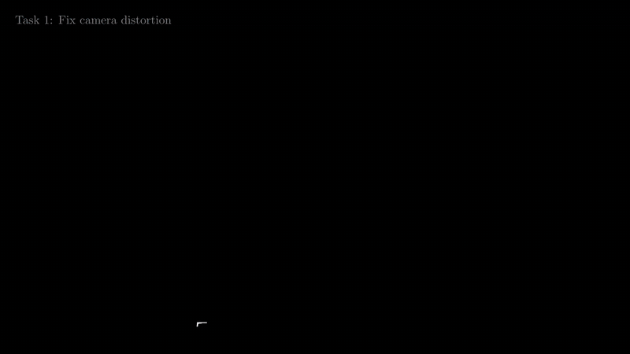
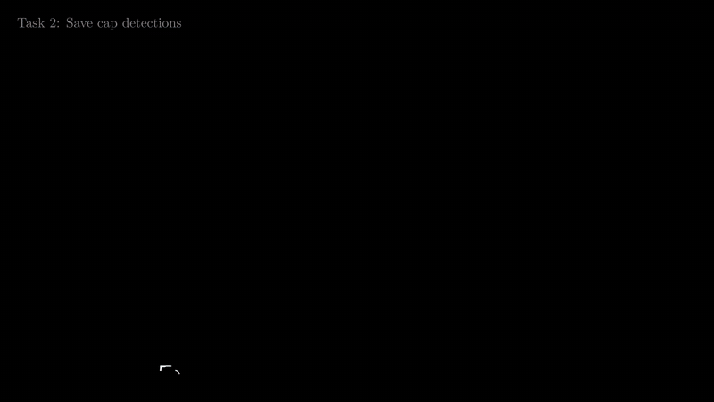
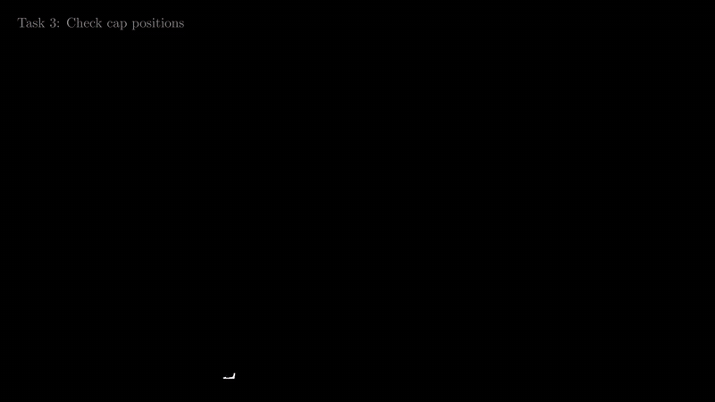
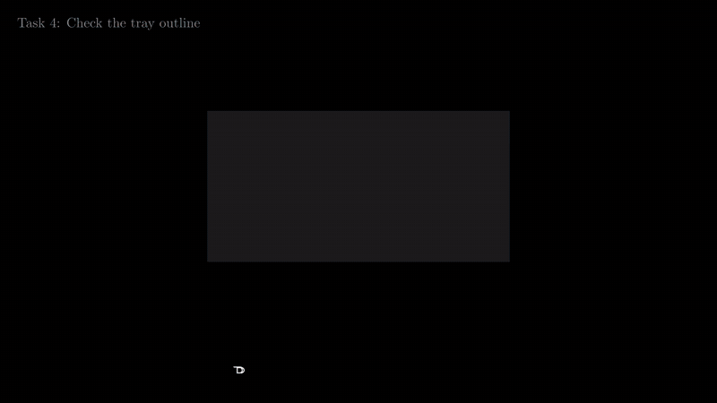
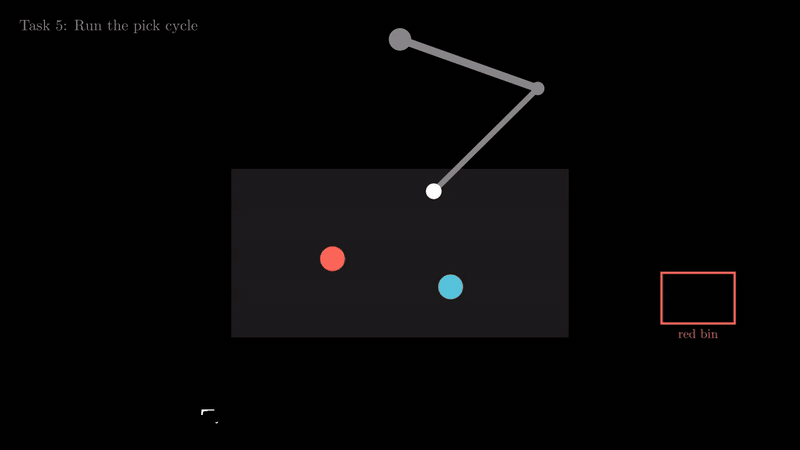

# Task Delegation

## How to use GitHub (every task)

| Word | Means |
| --- | --- |
| **Branch** | A separate line of work where you can make changes without changing the team's shared `main` branch. |
| **Commit** | A saved snapshot of your changes, accompanied by a short note. A commit is stored on your computer until you push it. |
| **Push** | Upload your commits from your computer to GitHub so the team can see them. |

For each task, the usual sequence is **make a branch → change files → commit your work → push the branch to GitHub**. This keeps unfinished work separate from the shared project and gives teammates a way to review it.

In the commands below, text inside angle brackets is a placeholder. Replace it with the value for your task, and leave out the angle brackets when you type the command.

| Replace | With | Example (Task 2) |
| --- | --- | --- |
| `<your-branch>` | your task's branch name (table below) | `task2-records` |
| `<your-files>` | the files you changed, with a space between them | `vision/records.py tests/test_records.py` |
| `<what you did>` | a short note | `write detection records` |

| Task | Your branch name |
| --- | --- |
| 1 Fix camera distortion | `task1-lens` |
| 2 Save cap detections | `task4-records` |
| 3 Check cap positions | `task5-position-test` |
| 4 Check the tray outline | `task6-outline-check` |
| 5 Run the pick cycle | `task7-pick-loop` |

The **How do I push?** section in each task lists the files and commands for that task. You can copy those commands after replacing any placeholders with your own values.

Enter Git and test commands in a terminal opened inside the project folder. In VS Code, you can open one from **Terminal → New Terminal**; check that the terminal is in the repository before running the commands.

### Step 1: Make your branch (once, at the start of your task)

```
git checkout main               # go to the team's copy
git pull                        # download the newest version of it
git checkout -b <your-branch>  # make your branch and switch to it
```

To confirm you switched branches, run `git branch`. The active branch has an asterisk (`*`) beside its name.

### Step 2: Work, then save (commit), as often as you like

Write your code in small steps. Whenever one part is working, check which files changed and save just the files for your task in a commit:

```
git status                                           # see which files you changed (red = not added yet)
git add <your-files>                         # pick the files to save
git commit -m "Task <number>: <what you did>" # save them, with a short note
```

It is useful to commit each time you finish a working piece. If a later change causes a problem, these earlier commits give you a clear point to return to.

### Step 3: Check the tests pass

```
python -m pytest tests/
```

If the test run finishes with all tests marked as passed, your changes have passed the current automated checks. If a test fails, read the failure message, fix the cause, and run the command again before committing the fix.

### Step 4: Upload (push)

First time on this branch:
```
git push -u origin <your-branch>
```
After that, just:
```
git push
```


### Keep your branch up to date

When teammates add changes to `main`, bring those changes into your branch so your work stays compatible with the shared project. You can do this when you start work or whenever you need the latest changes:

```
git checkout main            # go to the team's copy
git pull                     # download the newest version
git checkout <your-branch>   # back to your branch
git merge main               # add the new work into your branch
```

### Rules

- Keep your changes focused on the files assigned to your task. This reduces the chance that two people edit the same code at the same time.
- Make commits on your task branch, not on `main`. If you are unsure which branch is active, check with `git branch` before committing.
- Push your work regularly in small, working pieces so teammates can see progress and help if you get stuck.

### If something goes wrong

| You see | Do |
| --- | --- |
| `error: failed to push` / `rejected` | Someone changed the branch. Run `git pull`, then `git push` again. |
| `CONFLICT` after `git merge main` | 2 people changed the same lines. Don't guess → ask a teammate for help. |
| Committed on `main` by mistake | Don't push. Ask a teammate before doing anything. |
| `nothing to commit` | You didn't change anything, or forgot to save the file in your editor. |
| Not sure where you are | `git status` tells you the branch and changed files. |

---

## Task 1: Fix camera distortion



**What's wrong now?**
The camera lens can make straight lines appear curved, particularly near the edges of an image. This effect is called lens distortion. Because the vision system uses image locations to estimate where caps are, distortion can shift a cap's detected position and make the arm's target less accurate. ([Limitation 1](limitation.md#1-the-robot-cant-use-the-cameras-positions-yet))

**What's the idea?**
Take several photos of a checkerboard, moving and tilting it so it appears in different parts of the image. Since the checkerboard's shape is known, OpenCV can compare its expected straight grid with the photographed grid and estimate how the lens distorts the image. Save that estimate and use it to correct later photos from the same camera.

**What do I build?**
Build two functions. The first should use checkerboard photos to calculate the camera's distortion values and save them to a file. The second should load those saved values and use them to correct an input image.

**Do I need another task first?**
No.

**How do I test without the camera?**
Use OpenCV's sample checkerboard photos as input instead of taking pictures with the robot camera. This lets you check that the calibration function can find the board, calculate distortion values, save them, and use them to correct an image.

**How do I know it works?**
- The calibration reprojection error is below 1 pixel.
- Corrected images retain their original dimensions.
- Checkerboard lines near the image edges appear straighter after correction.

**How do I push?**
Branch `task1-lens`.
```
git add vision/lens.py tests/test_lens.py tests/fake_data/checkerboard
git commit -m "Task 1: lens calibration"
git push -u origin task1-lens
```

**What changes with the real camera?**
For the hardware check, print a checkerboard and attach it flat to a piece of cardboard so it does not bend while you take pictures. Capture 10–20 photos with the robot camera, changing the board's position and angle and making sure it appears near the edges of the image as well as in the center. Count the inner corners, where four squares meet, and set `PATTERN` to those counts. Save the resulting calibration in `vision/lens_calib.npz` and commit the file. The target reprojection error is below 1 pixel.

<details>
<summary><b>Code help</b> (click to open)</summary>

**File:** `vision/lens.py`
```python
PATTERN = (7, 6)   # inside corners (where 4 squares meet), not squares

def calibrate(photo_paths, save_path):
    """Checkerboard photos → lens numbers saved to save_path. Returns error in pixels."""

def undistort(img, calib_path="vision/lens_calib.npz"):
    """Picture → straightened picture."""
```

**Steps:**
1. Each photo: grey → `cv2.findChessboardCorners(gray, PATTERN)`. `False` → skip that photo.
2. Make the "perfect board" points (same for every photo):
   ```python
   board = np.zeros((PATTERN[0] * PATTERN[1], 3), np.float32)
   board[:, :2] = np.mgrid[0:PATTERN[0], 0:PATTERN[1]].T.reshape(-1, 2)
   ```
3. `err, K, dist, _, _ = cv2.calibrateCamera(boards, corners, gray.shape[::-1], None, None)`
4. Save: `np.savez(save_path, K=K, dist=dist)`. Return `err`.
5. `undistort`: `d = np.load(calib_path)` → `cv2.undistort(img, d["K"], d["dist"])`.

**Fake data:** download `left01.jpg` … `left14.jpg` from [opencv samples/data](https://github.com/opencv/opencv/tree/4.x/samples/data) into `tests/fake_data/checkerboard/`. They have `(7, 6)` inside corners. Some photos return `False`, that's fine.

**Test:** `tests/test_lens.py`
```python
import glob, cv2
from vision.lens import calibrate, undistort

PHOTOS = sorted(glob.glob("tests/fake_data/checkerboard/left*.jpg"))

def test_error_small(tmp_path):
    assert calibrate(PHOTOS, tmp_path / "calib.npz") < 1.0     # samples give ~0.5

def test_undistort_keeps_size(tmp_path):
    calibrate(PHOTOS, tmp_path / "calib.npz")
    img = cv2.imread(PHOTOS[0])
    assert undistort(img, tmp_path / "calib.npz").shape == img.shape
```

</details>

---

## Task 2: Save cap detections



**What's wrong now?**
The program currently prints detected positions to the screen periodically. Printed output is difficult to use later: it is not saved as structured data, and different parts of the system may not agree on the names or order of the values. The robot code also needs a consistent format it can read. ([Limitation 1](limitation.md#1-the-robot-cant-use-the-cameras-positions-yet))

**What's the idea?**
Represent every detected cap as a **record**, which is a structured collection of values such as its color, slot, position, and detection time. Use the field names agreed by the team so the robot code, tests, and people all interpret the values in the same way. Append each record as its own line in a **log file**, which makes it possible to inspect detections after a run.

**What do I build?**
Write one function that creates a record containing exactly the fields listed in [Limitation 1](limitation.md#1-the-robot-cant-use-the-cameras-positions-yet) under "How each position should be recorded." Write another function that appends the record to the log file, adding one line for each cap detected.

**What if the color isn't red, blue, or purple?**
If the program cannot identify a cap as red, blue, or purple, set its color field to `"unknown"`. An unknown color should stay visible in the log for later review, but the pick loop should not send that cap to a bin based on a guess.

**Do I need another task first?**
No earlier task is required. Because the records can be created from made-up values, this is a useful task to start with while other work is still underway.

**How do I test without the camera?**
Create a few sample records directly in your test code or in a fixture file. For example, you could make a record for a red cap assigned to slot B3 at x = 212.4 mm, y = -38.0 mm, and z = 96.0 mm. This lets you test logging without connecting the camera.

**How do I know it works?**
Write three sample records and check that the log contains exactly three lines. Read each line back and confirm that it contains all the required fields and no extra fields. Also check that an unsupported color, such as green, is stored as `"unknown"`.

**How do I push?**
Branch `task4-records`.
```
git add vision/records.py tests/test_records.py
git commit -m "Task 4: records + log"
git push -u origin task4-records
```

**What changes with the real camera?**
The record and logging functions do not need a special camera-specific implementation. When you begin creating logs during real runs, add the `logs/` folder to `.gitignore` so machine-generated run data does not accidentally get added to source code commits.

<details>
<summary><b>Code help</b> (click to open)</summary>

**File:** `vision/records.py`
```python
COLORS = ("red", "blue", "purple")

def make_record(frame, time_ms, color, color_confidence, xyz_mm, slot,
                error_mm, tray_xy_mm, calibration):
    """→ dict with exactly the fields from limitation.md. Unknown color → "unknown"."""

def write_log(record, path="logs/detections.jsonl"):
    """Add the record as 1 JSON line at the end of the file."""
```

**Steps:**
1. `make_record`: build the dict. Field names exactly: `frame, time_ms, slot, color, color_confidence, x_mm, y_mm, z_mm, error_mm, tray_x_mm, tray_y_mm, calibration`. Round mm to 1 decimal.
2. `write_log`: make the folder if missing, `open(path, "a")`, write `json.dumps(record) + "\n"`.

**Test:** `tests/test_records.py`
```python
import json
from vision.records import make_record, write_log

FIELDS = {"frame", "time_ms", "slot", "color", "color_confidence", "x_mm", "y_mm",
          "z_mm", "error_mm", "tray_x_mm", "tray_y_mm", "calibration"}

def fake(i, color="red"):
    return make_record(i, 1730000000000 + i * 33, color, 0.9, (212.4, -38.0, 96.0),
                       "B3", 3.0, (145.0, 80.5), "2026-10-26")

def test_log_lines(tmp_path):
    path = tmp_path / "log.jsonl"
    for i in range(3):
        write_log(fake(i), path)
    lines = path.read_text().splitlines()
    assert len(lines) == 3
    assert all(set(json.loads(line)) == FIELDS for line in lines)

def test_unknown_color():
    assert fake(0, "green")["color"] == "unknown"
```

</details>

---

## Task 3: Check cap positions



**What's wrong now?**
The earlier tasks check individual pieces of the system, but pieces that work on their own can still fail when connected together. For example, coordinate conversion, slot assignment, and record creation may use different assumptions about positions. This task checks the whole chain against known measurements. ([Limitation 1](limitation.md#1-the-robot-cant-use-the-cameras-positions-yet), "Done when")

**What's the idea?**
Place caps in slots whose locations are known, then process them through the complete system: detect each cap in the image, convert its pixel location into millimeters, decide which slot it belongs to, and create its record (Task 2). Compare the output coordinates and assigned slot with the known reference values. Save a table with one pass or fail result for each cap.

**What do I build?**
Write a function that compares the detection records with the reference measurements and produces one row of results for each cap. Then write a function that saves these rows to a CSV file, which can be opened and reviewed as a table.

**Do I need another task first?**
This test checks the record and position outputs together. Until the record task is ready, use clearly marked sample records, then replace them with the real implementation.

**How do I test without the camera?**
Create a reference CSV with nine slot names and their known coordinates. Use a known synthetic camera mapping to convert those positions into fake pixels. The pipeline should recover the expected coordinates and assign each cap to the correct slot.

**How do I know it works?**
With the fake data, all nine caps should pass when the accepted position error is set to 5 mm. To confirm that the check can also catch a problem, shift one cap's pixel by 40 pixels, which is about 10 mm in the example mapping. That cap should fail while the others continue to pass.

**How do I push?**
Branch `task5-position-test`.
```
git add vision/position_test.py tests/test_position_test.py tests/fake_data/ruler.csv
git commit -m "Task 5: full position test"
git push -u origin task5-position-test
```

**What changes with the real camera and arm?**
For the real-hardware check, place caps in at least nine slots distributed across the rack, including corners, edges, and the center. Use the measured slot map and tape-measure measurements as the reference. Save the results to `docs/results/position_test_<date>.csv`, replacing `<date>` with the test date. Limitation 1 is complete when every tested cap is within the team's agreed position tolerance and is assigned to the correct slot.

<details>
<summary><b>Code help</b> (click to open)</summary>

**File:** `vision/position_test.py`
```python
def compare(records, ruler, tolerance_mm):
    """→ 1 row per cap: slot, camera x/y, ruler x/y, error mm, right slot?, pass?"""

def save_table(rows, path):
    """Rows → CSV file."""
```

**Fake ruler:** `tests/fake_data/ruler.csv`, 9 slots spread over the rack:
```
slot,x_mm,y_mm
A1,200,-50
A6,200,50
D1,260,-50
...
```

**Fake cap pixels:** use a known camera mapping (`H_true`) to generate pixel coordinates:
```python
px = cv2.perspectiveTransform(np.float32([[[x_mm, y_mm]]]), H_true)[0][0]
```

**Test:** `tests/test_position_test.py`
- `tolerance_mm=5`
- All 9 rows pass.
- 1 pixel moved by 40 → that row fails.

</details>

---

## Task 4: Check the tray outline



**What's wrong now?**
The program finds the tray by detecting its dark outline and estimating the four corners. A cap, hand, or shadow near the edge can make one or more corners appear to be in the wrong place. Since later position calculations use those corners as a reference, a bad outline can shift the calculated location of every cap. ([Limitation 3](limitation.md#3-objects-near-the-trays-edge-can-bend-its-outline), also part of [Limitation 2](limitation.md#2-the-robot-arm-can-stop-the-camera-from-finding-the-tray))

**What's the idea?**
Keep the most recent outline that passed the checks. Each time a new outline is detected, compare its corners and shape with that trusted outline. If the corners have shifted only a little, classify it as **same** and continue using it. If all four corners have shifted together while the shape remains consistent, classify it as **moved**, accept the new outline, and warn the operator that the tray may have moved. If the corners shift unevenly or the shape changes, classify it as **bent**; this may mean something is covering the tray edge, so keep the previous trusted outline. Also wait for detections to become stable across several frames before trusting them, since a changing outline may mean something is still moving.

**What do I build?**
Build a function that compares a newly detected outline with the last trusted one and returns `"same"`, `"moved"`, or `"bent"`. Build a second function that examines the most recent five outlines and reports whether their corner positions are stable enough to use.

**What is an "outline" in the code?**
In this task, an outline is simply a list of four corner coordinates measured in image pixels. For example, `[(100, 80), (700, 80), (700, 380), (100, 380)]` gives the four corners of a rectangular tray in one image.

**Do I need another task first?**
No.

**How do I test without the camera?**
You can test the classification logic without a camera by creating outline coordinates yourself. Move all four corners by the same amount to represent a tray that has moved, or move only one corner to represent a distorted outline. You can also use OpenCV to draw a dark tray on a grey background, add a dark shape at one corner, and run the existing tray finder on the generated image before checking its outline.

**How do I know it works?**
Check several example cases: a 2-pixel change in the corners should be classified as `"same"`; a 40-pixel shift of all four corners should be `"moved"`; and a 40-pixel shift of just one corner should be `"bent"`. A generated image with a dark shape on a tray corner should also produce a `"bent"` result. Finally, a sequence of outlines that jumps back and forth should be reported as not stable.

**How do I push?**
Branch `task6-outline-check`.
```
git add vision/outline_check.py tests/test_outline_check.py
git commit -m "Task 6: outline check"
git push -u origin task6-outline-check
```

**What changes with the real camera?**
For the camera check, place a cap at each tray corner and a dark object against each side, confirming that each obstruction is classified as `"bent"`. Slide the tray by 3 cm and confirm that the new outline is classified as `"moved"`. Then move a cap across the tray edge while capturing frames and confirm that outlines are not trusted until they become stable. Limitation 3 is complete when these checks work with the real tray and camera.

<details>
<summary><b>Code help</b> (click to open)</summary>

**File:** `vision/outline_check.py`
```python
def check_outline(new, last_good, ref_ratio, drift_px=10, shape_pct=10):
    """2 outlines (4 corners each, pixels) → "same", "moved" or "bent"."""

def is_still(recent_outlines, drift_px=10):
    """Last 5 outlines → True if none moved more than drift_px from the one before."""
```
- `ref_ratio` = long side ÷ short side of a clean outline at start, in pixels. (Not the real tray's mm: the camera angle changes the shape.)
- `drift_px`, `shape_pct`: final values from [numbers to agree on](limitation.md#numbers-to-agree-on).

**Steps:**
1. Shape: long ÷ short side of `new` (average the 2 opposite sides). Differs from `ref_ratio` by more than `shape_pct` % → `"bent"`.
2. How far each corner moved vs `last_good`. All ≤ `drift_px` → `"same"`.
3. All 4 corners moved about the same way (differences ≤ `drift_px`) → `"moved"`. Otherwise → `"bent"`.

**Fake data:**
```python
import numpy as np, cv2
from vision.tray_object_pipeline import tray_quad

GOOD = np.float32([[100, 80], [700, 80], [700, 380], [100, 380]])   # ratio 2.0
ARGS = (0, 179, 0, 0, 130, 85, 0.04, 9)                              # pipeline defaults

def picture():
    img = np.full((480, 800, 3), 160, np.uint8)                   # grey table
    cv2.rectangle(img, (100, 80), (700, 380), (30, 30, 30), -1)   # black tray
    return img
```

**Test:** `tests/test_outline_check.py`
```python
def test_same():  assert check_outline(GOOD + 2, GOOD, 2.0) == "same"
def test_moved(): assert check_outline(GOOD + 40, GOOD, 2.0) == "moved"

def test_bent():
    new = GOOD.copy(); new[1] += (40, -20)
    assert check_outline(new, GOOD, 2.0) == "bent"

def test_dark_blob_on_corner():               # tray_quad moves that corner ~40 px
    img = picture()
    cv2.circle(img, (700, 80), 40, (40, 40, 40), -1)
    new, _ = tray_quad(img, *ARGS)
    assert check_outline(new, GOOD, 2.0) == "bent"

def test_not_still():
    assert not is_still([GOOD, GOOD + 15, GOOD, GOOD + 15, GOOD])
    assert is_still([GOOD] * 5)
```

</details>

---

## Task 5: Run the pick cycle



**What's wrong now?**
The arm can appear in the camera image while the vision system is trying to locate the tray. A dark part of the arm may blend into the tray's dark outline and make the tray difficult to detect. A light part of the arm that covers a tray corner may cause the corner to be placed incorrectly. ([Limitation 2](limitation.md#2-the-robot-arm-can-stop-the-camera-from-finding-the-tray))

**What's the idea?**
The loop should take each picture only after the arm has moved to a parked position outside the camera's view. During each cycle, first park the arm and capture an image. Find the tray and check its outline using Task 6. If the outline is bent, skip that cycle and wait for a usable image; if it has moved, warn the operator. When the outline is acceptable, find the caps, move to one, pick it up, and drop it into the appropriate bin. Then repeat the cycle until the requested number of picks is complete or no caps remain.

**What do I build?**
Implement the cycle in one function that receives the arm, camera, and functions for finding the tray, finding caps, and checking the outline. Passing these parts into the function makes it possible for tests to substitute fake hardware and simple test functions, while the real run can provide the actual camera and arm controls.

**Do I need another task first?**
The real pick loop should use the outline check from Task 6. You can start testing the rest of the loop before that task is finished by passing in a temporary check function that always returns `"same"`. Replace the temporary function with the real check when it is ready.

**How do I test without the arm?**
Create a fake arm whose methods only add commands such as `park`, `move`, and `pick` to a list; it should not move any hardware. Create a fake camera that returns saved images one at a time. Together, these fakes let you inspect the order of actions without connecting to the robot.

**How do I know it works?**
For a valid cap, check that the loop parks the arm, captures an image, checks the outline, and then commands the arm to move, pick, and drop the cap. Confirm that the arm is parked again when the loop finishes. If the outline check returns `"bent"`, the loop must skip picking during that cycle. If it returns `"moved"`, the loop should issue a warning so the operator knows the tray position may have changed.

**How do I push?**
Branch `task7-pick-loop`.
```
git add vision/pick_loop.py tests/test_pick_loop.py
git commit -m "Task 7: pick loop"
git push -u origin task7-pick-loop
```

**What changes with the real arm?**
For the real hardware, create an arm adapter that implements the four commands used by the loop—`park`, `move_to`, `pick`, and `drop`—and connects them to the arm controller. Cover any arm parts that enter the camera's view with light, matte tape, such as white or light grey tape, to make them easier to distinguish from the tray. Test the loop by parking the arm and sliding the tray, then confirm that the next image causes a movement warning. Put the arm over a tray corner and confirm that the system retains its last trusted outline, and check that arm parts are not classified as caps. Limitation 2 is complete when these checks pass.

<details>
<summary><b>Code help</b> (click to open)</summary>

**File:** `vision/pick_loop.py`
```python
def run(arm, camera, find_tray, find_caps, check, picks=10):
    """The loop. Everything comes in as arguments → easy to fake."""
```

**Loop, in pseudo-code:**
```
repeat picks times:
    arm.park()
    picture = camera.picture()
    outline = find_tray(picture)
    result = check(outline, last_good)
    "bent"  → print "tray covered, waiting", skip this round
    "moved" → print "WARNING: tray moved"
    last_good = outline
    caps = find_caps(picture, outline)        # list of (x, y, z, color)
    no caps → stop
    arm.move_to(x, y, z) → arm.pick() → arm.drop(color)
arm.park()
```

**Fake arm + camera:**
```python
class FakeArm:
    def __init__(self):           self.log = []
    def park(self):               self.log.append("park")
    def move_to(self, x, y, z):   self.log.append("move")
    def pick(self):               self.log.append("pick")
    def drop(self, color):        self.log.append("drop " + color)

class FakeCamera:
    def __init__(self, pictures): self.pictures = list(pictures)
    def picture(self):            return self.pictures.pop(0)
```
Later also: drawn pictures (see Task 6) with a light grey "arm" over a corner: `cv2.rectangle(img, (640, 0), (760, 120), (200, 200, 200), -1)`.

**Test:** `tests/test_pick_loop.py`
```python
from vision.pick_loop import run

def go(answers):
    arm, camera = FakeArm(), FakeCamera([None] * len(answers))
    answers = iter(answers)
    run(arm, camera,
        find_tray=lambda img: "outline",
        find_caps=lambda img, outline: [(200, 0, 96, "red")],
        check=lambda new, last: next(answers),
        picks=3)
    return arm.log

def test_bent_means_no_pick():
    assert go(["same", "bent", "same"]) == [
        "park", "move", "pick", "drop red",
        "park",                                  # bent → no pick
        "park", "move", "pick", "drop red",
        "park"]

def test_moved_warns(capsys):
    go(["same", "moved", "same"])
    assert "moved" in capsys.readouterr().out
```

</details>
