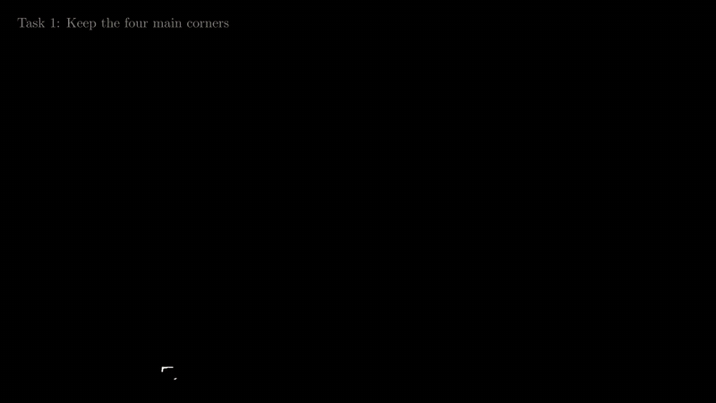
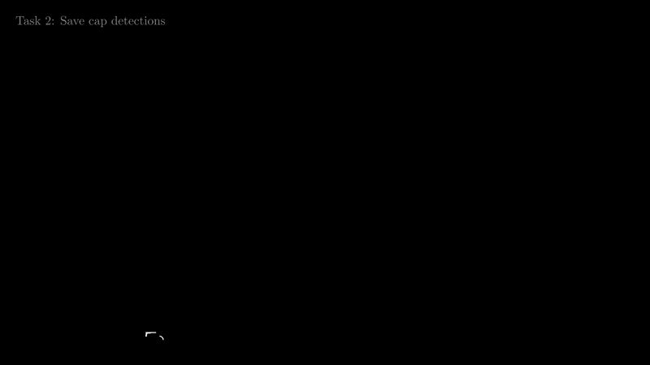
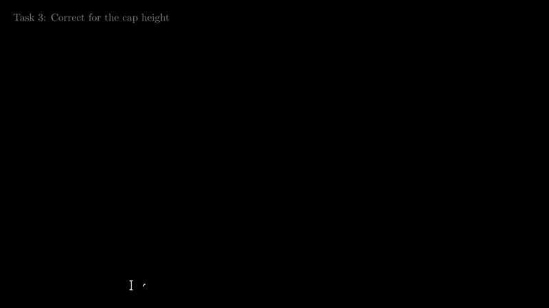
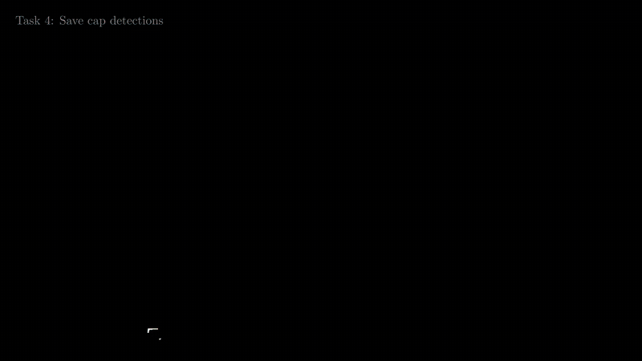

# Task Delegation

## How to use GitHub (every task)

| Word | Means |
| --- | --- |
| **Branch** | A separate line of work where you can make changes without changing the team's shared `main` branch. |
| **Commit** | A saved snapshot of your changes, accompanied by a short note. A commit is stored on your computer until you push it. |
| **Push** | Upload your commits from your computer to GitHub so the team can see them. |

For each task, the usual sequence is **make a branch → change files → commit your work → push the branch to GitHub**. This keeps unfinished work separate from the shared project and gives teammates a way to review it.

In the commands below, text inside angle brackets is a placeholder. Replace it with the value for your task, and leave out the angle brackets when you type the command.

| Replace | With | Example (Task 4) |
| --- | --- | --- |
| `<your-branch>` | your task's branch name (table below) | `task4-records` |
| `<your-files>` | the files you changed, with a space between them | `vision/records.py tests/test_records.py` |
| `<what you did>` | a short note | `write detection records` |

| Task | Your branch name |
| --- | --- |
| 1 Keep the tray's four main corners | `task1-corners` |
| 2 Calibrate the cap colors | `task2-colors` |
| 3 Correct the cap positions for their height | `task3-height` |
| 4 Save cap detections | `task4-records` |

The **How do I push?** section in each task lists the files and commands for that task. You can copy those commands after replacing any placeholders with your own values.

Enter Git and test commands in a terminal opened inside the project folder. In VS Code, you can open one from **Terminal → New Terminal**; check that the terminal is in the repository before running the commands.

### Step 1: Make your branch (once, at the start of your task)

```
git checkout main               # go to the team's copy
git pull                        # download the newest version of it
git checkout -b <your-branch>  # make your branch and switch to it
```

To confirm you switched branches, run `git branch`. The active branch has an asterisk (`*`) beside its name.

### Step 2: Work, then save (commit), as often as you like

Write your code in small steps. Whenever one part is working, check which files changed and save just the files for your task in a commit:

```
git status                                           # see which files you changed (red = not added yet)
git add <your-files>                         # pick the files to save
git commit -m "Task <number>: <what you did>" # save them, with a short note
```

It is useful to commit each time you finish a working piece. If a later change causes a problem, these earlier commits give you a clear point to return to.

### Step 3: Check the tests pass

```
python -m pytest tests/
```

If the test run finishes with all tests marked as passed, your changes have passed the current automated checks. If a test fails, read the failure message, fix the cause, and run the command again before committing the fix.

### Step 4: Upload (push)

First time on this branch:
```
git push -u origin <your-branch>
```
After that, just:
```
git push
```


### Keep your branch up to date

When teammates add changes to `main`, bring those changes into your branch so your work stays compatible with the shared project. You can do this when you start work or whenever you need the latest changes:

```
git checkout main            # go to the team's copy
git pull                     # download the newest version
git checkout <your-branch>   # back to your branch
git merge main               # add the new work into your branch
```

### Rules

- Keep your changes focused on the files assigned to your task. This reduces the chance that two people edit the same code at the same time.
- Make commits on your task branch, not on `main`. If you are unsure which branch is active, check with `git branch` before committing.
- Push your work regularly in small, working pieces so teammates can see progress and help if you get stuck.

### If something goes wrong

| You see | Do |
| --- | --- |
| `error: failed to push` / `rejected` | Someone changed the branch. Run `git pull`, then `git push` again. |
| `CONFLICT` after `git merge main` | 2 people changed the same lines. Don't guess → ask a teammate for help. |
| Committed on `main` by mistake | Don't push. Ask a teammate before doing anything. |
| `nothing to commit` | You didn't change anything, or forgot to save the file in your editor. |
| Not sure where you are | `git status` tells you the branch and changed files. |

---

## Task 1: Keep the tray's four main corners



**What's wrong now?**
A thin dark thing touching the tray, like a cable or a shadow, shows up as a spike in the "Tray threshold" window. The spike counts as an extra corner. The four-corner check fails, so the program falls back to a bigger rectangle around everything. The outline is too big, and if it locks like this, every cap's (u, v) is measured against the wrong outline. ([Limitation 1](limitation.md#1-a-thin-object-can-make-the-tray-outline-wrong))

**What's the idea?**
Look at the outline of the white area (its convex hull, the shape you get by stretching a rubber band around it). While it has more than four corners, remove the one that sticks out the least. How much a corner sticks out is the area of the triangle it makes with its two neighbors. A spike is thin, so its triangle is small and it goes first. The four real corners are big triangles, so they stay.

**What do I build?**
One new function, `four_main_corners(hull)`, in `vision/tray.py`. It takes the hull and returns four corners. Then use it in `find_tray_corners` instead of the `approxPolyDP` step. The function's arguments and return values stay the same, so nothing else changes.

**Do I need another task first?**
No.

**How do I test without the camera?**
Draw a black tray as a four-sided shape on a grey table, as if seen from an angle. Add a thin cable, a thick object and a dark blob touching an edge. Check the corners against the true corners.

**How do I know it works?**
- A clean tray gives corners within 3 pixels of the true ones.
- A thin cable, a thicker object and a blob on an edge all give corners within 3 pixels of the true ones.
- All the tests in `tests/` still pass.
- It does **not** fix an object sitting on a corner. The corner really moves.

**How do I push?**
Branch `task1-corners`.
```
git add vision/tray.py tests/test_tray_corners.py
git commit -m "Task 1: keep the four main corners"
git push -u origin task1-corners
```

**What changes with the real camera?**
Run the program with the real cable in view. Look at the "Tray threshold" window: the spike is still there, but in "Camera / tray localization" the outline should hug the tray. Press `r` and check again after it locks. Compare the corners before and after the change, and write down the corner error you measured.

<details>
<summary><b>Code help</b> (click to open)</summary>

**File:** `vision/tray.py`
```python
def four_main_corners(hull):
    """Reduce a convex outline (from cv2.convexHull) to its 4 most important corners."""
```

**Steps:**
1. Make a list of the hull's points: `points = [tuple(p) for p in hull.reshape(-1, 2).astype(np.float64)]`.
2. `while len(points) > 4:`
   - For each point, work out the triangle area with its neighbors `before = points[i - 1]` and `after = points[(i + 1) % len(points)]`:
     `abs((x - bx) * (ay - by) - (ax - bx) * (y - by)) / 2`
   - `del points[...]` the one with the smallest area (`np.argmin`).
3. Return `np.array(points, dtype=np.float32).reshape(-1, 1, 2)`.
4. In `find_tray_corners`, replace these lines (the `perimeter`, `simplified` and `if len(simplified) == 4 ...` lines):
   ```python
   perimeter = cv2.arcLength(hull, True)
   simplified = cv2.approxPolyDP(hull, 0.04 * perimeter, True)
   if len(simplified) == 4 and cv2.isContourConvex(simplified):
       corners = order_corners(simplified)
   ```
   with:
   ```python
   simplified = four_main_corners(hull)
   if cv2.contourArea(simplified) >= 0.9 * cv2.contourArea(hull):
       corners = order_corners(simplified)
   ```
   Keep the `elif rectangularity >= 0.58:` fallback after it. The new check keeps the four corners only if they still cover at least 90% of the hull. If not, the shape is not a tray, and the old fallback decides.

**Fake data and test:** `tests/test_tray_corners.py`
```python
import numpy as np, cv2
from vision.tray import find_tray_corners

TRUE = np.float32([[150, 90], [650, 90], [720, 380], [80, 380]])   # a tray seen at an angle
ARGS = (0, 179, 0, 0, 130, 85, 0.04, 9)                              # pipeline defaults
DARK = (30, 30, 30)

def picture():
    img = np.full((480, 800, 3), 160, np.uint8)                      # grey table
    cv2.fillConvexPoly(img, TRUE.astype(np.int32), DARK)             # black tray
    return img

def corner_error(img):
    corners, _ = find_tray_corners(img, *ARGS)
    assert corners is not None
    return float(np.abs(corners - TRUE).max())

def test_clean_tray():
    assert corner_error(picture()) < 3

def test_thin_cable():
    img = picture()
    cv2.rectangle(img, (400, 20), (406, 100), DARK, -1)              # 6 pixels wide, sticks up 70
    assert corner_error(img) < 3

def test_thick_object():
    img = picture()
    cv2.rectangle(img, (400, 60), (430, 100), DARK, -1)
    assert corner_error(img) < 3

def test_blob_on_the_top_edge():
    img = picture()
    cv2.circle(img, (300, 90), 20, DARK, -1)
    assert corner_error(img) < 3
```

</details>

---

## Task 2: Calibrate the cap colors



**What's wrong now?**
The color ranges for red, blue and purple were set by eye. A cap slightly outside a range is missed or breaks into specks. When the lights, the camera or the caps change, someone has to edit the code and guess again. ([Limitation 2](limitation.md#2-cap-colors-were-set-by-eye))

**What's the idea?**
Measure the real caps. Show the straightened tray. Click on a cap, and the program reads the pixels around the click. Do this a few times for each color. The program works out the hue, saturation and brightness range that covers all the clicked pixels, and saves the ranges in a file. The pipeline loads the file when it starts.

**What do I build?**
- A function that takes a picture and some clicked points and returns the color range that covers them.
- Functions that save and load the ranges as a JSON file. Loading gives today's ranges if the file is missing.
- A small tool with a window: press `r`, `b` or `p` to choose the color, click on caps, press `s` to save.
- A change in `make_color_masks` so it uses the ranges.

**Do I need another task first?**
No. It works best after Task 1, so the straightened tray is a good one.

**How do I test without the camera?**
Draw a picture with a black tray and three caps with known colors, with a little random noise. "Click" by giving points inside each cap. The measured ranges must cover the cap, and must not cover the tray or the other caps.

**How do I know it works?**
- Each measured range covers at least 95% of its own cap.
- It covers none of the tray and none of the other caps.
- Red works even though it sits at both ends of the hue scale (a range like 176 to 179 and 0 to 9).
- The pipeline finds the caps when it uses the measured ranges.
- With no file, the pipeline behaves exactly as before.

**How do I push?**
Branch `task2-colors`.
```
git add vision/calibrate_colors.py vision/caps.py tests/test_colors.py
git commit -m "Task 2: calibrate cap colors"
git push -u origin task2-colors
```

**What changes with the real camera?**
Put the real caps on the real tray in the real lights. Run `python vision/calibrate_colors.py --camera-index 0`. For each color, click at least five places on the caps, including the shaded side. Press `s`. Then run the pipeline and watch the windows: every cap found, and no false caps on an empty tray for one minute. **A teammate must read the saved numbers before they are used**, because the color ranges decide what counts as a cap. Commit `vision/colors.json`. Run the tool again whenever the lights, the camera or the caps change.

<details>
<summary><b>Code help</b> (click to open)</summary>

**File:** `vision/calibrate_colors.py`
```python
def measure_color(straight_tray_bgr, points, radius=6, margin=4):
    """Picture + clicked points → {"hue": [[low, high], ...], "min_saturation": n, "min_value": n}."""

def save_colors(ranges, path="vision/colors.json"): ...
def load_colors(path="vision/colors.json"):
    """{"red": ..., "blue": ..., "purple": ...}, or None if the file is missing."""
```

**Steps:**
1. `measure_color`: convert to HSV (`cv2.cvtColor(..., cv2.COLOR_BGR2HSV)`). For each point take the pixels inside a disk of `radius`. Put all pixels in one list.
2. Hue is a circle. Red is near 0 **and** near 179, so a plain minimum and maximum would give 0 to 179. Move the hue first: `shifted = (hue + 90) % 180`. Now red sits in the middle. Take the 2nd and 98th percentile (`np.percentile`), add the `margin`, and move it back: `(value - 90) % 180`. If the low end is bigger than the high end, the range wraps: save it as two ranges, `[0, high]` and `[low, 179]`.
3. `min_saturation`: the 2nd percentile of the saturation minus `margin * 2`. Same for `min_value`.
4. `save_colors` / `load_colors`: a JSON file with the three colors.
5. In `vision/caps.py`: `make_color_masks` gets an optional `color_ranges` argument. If it is `None`, use `load_colors()`. If that is also `None` (no file), run today's code exactly as it is: it has extra rules that a plain range cannot say, such as strongly colored pixels in the hue band 165-176 counting as red and not purple. Only when ranges are given, build each mask with `cv2.inRange` for every hue range, and join them with `cv2.bitwise_or`.
6. The tool (`if __name__ == "__main__":`): open the camera, find and straighten the tray (use `TrayCapPipeline` and `straighten_tray`), show the straightened tray, and use `cv2.setMouseCallback` to collect clicks for the chosen color.

**Fake data and test:** `tests/test_colors.py`
```python
import numpy as np, cv2
from vision.calibrate_colors import measure_color
from vision.caps import make_color_masks

TRUE = {"red": (2, 200, 200), "blue": (108, 200, 180), "purple": (150, 110, 170)}   # hue, saturation, brightness
CENTERS = {"red": (100, 150), "blue": (300, 150), "purple": (500, 150)}

def picture():
    rng = np.random.default_rng(1)
    img = np.zeros((300, 600, 3), np.uint8)
    img[:] = cv2.cvtColor(np.uint8([[[0, 0, 30]]]), cv2.COLOR_HSV2BGR)[0, 0]       # black tray
    for name, (x, y) in CENTERS.items():
        h, s, v = TRUE[name]
        patch = np.zeros((60, 60, 3), np.uint8)
        patch[..., 0] = np.clip(h + rng.integers(-3, 4, (60, 60)), 0, 179)
        patch[..., 1] = np.clip(s + rng.integers(-15, 16, (60, 60)), 0, 255)
        patch[..., 2] = np.clip(v + rng.integers(-15, 16, (60, 60)), 0, 255)
        img[y - 30:y + 30, x - 30:x + 30] = cv2.cvtColor(patch, cv2.COLOR_HSV2BGR)
    return img

def clicks(name):
    x, y = CENTERS[name]
    return [(x + dx, y + dy) for dx, dy in ((0, 0), (10, 5), (-10, 8), (5, -10))]

def test_measured_ranges_find_the_caps():
    img = picture()
    ranges = {name: measure_color(img, clicks(name)) for name in CENTERS}
    masks, _, _ = make_color_masks(img, 70, 45, color_ranges=ranges)
    for name, (x, y) in CENTERS.items():
        assert masks[name][y - 30:y + 30, x - 30:x + 30].mean() > 0.95 * 255   # its own cap
        assert masks[name][:40, :40].max() == 0                                # the tray
        for other, (ox, oy) in CENTERS.items():
            if other != name:
                assert masks[name][oy - 30:oy + 30, ox - 30:ox + 30].max() == 0

def test_red_wraps_around():
    img = picture()
    assert len(measure_color(img, clicks("red"))["hue"]) == 2                  # [0, 9] and [176, 179]
```

</details>

---

## Task 3: Correct the cap positions for their height



**What's wrong now?**
The program straightens the picture using the tray's four corners. That is exact for things lying on the tray, but our caps sit on tubes, tens of millimeters above it. The camera sees a raised cap pushed away from the middle of the picture, so its (u, v) are wrong by up to tens of millimeters near the edges. ([Limitation 3](limitation.md#3-a-cap-above-the-tray-is-measured-in-the-wrong-place))

**What's the idea?**
All our caps are at the same height, so they all have the same kind of error. Measure it once. Put one cap in each of at least 4 rack slots whose real positions you measured with a ruler. For each slot, read the (u, v) the program reports. Then `cv2.findHomography` finds the one correction that turns every reported position into the real one. Save it, and apply it to every cap.

**What do I build?**
- A function that fits the correction from "reported" and "real" positions.
- A function that applies the correction to one (u, v).
- Functions that save and load the correction.
- A small tool that walks you through the slots and saves the result.
- A change in `TrayCapPipeline`: apply the correction to the (u, v) of every cap, and add a `--correction-file` flag.

**Do I need another task first?**
No. It helps to have Task 1 done, so the tray corners are good.

**How do I test without the camera?**
Make up the "reported" positions: take real positions on a grid, and push them away from the middle of the picture, like a raised cap would be. Calibrate with 4 of them, and check that all 9 grid positions come out right.

**How do I know it works?**
- Calibrating with 4 marks gives every one of the 9 grid positions within 0.002 (0.2% of the tray).
- Fewer than 4 marks gives a clear error message.
- Save then load gives the same correction, and a missing file gives `None`.
- With a correction file, the pipeline's (u, v) change as expected. With no file, nothing changes.
- All the other tests in `tests/` still pass.

**How do I push?**
Branch `task3-height`.
```
git add vision/height_fix.py vision/calibrate_height.py vision/tray_object_pipeline.py tests/test_height_fix.py tests/test_frame_pipeline.py
git commit -m "Task 3: correct cap positions for height"
git push -u origin task3-height
```

**What changes with the real camera?**
- Measure the tray's width and depth, and the real position of at least 4 rack slots (corners included). For each slot: millimeters from the tray's top-left corner, divided by the tray's width for `u` and by its depth for `v`.
- Run `python vision/calibrate_height.py --camera-index 0 --real 0.15,0.15 0.85,0.15 0.85,0.85 0.15,0.85` with your own numbers. It asks you to put **one** cap in each slot, one at a time.
- It prints how far each slot is off after the fix. Then test with caps in 9 or more other slots, and compare with the ruler. The pass number is the position error you agreed on in [Numbers to agree on](limitation.md#numbers-to-agree-on).
- Commit `vision/cap_height.json`. If the tubes change length, calibrate again.

<details>
<summary><b>Code help</b> (click to open)</summary>

**File:** `vision/height_fix.py`
```python
import json
import cv2
import numpy as np

def fit_correction(measured, real):
    """Two lists of (u, v), same length (at least 4) → 3 x 3 matrix."""

def apply_correction(matrix, u, v):
    """(u, v) → corrected (u, v)."""

def save_correction(matrix, path="vision/cap_height.json"): ...
def load_correction(path="vision/cap_height.json"):
    """3 x 3 matrix, or None if the file is missing or broken."""
```

**Steps:**
1. `fit_correction`: if there are fewer than 4 pairs, `raise ValueError("need at least 4 marks")`. Then `matrix, _ = cv2.findHomography(np.float32(measured), np.float32(real))`.
2. `apply_correction`: `cv2.perspectiveTransform(np.float32([[[u, v]]]), matrix)[0, 0]`. Return two floats.
3. `save_correction`: `json.dump({"matrix": matrix.tolist()}, f)`. `load_correction`: catch `OSError`, `ValueError`, `KeyError`, and return `None`.
4. In `TrayCapPipeline.__init__`:
   ```python
   self.correction = load_correction(args.correction_file) if args.correction_file else None
   ```
   Import `load_correction` the way `vision/tray_object_pipeline.py` imports its other modules (try `from .height_fix import ...`, and if that fails, `from height_fix import ...`).
5. In `process_frame`, right after `objects = self.object_tracker.update(detections)`:
   ```python
   if self.correction is not None:
       fixed = []
       for obj in objects:
           u, v = apply_correction(self.correction, obj["u"], obj["v"])
           fixed.append(dict(obj, u=u, v=v))
       objects = fixed
   ```
6. In `parse_args`: `--correction-file`, default `"vision/cap_height.json"` (an empty value turns it off).
7. The tool `vision/calibrate_height.py`:
   - flags: `--camera-index`, `--url`, `--transport` (like the main program), and `--real` with one or more `u,v` values
   - make `TrayCapPipeline(parse_args([... "--correction-file", ""]))`
   - for each real position: `input("Put ONE cap in slot ... and press Enter")`, then feed frames for 2 seconds and take the **median** of the cap's (u, v). If there is not exactly one cap, say so and ask again.
   - call `fit_correction`, print for each slot how far it is off after the fix, and call `save_correction`
8. The pipeline tests in `tests/test_frame_pipeline.py` should not depend on a real file. In that file, replace every `parse_args([])` with `parse_args(["--correction-file", ""])`.

**Test:** `tests/test_height_fix.py`
```python
import numpy as np, cv2
import pytest
from vision.height_fix import fit_correction, apply_correction, save_correction, load_correction
from vision.tray_object_pipeline import TrayCapPipeline, parse_args

GRID = [(a, b) for a in (0.15, 0.5, 0.85) for b in (0.15, 0.5, 0.85)]
MARKS = [(0.15, 0.15), (0.85, 0.15), (0.85, 0.85), (0.15, 0.85)]

def reported(u, v):
    """What the pipeline reports for a cap on a tube: pushed away from the middle (0.5, 0.5)."""
    return 0.5 + (u - 0.5) * 1.18 + 0.01, 0.5 + (v - 0.5) * 1.12 - 0.015

def test_four_marks_fix_every_position():
    matrix = fit_correction([reported(*m) for m in MARKS], MARKS)
    for u, v in GRID:
        fixed_u, fixed_v = apply_correction(matrix, *reported(u, v))
        assert abs(fixed_u - u) < 0.002 and abs(fixed_v - v) < 0.002

def test_too_few_marks():
    with pytest.raises(ValueError):
        fit_correction([(0.1, 0.1)] * 3, [(0.1, 0.1)] * 3)

def test_save_and_load(tmp_path):
    matrix = fit_correction([reported(*m) for m in MARKS], MARKS)
    save_correction(matrix, tmp_path / "fix.json")
    assert np.allclose(load_correction(tmp_path / "fix.json"), matrix)
    assert load_correction(tmp_path / "missing.json") is None

def picture():
    img = np.full((480, 800, 3), 160, np.uint8)
    cv2.rectangle(img, (100, 80), (700, 380), (30, 30, 30), -1)
    cv2.circle(img, (300, 230), 30, (40, 40, 220), -1)                    # a red cap
    return img

def first_cap_u(flags):
    pipeline = TrayCapPipeline(parse_args(flags))
    now, result = 0.0, None
    while now < 3.0:
        result = pipeline.process_frame(picture(), now)
        now += 0.1
    return result.objects[0]["u"]

def test_pipeline_applies_the_correction(tmp_path):
    shift = np.array([[1, 0, 0.1], [0, 1, 0], [0, 0, 1]], np.float64)      # moves every u by +0.1
    save_correction(shift, tmp_path / "fix.json")
    plain = first_cap_u(["--correction-file", ""])
    fixed = first_cap_u(["--correction-file", str(tmp_path / "fix.json")])
    assert abs(fixed - plain - 0.1) < 0.001
```

</details>

---

## Task 4: Save cap detections



**What's wrong now?**
When the program finds a cap, it only **shows** it: a line on the screen. Screen lines scroll away, and nothing is saved. After a run we can't ask "where was the red cap at frame 1042?" or compare the camera's numbers with a ruler. ([Limitation 4](limitation.md#4-detections-are-not-saved))

**What's the idea?**
Two small ideas:
1. A **record** is a short "card" with the facts about **one** cap. Every card has the same facts, with the same names, in the same order. So the code, the tests and your teammates all read it the same way.
2. A **log file** is a notebook. Each card is written as **one line** at the **end** of the notebook. We never erase a line, we only add new ones at the end. Later you can open the notebook and read what happened.

In Python, a card is a `dict`. A line in the log is that dict written as text (this text format is called JSON). For example, this card:

```python
{"frame": 1042, "time_ms": 1730000123456, "color": "red", "u": 0.412, "v": 0.688,
 "center_x": 206.0, "center_y": 151.4, "box": [190, 135, 32, 33], "area": 780}
```

becomes this one line in the log file (it is the same text, on one line):

```
{"frame": 1042, "time_ms": 1730000123456, "color": "red", "u": 0.412, "v": 0.688, "center_x": 206.0, "center_y": 151.4, "box": [190, 135, 32, 33], "area": 780}
```

**What are the facts on a card?**

| Name | What it means | Example |
| --- | --- | --- |
| `frame` | Which camera picture this cap was found in | `1042` |
| `time_ms` | When that picture was taken (milliseconds) | `1730000123456` |
| `color` | `"red"`, `"blue"`, `"purple"`, or `"unknown"` | `"red"` |
| `u` | How far across the tray the cap is (0 = left edge, 1 = right edge) | `0.412` |
| `v` | How far down the tray the cap is (0 = top edge, 1 = bottom edge) | `0.688` |
| `center_x`, `center_y` | The cap's middle, in pixels | `206.0`, `151.4` |
| `box` | The box around the cap: x, y, width, height in pixels | `[190, 135, 32, 33]` |
| `area` | How big the cap looks, in pixels | `780` |

**What do I build?**
Two small functions in a new file:
- `make_record(frame, time_ms, obj)`: takes **one** cap that the pipeline found (`obj`) and returns its card (the dict above).
- `write_log(record, path)`: adds the card as **one line** at the end of the log file.

Where does `obj` come from? The pipeline gives a list of caps in `result.objects`. Each item of that list is one `obj`.

**What if the color isn't red, blue, or purple?**
The pipeline only reports these 3 colors today. But if `color` is anything else, write `"unknown"` on the card. Don't throw the cap away: the log keeps it, so a person can look at it later.

**Do I need another task first?**
No. You can build and test everything with made-up caps, so you can start right away.

**How do I test without the camera?**
Write a fake cap by hand in your test, in the same shape the pipeline gives: `color`, `u`, `v`, `center_x`, `center_y`, `box`, `area`. For example, a red cap at `u = 0.412` and `v = 0.688`. You don't need a camera or OpenCV.

**How do I know it works?**
- Write 3 cards. Open the log file: it has exactly 3 lines.
- Read each line back. It has every name from the table, and no extra names.
- A cap with color `"green"` is written as `"unknown"`.

**How do I push?**
Branch `task4-records`.
```
git add vision/records.py tests/test_records.py
git commit -m "Task 4: records + log"
git push -u origin task4-records
```

**What changes with the real camera?**
Nothing in the two functions. In `main()`, after the program finds the caps in each frame, call `make_record` and `write_log` once for **each** cap in `result.objects`. Add a `--log-file` flag so you can choose the file. Add `logs/` to `.gitignore`, so run data is not committed.

<details>
<summary><b>Code help</b> (click to open)</summary>

**File:** `vision/records.py`
```python
COLORS = ("red", "blue", "purple")

def make_record(frame, time_ms, obj):
    """obj = one cap from the pipeline → the card (a dict). Other color → "unknown"."""

def write_log(record, path="logs/detections.jsonl"):
    """Add the card as one line at the end of the file."""
```

**Steps:**
1. `make_record`: build the dict with exactly these names: `frame, time_ms, color, u, v, center_x, center_y, box, area`.
   - Round `u` and `v` to 3 decimals, and `center_x` and `center_y` to 1 decimal (`round(value, 3)`).
   - Make `box` a list of ints: `[int(n) for n in obj["box"]]`. JSON has no tuples.
   - For `color`, use `obj["color"] if obj["color"] in COLORS else "unknown"`.
2. `write_log`:
   - Make the folder if it is missing (`os.makedirs(folder, exist_ok=True)`).
   - Open the file with `open(path, "a")`. The `"a"` means **append**: new text goes at the end, and old lines stay.
   - Write `json.dumps(record) + "\n"`. `json.dumps` turns the dict into text, and `"\n"` ends the line.

**Test:** `tests/test_records.py`
```python
import json
from vision.records import make_record, write_log

FIELDS = {"frame", "time_ms", "color", "u", "v", "center_x", "center_y", "box", "area"}

def fake_cap(color="red"):
    return {"color": color, "u": 0.412, "v": 0.688, "center_x": 206.0,
            "center_y": 151.4, "box": (190, 135, 32, 33), "area": 780.0}

def fake(i, color="red"):
    return make_record(i, 1730000000000 + i * 33, fake_cap(color))

def test_log_lines(tmp_path):
    path = tmp_path / "log.jsonl"
    for i in range(3):
        write_log(fake(i), path)
    lines = path.read_text().splitlines()
    assert len(lines) == 3
    assert all(set(json.loads(line)) == FIELDS for line in lines)

def test_unknown_color():
    assert fake(0, "green")["color"] == "unknown"
```

</details>
