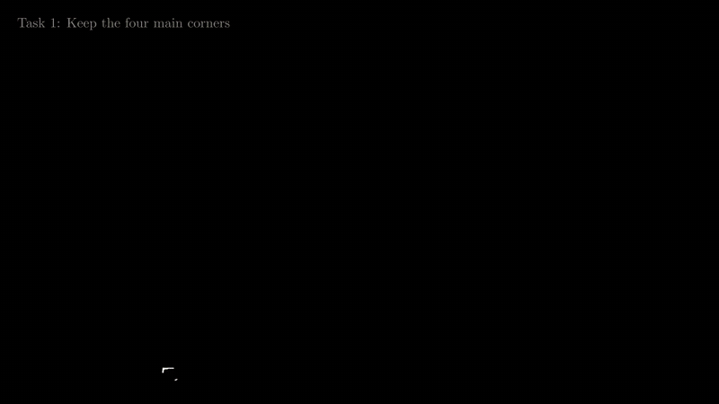
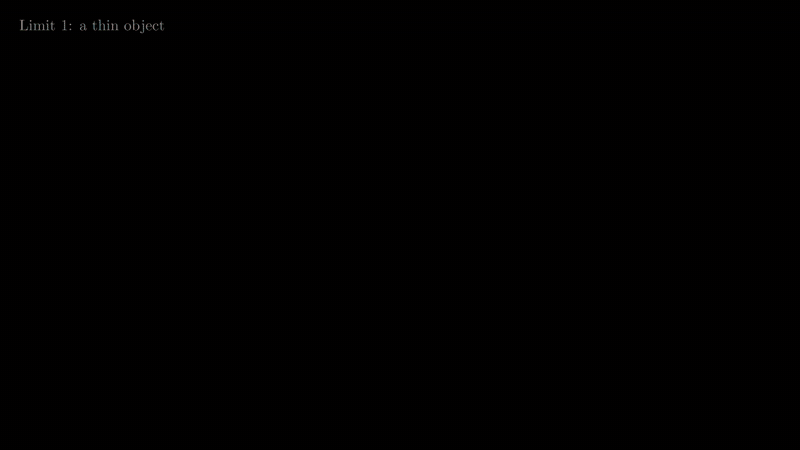
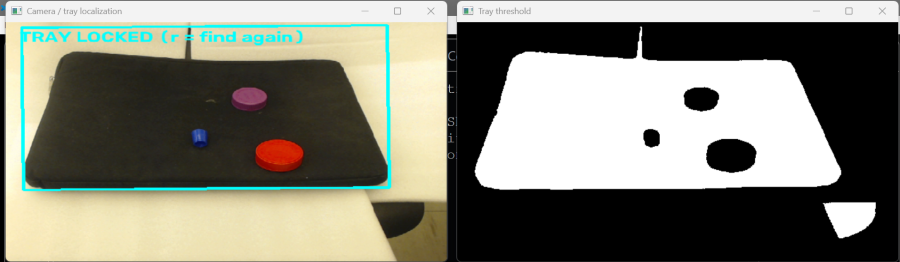
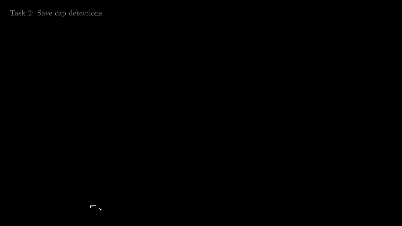
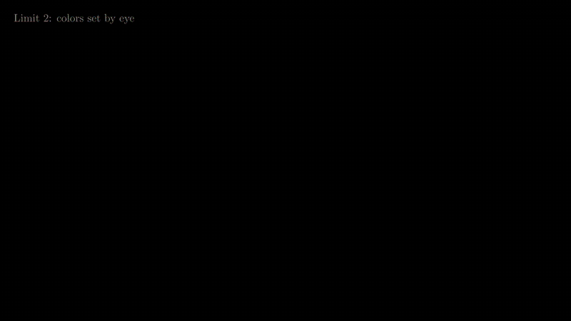
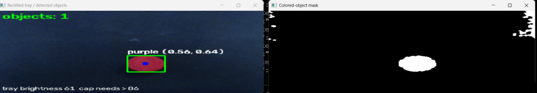
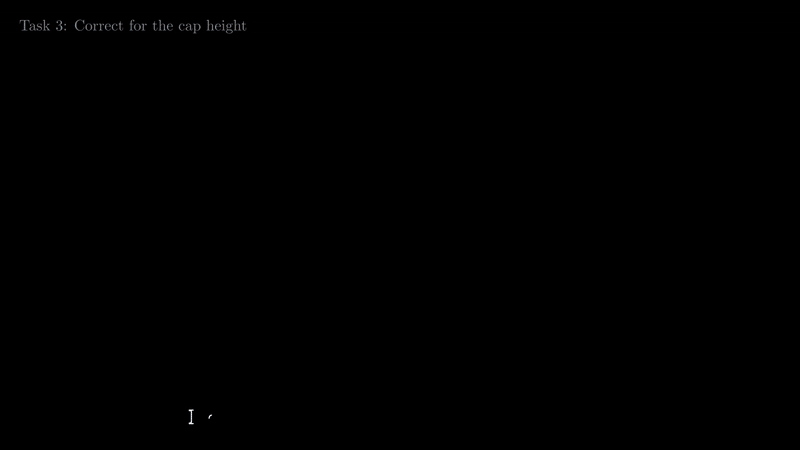
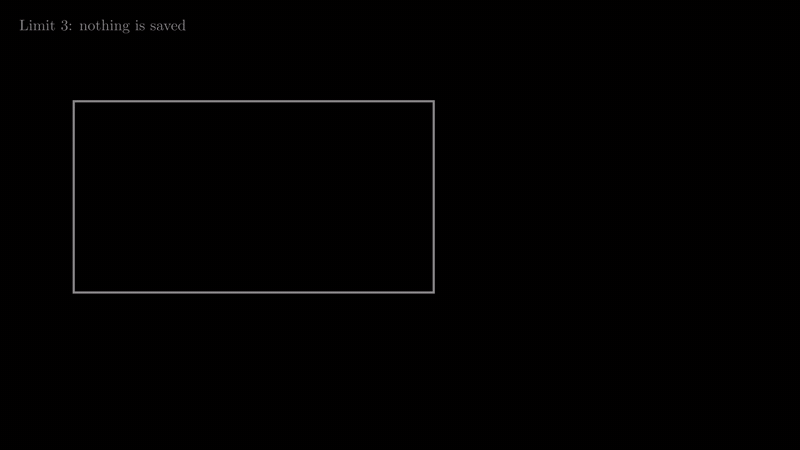
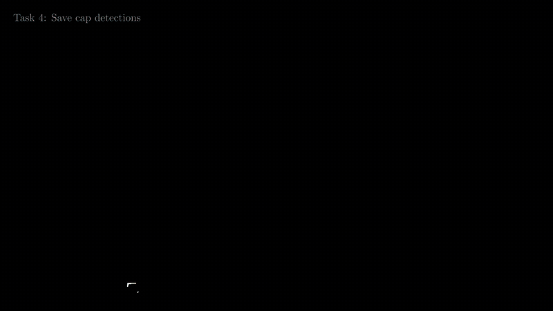
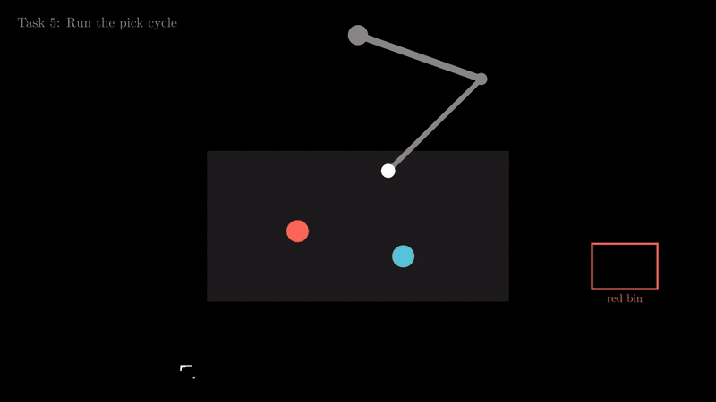

## Task 1: Make the tray outline ignore cables



**Your goal:** when a cable or a shadow touches the tray, the cyan outline still sits exactly on the tray's 4 corners.

**What you need:** Python and this repo for steps 1-5. No camera. For step 6: the camera, the tray and a cable.

**Steps:**
1. **Make your branch** `task1-corners`.
2. **Add the test.** Create `tests/test_tray_corners.py` with the test in Code help below. Run `python -m pytest tests/test_tray_corners.py`. The cable tests **fail**: that is the problem you are fixing.
3. **Write `four_main_corners(hull)`** in `vision/tray.py`, above `find_tray_corners`. It gets the outline's corner points. While there are more than 4, it removes the one that sticks out the least: the corner whose triangle with its two neighbors is smallest. A thin cable sticks out very little, so it goes first.
4. **Use it.** In `find_tray_corners`, replace the 4 `approxPolyDP` lines with the 3 new lines from Code help.
5. **Run all tests:** `python -m pytest tests/`. Everything passes, the new tests too.
6. **Try the real tray.** Put a cable behind it. Run `python vision/tray_object_pipeline.py --camera-index 0`, press `r`, and wait for "TRAY LOCKED". The cyan outline should touch the 4 tray corners.
7. **Push** (see How to push).

**This does not fix:** an object sitting right on a tray corner. That really changes the outline.

**You're done when:**

| Check | How to check | Pass |
| --- | --- | --- |
| Code works | `python -m pytest tests/` | All tests pass |
| Drawn trays | The 4 drawn tests: clean tray, thin cable, thick object, dark blob on an edge | Corners within 3 pixels of the true corners |
| Real tray | Step 6 | The cyan outline touches all 4 tray corners |

**How to push:**
```
git add vision/tray.py tests/test_tray_corners.py
git commit -m "Task 1: keep the four main corners"
git push -u origin task1-corners
```

<details>
<summary><b>Code help</b> (click to open)</summary>

**File:** `vision/tray.py`
```python
def four_main_corners(hull):
    """Reduce a convex outline (from cv2.convexHull) to its 4 most important corners."""
```

**Steps:**
1. Make a list of the hull's points: `points = [tuple(p) for p in hull.reshape(-1, 2).astype(np.float64)]`.
2. `while len(points) > 4:`
   - For each point, work out the triangle area with its neighbors `before = points[i - 1]` and `after = points[(i + 1) % len(points)]`:
     `abs((x - bx) * (ay - by) - (ax - bx) * (y - by)) / 2`
   - `del points[...]` the one with the smallest area (`np.argmin`).
3. Return `np.array(points, dtype=np.float32).reshape(-1, 1, 2)`.
4. In `find_tray_corners`, replace these lines (the `perimeter`, `simplified` and `if len(simplified) == 4 ...` lines):
   ```python
   perimeter = cv2.arcLength(hull, True)
   simplified = cv2.approxPolyDP(hull, 0.04 * perimeter, True)
   if len(simplified) == 4 and cv2.isContourConvex(simplified):
       corners = order_corners(simplified)
   ```
   with:
   ```python
   simplified = four_main_corners(hull)
   if cv2.contourArea(simplified) >= 0.9 * cv2.contourArea(hull):
       corners = order_corners(simplified)
   ```
   Keep the `elif rectangularity >= 0.58:` fallback after it. The new check keeps the four corners only if they still cover at least 90% of the hull. If not, the shape is not a tray, and the old fallback decides.

**Fake data and test:** `tests/test_tray_corners.py`
```python
import numpy as np, cv2
from vision.tray import find_tray_corners

TRUE = np.float32([[150, 90], [650, 90], [720, 380], [80, 380]])   # a tray seen at an angle
ARGS = (0, 179, 0, 0, 130, 85, 0.04, 9)                              # pipeline defaults
DARK = (30, 30, 30)

def picture():
    img = np.full((480, 800, 3), 160, np.uint8)                      # grey table
    cv2.fillConvexPoly(img, TRUE.astype(np.int32), DARK)             # black tray
    return img

def corner_error(img):
    corners, _ = find_tray_corners(img, *ARGS)
    assert corners is not None
    return float(np.abs(corners - TRUE).max())

def test_clean_tray():
    assert corner_error(picture()) < 3

def test_thin_cable():
    img = picture()
    cv2.rectangle(img, (400, 20), (406, 100), DARK, -1)              # 6 pixels wide, sticks up 70
    assert corner_error(img) < 3

def test_thick_object():
    img = picture()
    cv2.rectangle(img, (400, 60), (430, 100), DARK, -1)
    assert corner_error(img) < 3

def test_blob_on_the_top_edge():
    img = picture()
    cv2.circle(img, (300, 90), 20, DARK, -1)
    assert corner_error(img) < 3
```

</details>


<details>
<summary><b>Why is this needed?</b> (click to open)</summary>

A thin dark thing touching the tray, like a cable or a shadow, adds a spike to the black-and-white tray picture. The program expects 4 corners. The spike is a fifth one, so the program gives up and uses a big box around everything. The outline is too big, every cap position is measured against it, and the lock keeps it that way for the whole run.



A real case: a cable behind the tray made the outline too big, and the lock kept it.



- Today the program simplifies the outline with `cv2.approxPolyDP`. When that does not give 4 corners, it falls back to `cv2.minAreaRect`.
- A tested version of the fix took a cable's corner error from 70 pixels to 0, and all existing tests still passed.
- `--tray-region` (a search box) helps only when the cable is outside the box.

</details>

---

## Task 2: Measure the cap colors



**Your goal:** in your real light, the program finds every cap with the right color, and finds nothing on an empty tray.

**What you need:** Python and this repo for steps 1-6. No camera. For steps 7-9: the camera, the tray, all real caps, and the final lights.

**Steps:**
1. **Make your branch** `task2-colors`.
2. **Add the test.** Create `tests/test_colors.py` with the test in Code help. Run it: it fails, because the functions don't exist yet.
3. **Write the measuring code** in a new file `vision/calibrate_colors.py`: `measure_color`, `save_colors`, `load_colors` (Code help steps 1-4). `measure_color` gets a picture and the spots you clicked, and returns the range of colors at those spots.
4. **Let the program use it.** In `vision/caps.py`, `make_color_masks` gets an optional `color_ranges` (Code help step 5). With no colors file, nothing changes.
5. **Run all tests:** `python -m pytest tests/`. Everything passes.
6. **Add the clicking tool** at the bottom of `vision/calibrate_colors.py` (Code help step 6).
7. **Measure the real caps.** Put them on the tray, in the final light. Run `python vision/calibrate_colors.py --camera-index 0`. Press `r`, `b` or `p` to choose a color, then click 5 or more spots on each cap of that color, shaded sides too. Press `s` to save `vision/colors.json`.
8. **Ask a teammate** to read the numbers in `vision/colors.json`. Color rules decide what counts as a cap, so a second person checks them.
9. **Check** with the table below. Then push, including `vision/colors.json`.

Do steps 7-9 again whenever the light, the camera or the caps change.

**This does not fix:** two caps whose colors look the same to the camera. Use clearly different caps.

**You're done when:**

| Check | How to check | Pass |
| --- | --- | --- |
| Code works | `python -m pytest tests/` | All tests pass |
| Drawn caps | The drawn tests in `tests/test_colors.py` | Each measured range covers at least 95% of its own cap, and none of the tray or the other caps |
| Every cap found | Put each cap color in 10 places across the tray | Found with the right color 10 out of 10 times |
| No false caps | Run on an empty tray for 1 minute | 0 caps found |
| Checked by a person | Step 8 | Approved |

**How to push:**
```
git add vision/calibrate_colors.py vision/caps.py vision/colors.json tests/test_colors.py
git commit -m "Task 2: calibrate cap colors"
git push -u origin task2-colors
```

<details>
<summary><b>Code help</b> (click to open)</summary>

**File:** `vision/calibrate_colors.py`
```python
def measure_color(straight_tray_bgr, points, radius=6, margin=4):
    """Picture + clicked points → {"hue": [[low, high], ...], "min_saturation": n, "min_value": n}."""

def save_colors(ranges, path="vision/colors.json"): ...
def load_colors(path="vision/colors.json"):
    """{"red": ..., "blue": ..., "purple": ...}, or None if the file is missing."""
```

**Steps:**
1. `measure_color`: convert to HSV (`cv2.cvtColor(..., cv2.COLOR_BGR2HSV)`). For each point take the pixels inside a disk of `radius`. Put all pixels in one list.
2. Hue is a circle. Red is near 0 **and** near 179, so a plain minimum and maximum would give 0 to 179. Move the hue first: `shifted = (hue + 90) % 180`. Now red sits in the middle. Take the 2nd and 98th percentile (`np.percentile`), add the `margin`, and move it back: `(value - 90) % 180`. If the low end is bigger than the high end, the range wraps: save it as two ranges, `[0, high]` and `[low, 179]`.
3. `min_saturation`: the 2nd percentile of the saturation minus `margin * 2`. Same for `min_value`.
4. `save_colors` / `load_colors`: a JSON file with the three colors.
5. In `vision/caps.py`: `make_color_masks` gets an optional `color_ranges` argument. If it is `None`, use `load_colors()`. If that is also `None` (no file), run today's code exactly as it is: it has extra rules that a plain range cannot say, such as strongly colored pixels in the hue band 165-176 counting as red and not purple. Only when ranges are given, build each mask with `cv2.inRange` for every hue range, and join them with `cv2.bitwise_or`.
6. The tool (`if __name__ == "__main__":`): open the camera, find and straighten the tray (use `TrayCapPipeline` and `straighten_tray`), show the straightened tray, and use `cv2.setMouseCallback` to collect clicks for the chosen color.

**Fake data and test:** `tests/test_colors.py`
```python
import numpy as np, cv2
from vision.calibrate_colors import measure_color
from vision.caps import make_color_masks

TRUE = {"red": (2, 200, 200), "blue": (108, 200, 180), "purple": (150, 110, 170)}   # hue, saturation, brightness
CENTERS = {"red": (100, 150), "blue": (300, 150), "purple": (500, 150)}

def picture():
    rng = np.random.default_rng(1)
    img = np.zeros((300, 600, 3), np.uint8)
    img[:] = cv2.cvtColor(np.uint8([[[0, 0, 30]]]), cv2.COLOR_HSV2BGR)[0, 0]       # black tray
    for name, (x, y) in CENTERS.items():
        h, s, v = TRUE[name]
        patch = np.zeros((60, 60, 3), np.uint8)
        patch[..., 0] = np.clip(h + rng.integers(-3, 4, (60, 60)), 0, 179)
        patch[..., 1] = np.clip(s + rng.integers(-15, 16, (60, 60)), 0, 255)
        patch[..., 2] = np.clip(v + rng.integers(-15, 16, (60, 60)), 0, 255)
        img[y - 30:y + 30, x - 30:x + 30] = cv2.cvtColor(patch, cv2.COLOR_HSV2BGR)
    return img

def clicks(name):
    x, y = CENTERS[name]
    return [(x + dx, y + dy) for dx, dy in ((0, 0), (10, 5), (-10, 8), (5, -10))]

def test_measured_ranges_find_the_caps():
    img = picture()
    ranges = {name: measure_color(img, clicks(name)) for name in CENTERS}
    masks, _, _ = make_color_masks(img, 70, 45, color_ranges=ranges)
    for name, (x, y) in CENTERS.items():
        assert masks[name][y - 30:y + 30, x - 30:x + 30].mean() > 0.95 * 255   # its own cap
        assert masks[name][:40, :40].max() == 0                                # the tray
        for other, (ox, oy) in CENTERS.items():
            if other != name:
                assert masks[name][oy - 30:oy + 30, ox - 30:ox + 30].max() == 0

def test_red_wraps_around():
    img = picture()
    assert len(measure_color(img, clicks("red"))["hue"]) == 2                  # [0, 9] and [176, 179]
```

</details>


<details>
<summary><b>Why is this needed?</b> (click to open)</summary>

Each color is a range of numbers that we typed in by looking at a few screenshots. The camera changes its colors with the light, so caps drift out of their range: a cap is missed, or gets the wrong color, or glare looks like a cap.



A real case: a red cap labeled purple, and glare in the corner of the cap picture.



- Hand-set rules today: red needs colorfulness 150 or more; strongly colored shades 165-176 also count as red; a cap must be 45 brighter than the tray; objects at the edge of the tray picture are ignored.
- The purple cap was measured in other light. The blue cap's brightness was never measured.
- Red sits at both ends of the shade scale (near 0 and near 179). Code help step 2 shows how to handle that.

</details>

---

## Task 3: Save every cap to a log file



**Your goal:** after a run, the file `logs/run.jsonl` has one line for every cap found, always with the same names.

**What you need:** Python and this repo for steps 1-6. No camera. For step 7: the camera.

**What works today:** without windows, the program already prints one line per frame, and you can save it: `python vision/tray_object_pipeline.py --camera-index 0 --no-gui > logs/run.jsonl`. This task makes it one line per cap, and works with the windows open too.

**What a line looks like:**

```json
{"frame": 1042, "time_ms": 1730000123456, "color": "red", "u": 0.412, "v": 0.688, "center_x": 206.0, "center_y": 151.4, "box": [190, 135, 32, 33], "area": 780}
```

| Name | What it means | Example |
| --- | --- | --- |
| `frame` | Which camera picture the cap was found in | `1042` |
| `time_ms` | When that picture was taken (milliseconds) | `1730000123456` |
| `color` | `"red"`, `"blue"`, `"purple"`, or `"unknown"` | `"red"` |
| `u`, `v` | Where the cap is on the tray (0 to 1) | `0.412`, `0.688` |
| `center_x`, `center_y` | The cap's middle, in pixels | `206.0`, `151.4` |
| `box` | The box around the cap: x, y, width, height in pixels | `[190, 135, 32, 33]` |
| `area` | How big the cap looks, in pixels | `780` |

**Steps:**
1. **Make your branch** `task3-records`.
2. **Add the test.** Create `tests/test_records.py` with the test in Code help. Run it: it fails.
3. **Write `make_record(frame, time_ms, obj)`** in a new file `vision/records.py`. `obj` is one cap from `result.objects`. It returns a dict with exactly the names in the table above. If the color isn't red, blue or purple, use `"unknown"`.
4. **Write `write_log(record, path)`.** It adds the record as **one line** at the **end** of the file, and never erases old lines.
5. **Run all tests:** `python -m pytest tests/`. Everything passes.
6. **Add `--log-file`** to `main()` in `vision/tray_object_pipeline.py`. In every frame, call `make_record` and `write_log` once for **each** cap in `result.objects`. Add `logs/` to `.gitignore`.
7. **Try it.** Run 1 minute with the windows open: `python vision/tray_object_pipeline.py --camera-index 0 --log-file logs/run.jsonl`. Open the file and compare it with what was printed.
8. **Push.**

**You're done when:**

| Check | How to check | Pass |
| --- | --- | --- |
| Code works | `python -m pytest tests/` | All tests pass |
| Records | The test in `tests/test_records.py`: write 3 records, read them back | 3 lines, each with exactly the names in the table |
| Unknown color | Same test, with a green cap | Saved as `"unknown"` |
| Real run | Step 7 | A line for every cap, matching what was printed |

**How to push:**
```
git add vision/records.py vision/tray_object_pipeline.py tests/test_records.py .gitignore
git commit -m "Task 3: records + log"
git push -u origin task3-records
```

<details>
<summary><b>Code help</b> (click to open)</summary>

**File:** `vision/records.py`
```python
COLORS = ("red", "blue", "purple")

def make_record(frame, time_ms, obj):
    """obj = one cap from the pipeline → the card (a dict). Other color → "unknown"."""

def write_log(record, path="logs/detections.jsonl"):
    """Add the card as one line at the end of the file."""
```

**Steps:**
1. `make_record`: build the dict with exactly these names: `frame, time_ms, color, u, v, center_x, center_y, box, area`.
   - Round `u` and `v` to 3 decimals, and `center_x` and `center_y` to 1 decimal (`round(value, 3)`).
   - Make `box` a list of ints: `[int(n) for n in obj["box"]]`. JSON has no tuples.
   - For `color`, use `obj["color"] if obj["color"] in COLORS else "unknown"`.
2. `write_log`:
   - Make the folder if it is missing (`os.makedirs(folder, exist_ok=True)`).
   - Open the file with `open(path, "a")`. The `"a"` means **append**: new text goes at the end, and old lines stay.
   - Write `json.dumps(record) + "\n"`. `json.dumps` turns the dict into text, and `"\n"` ends the line.

**Test:** `tests/test_records.py`
```python
import json
from vision.records import make_record, write_log

FIELDS = {"frame", "time_ms", "color", "u", "v", "center_x", "center_y", "box", "area"}

def fake_cap(color="red"):
    return {"color": color, "u": 0.412, "v": 0.688, "center_x": 206.0,
            "center_y": 151.4, "box": (190, 135, 32, 33), "area": 780.0}

def fake(i, color="red"):
    return make_record(i, 1730000000000 + i * 33, fake_cap(color))

def test_log_lines(tmp_path):
    path = tmp_path / "log.jsonl"
    for i in range(3):
        write_log(fake(i), path)
    lines = path.read_text().splitlines()
    assert len(lines) == 3
    assert all(set(json.loads(line)) == FIELDS for line in lines)

def test_unknown_color():
    assert fake(0, "green")["color"] == "unknown"
```

</details>


<details>
<summary><b>Why is this needed?</b> (click to open)</summary>

With the windows open, the program prints the caps once per second, and the lines scroll away. After a run we can't look back, or compare the camera's positions with a ruler. A log file keeps every cap, with fixed names, so code, tests and people all read it the same way.



</details>

---

## Task 4: Find the arm base exactly



**Your goal:** two different clicks near the arm's base give the same base position, so the tip's coordinates do not change with your click.

**What you need:** Python and this repo for steps 1-5. No camera: the tests use a drawn arm. For step 6: the arm and the camera.

**What works today:** `vision/arm_vision.py` asks you to click the arm's base (or you pass `--base X Y`). The tip's x and y are measured from that base.

**Steps:**
1. **Make your branch** `task4-base`.
2. **Add the test.** Create `tests/test_arm_base.py` with the test in Code help. Run `python -m pytest tests/test_arm_base.py`. Both tests **fail**: that is the problem you are fixing.
3. **Write `snap_to_arm_end(skeleton, click_xy)`** in `vision/arm_vision.py`, above `_longest_path`. It finds the ends of the skeleton (a skeleton pixel with exactly one neighbor) and returns the end nearest to the click.
4. **Use it.** In `_longest_path`, replace the 2 lines under `if base_xy is not None:` that make `gap` and `start` with the 4 lines from Code help.
5. **Run all tests:** `python -m pytest tests/`. Everything passes, the new tests too.
6. **Try the real arm.** Hold the arm still. Run `python vision/arm_vision.py --camera-index 0 --base X Y` 5 times. Each time use a base that is a few pixels different (up to 15 pixels along the arm). Write down the printed `tip` of each run.
7. **Push** (see How to push).

**This does not fix:** an arm whose base is hidden, or joined to a big dark mount. There the end of the skeleton is not the base. That needs a marker on the base, which is a different task.

**You're done when:**

| Check | How to check | Pass |
| --- | --- | --- |
| Code works | `python -m pytest tests/` | All tests pass |
| Same base | The first drawn test: 8 clicks within 20 pixels of the base | The base differs by less than 1 pixel between clicks (today: 18 pixels) |
| Same tip | The second drawn test: the same 8 clicks | The tip differs by less than 1 pixel between clicks (today: 17 pixels) |
| Real arm | Step 6 | The 5 printed tips agree within 2 mm |

**How to push:**
```
git add vision/arm_vision.py tests/test_arm_base.py
git commit -m "Task 4: snap the clicked base to the arm end"
git push -u origin task4-base
```

<details>
<summary><b>Code help</b> (click to open)</summary>

**File:** `vision/arm_vision.py`
```python
def snap_to_arm_end(skeleton, click_xy):
    """The skeleton end point (x, y) nearest to the click. The click may be a few pixels off."""
```

**Steps:**
1. Add `from scipy.ndimage import convolve` at the top.
2. Count each pixel's neighbors: `neighbors = convolve(skeleton.astype(int), np.ones((3, 3), int), mode="constant") - 1`. Subtract 1 so the pixel does not count itself. The end of a line has exactly 1 neighbor.
3. `ys, xs = np.nonzero(skeleton & (neighbors == 1))` gives the ends. If there are none, `return click_xy`.
4. `nearest = np.argmin(np.hypot(xs - click_xy[0], ys - click_xy[1]))`, then `return xs[nearest], ys[nearest]`.
5. In `_longest_path`, replace these 2 lines:
   ```python
   gap = np.hypot(xs - base_xy[0], ys - base_xy[1])
   start = int(np.argmin(gap))
   ```
   with:
   ```python
   click_xy = base_xy
   base_xy = snap_to_arm_end(skeleton, click_xy)
   gap = np.hypot(xs - click_xy[0], ys - click_xy[1])
   start = int(np.argmin(np.hypot(xs - base_xy[0], ys - base_xy[1])))
   ```
   `gap` still measures from your click. So a click far from every arm still gives up, as before.

**More ideas (not needed to pass):**
- A skeleton can grow a tiny spur near the base. If the base jumps between frames, ignore ends that belong to very short branches.
- Keep the median of the base over the first 30 good frames and reuse it, the way the tray lock keeps the tray.

**Fake data and test:** `tests/test_arm_base.py`
```python
import sys
from pathlib import Path

import numpy as np

sys.path.insert(0, str(Path(__file__).resolve().parents[1] / "vision"))
from arm_vision import estimate_shape  # noqa: E402
from test_modeling import draw_arm  # noqa: E402

# Clicks near the base of the drawn arm. The base is at (320, 440). None of the clicks is exact.
CLICKS = [(320, 440), (320, 432), (320, 420), (326, 440), (312, 436), (330, 425), (320, 448), (310, 430)]


def test_every_click_gives_the_same_base():
    img, _ = draw_arm(0.006)
    bases = np.array([estimate_shape(img, base_xy=c)["base_px"] for c in CLICKS])
    assert np.ptp(bases, axis=0).max() < 1.0      # pixels


def test_every_click_gives_the_same_tip():
    img, _ = draw_arm(0.006)
    tips = np.array([estimate_shape(img, base_xy=c)["tip"] for c in CLICKS])
    assert np.ptp(tips, axis=0).max() < 1.0       # pixels
```

</details>


<details>
<summary><b>Why is this needed?</b> (click to open)</summary>

You click the base, and a click is never exact. The program starts the arm's middle line at the skeleton point nearest to your click, and measures the tip from there. Click a little higher up the arm and the base moves up with it, so every tip coordinate is off by the same amount.


- On a drawn arm, 8 clicks within 20 pixels of the base moved the base by up to 18 pixels and the tip's coordinates by up to 17 pixels.
- Only the click's place along the arm matters: the skeleton is a line, so a sideways error is removed.
- A tested version of the fix (snap the click to the nearest end of the skeleton) took both numbers to 0, and all existing tests still passed.

</details>

---

## Task 5: Steady the tip



**Your goal:** when the arm is held still, the red tip dot and the printed tip stay in the same place (within 1 pixel), and they still follow the arm when it moves.

**What you need:** Python and this repo for steps 1-4. No camera: the tests use a drawn arm with noise. For steps 5-6: a recorded arm video (`--video`) or the camera.

**What works today:** `ShapeSmoother` in `vision/arm_vision.py` already blends each new tip with the last one (`alpha` 0.4) and skips bad frames. The red dot still wobbles.

**Steps:**
1. **Make your branch** `task5-tip`.
2. **Add the test.** Create `tests/test_arm_tip.py` with the test in Code help. Run `python -m pytest tests/test_arm_tip.py`. The first test **fails** (wobble about 2 pixels). The second one passes: it guards that the tip still follows a moving arm.
3. **Change `ShapeSmoother`.** Add a `window` setting (default 9). Keep the last 9 tips from good frames, and report their **median**. One odd frame can no longer pull the tip away.
4. **Run all tests:** `python -m pytest tests/`. Everything passes, the new tests too.
5. **Try a still arm.** Hold the arm still for 10 seconds. The red dot stays put. To measure it:
   ```powershell
   python vision/arm_vision.py --video arm.mp4 --base X Y --no-gui > tips.jsonl
   python -c "import json, numpy as np; t = [r['tip'] for r in map(json.loads, open('tips.jsonl')) if 'tip' in r]; print(np.std(t[30:], axis=0))"
   ```
6. **Try a moving arm.** Bend the arm. The dot catches up in about half a second.
7. **Push** (see How to push).

**This does not fix:** a tip that is wrong for a reason other than noise, such as a hand hiding the end of the arm. A median of 9 frames also makes the number about 4 frames late (0.13 s at 30 frames per second). If that is too slow, use a smaller `window`. The base position is Task 4.

**You're done when:**

| Check | How to check | Pass |
| --- | --- | --- |
| Code works | `python -m pytest tests/` | All tests pass |
| Still arm (drawn) | `test_the_tip_of_a_still_arm_is_steady` | The tip's standard deviation is under 1 pixel (today: 2 pixels) |
| Moving arm (drawn) | `test_the_tip_still_follows_a_moving_arm` | After the arm stops, the tip is within 3 pixels of the true tip |
| Still arm (real) | Step 5 | The printed standard deviation is under 1 mm |
| Moving arm (real) | Step 6 | The dot catches up in about half a second |

**How to push:**
```
git add vision/arm_vision.py tests/test_arm_tip.py
git commit -m "Task 5: steady the arm tip with a median"
git push -u origin task5-tip
```

<details>
<summary><b>Code help</b> (click to open)</summary>

**File:** `vision/arm_vision.py`, class `ShapeSmoother`

**Steps:**
1. Add `from collections import deque` at the top.
2. In `__init__`, add `window=9` to the arguments, and add `self.recent_tips = deque(maxlen=window)`. A `deque` with `maxlen` drops the oldest tip by itself.
3. In `update`, replace the block that blends the tip:
   ```python
   if self.tip is None:
       self.tip, self.kappa, self.length = new
   else:
       a = self.alpha
       self.tip = (1 - a) * self.tip + a * new[0]
       self.kappa = (1 - a) * self.kappa + a * new[1]
       self.length = (1 - a) * self.length + a * new[2]
   ```
   with:
   ```python
   self.recent_tips.append(new[0])
   if self.tip is None:
       self.tip, self.kappa, self.length = new
   else:
       a = self.alpha
       self.tip = np.median(self.recent_tips, axis=0)
       self.kappa = (1 - a) * self.kappa + a * new[1]
       self.length = (1 - a) * self.length + a * new[2]
   ```
4. In the branch that forgets everything (`if self.bad_in_a_row > self.hold_frames:`), also call `self.recent_tips.clear()`.
5. Update the class docstring: `tip` is now the median of the last `window` good tips.

**More ideas (not needed to pass):**
- Take the tip from the fitted curve (`result["pcc"]["fit"][-1]`) instead of the last skeleton point. The curve ignores a hair or a speck at the end.
- Blend the median with a small `alpha`, if it still jumps when the arm starts to move.

**Fake data and test:** `tests/test_arm_tip.py`
```python
import sys
from pathlib import Path

import cv2
import numpy as np

sys.path.insert(0, str(Path(__file__).resolve().parents[1] / "vision"))
from arm_vision import ShapeSmoother, estimate_shape  # noqa: E402
from test_modeling import draw_arm  # noqa: E402

BASE = (320, 440)


def shaky_frames(count=120, seed=3):
    """A still arm. Every frame has camera noise; 3 frames in 10 also have a thin dark hair at the tip."""
    img, tip = draw_arm(0.006)
    tip_x, tip_y = BASE[0] + tip[0], BASE[1] - tip[1]
    rng = np.random.default_rng(seed)
    for _ in range(count):
        frame = img.astype(np.float32) * rng.uniform(0.8, 1.1) + rng.normal(0, 25, img.shape)
        frame = np.clip(frame, 0, 255).astype(np.uint8)
        if rng.random() < 0.3:
            length, angle = rng.integers(5, 30), rng.uniform(-0.8, 0.8)
            end = (int(tip_x - np.cos(0.3 + angle) * length), int(tip_y - abs(np.sin(0.3 + angle)) * length))
            cv2.line(frame, (int(tip_x), int(tip_y)), end, (20, 20, 20), 5)
        yield frame


def test_the_tip_of_a_still_arm_is_steady():
    smoother, tips = ShapeSmoother(), []
    for frame in shaky_frames():
        smoother.update(estimate_shape(frame, BASE))
        if smoother.tip is not None:
            tips.append(smoother.tip.copy())
    assert np.std(tips[10:], axis=0).max() < 1.0      # pixels


def test_the_tip_still_follows_a_moving_arm():
    smoother = ShapeSmoother()
    for kappa in np.linspace(0.0, 0.006, 30):
        smoother.update(estimate_shape(draw_arm(kappa)[0], BASE))
    final, _ = draw_arm(0.006)
    for _ in range(15):
        smoother.update(estimate_shape(final, BASE))
    assert np.hypot(*(smoother.tip - estimate_shape(final, BASE)["tip"])) < 3      # pixels
```

</details>


<details>
<summary><b>Why is this needed?</b> (click to open)</summary>

The tip is the last point of the arm's middle line. A thin shadow, a speck or camera noise at the end of the arm adds or removes a few pixels there, so the tip jumps from frame to frame. The red dot keeps moving back and forth, and so do the printed numbers.


- On a real recording, the raw tip moved a median of 2.5 pixels per frame, and more than 22 pixels in 1 frame of 100.
- Today's blending helps, but 1 frame in 100 still jumps more than 12 pixels (the worst was 21). With the arm held still, the blended tip still moved about 1-2 pixels.
- On the drawn test arm with noise and hairs, the tip's standard deviation is 2 pixels today. A median of 9 frames took it under 0.1 pixel, and the other tests still passed.

</details>

---

# Simulating the arm (Tasks 6-10)

The goal: **we make the sensor data ourselves, and a model works out the arm's tip and curvature from it.** No camera and no real arm are needed. The sensor is a **tension sensor** on the tendon (how hard the string pulls, in newtons, N).

Do the tasks in order. Each one builds on the one before. All new code goes in a new folder `simulation/`. Run every command from the project folder. The tests import `simulation` and `vision`, so use `python -m pytest`.

```text
tension (N)  ->  model  ->  tip (x, y in mm) and curvature (kappa, 1/mm)
   Task 6        Tasks 7-8        checked in Task 9, made robust in Task 10
```

| Task | What you build | File |
| --- | --- | --- |
| 6 | Fake tension data, with the true answer next to it | `simulation/sensor_data.py` |
| 7 | Tension to tip and curvature, one arc, no gravity | `simulation/model.py` |
| 8 | The same, with gravity | `simulation/model.py` |
| 9 | Check the model against the camera code | `simulation/draw_picture.py` |
| 10 | Noisy sensor, steady result | `simulation/sensor_data.py`, `simulation/model.py` |

---

## Task 6: Make fake tension data


**Your goal:** a file `simulation/data/tension.csv` has 120 fake tension readings. Next to every reading is the arm's **true** tip and curvature, always with the same names.

**What you need:** Python and this repo. No camera.

**What works today:** `vision/shape_models.py` already has `cosserat_planar_static`. It gives the shape of the arm for a tendon moment and a weight. This task uses it to make the *true* answer. The model in Tasks 7-10 never sees that answer: it only gets the tension.

**The arm's numbers.** They are **placeholders**. Replace them with measured values of the real arm when you have them.

| Name | What it is | Placeholder |
| --- | --- | --- |
| `LENGTH_MM` | Length of the bending part | 300 mm |
| `BENDING_STIFFNESS` | `EI`: how hard the arm is to bend | 20000 N * mm^2 |
| `TENDON_OFFSET_MM` | `d`: how far the tendon runs from the arm's middle line | 10 mm |
| `WEIGHT_PER_MM` | Weight of the arm per mm | 0.001 N/mm (30 g in all) |

**What a row looks like:**

```text
time_s,tension_n,true_tip_x_mm,true_tip_y_mm,true_kappa_per_mm
5.9,12.0,-217.4,130.803,0.0065847
```

| Name | What it means | Example |
| --- | --- | --- |
| `time_s` | Seconds since the start | `5.9` |
| `tension_n` | What the tension sensor reads (newtons) | `12.0` |
| `true_tip_x_mm`, `true_tip_y_mm` | The tip, measured from the base. x to the right, y up | `-217.4`, `130.803` |
| `true_kappa_per_mm` | Curvature: how much the arm turns per mm | `0.0065847` |

**Steps:**
1. **Make your branch** `task6-sensor-data`.
2. **Add the test.** Create `tests/test_sensor_data.py` with the test in Code help. Run it: it fails, because the files don't exist yet.
3. **Write `simulation/arm_parameters.py`** with the 4 numbers above (Code help).
4. **Write `mean_curvature(backbone)` and `true_shape(tension_n, weight_per_mm)`** in `simulation/sensor_data.py`. `true_shape` calls `cosserat_planar_static` with `n=400` nodes (a fine solve). The tendon moment is `tension_n * TENDON_OFFSET_MM`.
5. **Write `make_tension_series`, `make_sensor_rows`, `write_sensor_csv`, `read_sensor_csv`** (Code help). The tension goes up for 40% of the time, holds for 20%, and comes back for 40%.
6. **Run all tests:** `python -m pytest tests/`. Everything passes.
7. **Make the file.** At the bottom of `sensor_data.py`, add `if __name__ == "__main__":` that writes `simulation/data/tension.csv`. Run `python simulation/sensor_data.py`. Open the file and check it has 120 rows.
8. **Push** (see How to push).

**You're done when:**

| Check | How to check | Pass |
| --- | --- | --- |
| Code works | `python -m pytest tests/` | All tests pass |
| Tension | `test_tension_goes_up_holds_and_comes_back` | 120 readings: 0 N, then 12 N for the middle part, then back near 0 |
| True shape | `test_no_gravity_arm_is_an_arc`, `test_gravity_pulls_the_tip_down` | Without gravity the curvature is `T * d / EI`. With gravity the tip is lower |
| Data file | Step 7 | 120 rows, with exactly the names in the table |

**How to push:**
```
git add simulation/ tests/test_sensor_data.py
git commit -m "Task 6: fake tension data with the true arm shape"
git push -u origin task6-sensor-data
```

<details>
<summary><b>Code help</b> (click to open)</summary>

**File:** `simulation/arm_parameters.py`
```python
"""Numbers that describe the arm. PLACEHOLDERS: replace them with measured values of the real arm."""

LENGTH_MM = 300.0            # length of the bending part
BENDING_STIFFNESS = 20000.0  # EI, in N * mm^2
TENDON_OFFSET_MM = 10.0      # d: how far the tendon runs from the middle line of the arm
WEIGHT_PER_MM = 0.001        # N per mm of arm
```

**File:** `simulation/sensor_data.py`
```python
FIELDS = ["time_s", "tension_n", "true_tip_x_mm", "true_tip_y_mm", "true_kappa_per_mm"]

def mean_curvature(backbone):
    """How much the arm turns per mm. backbone = array (N, 2) of points, base first."""

def true_shape(tension_n, weight_per_mm=WEIGHT_PER_MM):
    """The arm's real shape for one tension: {"tip": [x, y], "kappa": k, "backbone": points}."""

def make_tension_series(seconds=12.0, rate_hz=10, peak_n=12.0):
    """Returns (time_s, tension_n), two numpy arrays."""

def make_sensor_rows(seconds=12.0, rate_hz=10, peak_n=12.0, weight_per_mm=WEIGHT_PER_MM):
    """One dict per reading, with exactly the names in FIELDS."""

def write_sensor_csv(rows, path): ...
def read_sensor_csv(path):
    """The rows back, every value a float."""
```

**Steps:**
1. `import` at the top: `csv`, `numpy as np`, the 4 numbers from `simulation.arm_parameters`, and `from vision.shape_models import cosserat_planar_static`.
2. `mean_curvature`: the arm turns from its first step to its last step. Take the steps `steps = np.diff(backbone, axis=0)`, their angles `np.arctan2(steps[:, 1], steps[:, 0])`, and `np.unwrap` them (so there is no jump when an angle passes 180 degrees). The answer is `(last angle - first angle) / length_between`. `length_between` is the length of all steps, minus half of the first step and half of the last one.
3. `true_shape`: `backbone = cosserat_planar_static(LENGTH_MM, BENDING_STIFFNESS, tension_n * TENDON_OFFSET_MM, weight_per_mm, n=400)`. The tip is its last point. Return `float`s, not numpy numbers, so the dict can be saved.
4. `make_tension_series`: `time_s = np.arange(int(seconds * rate_hz)) / rate_hz`, then `np.interp(time_s, [0, 0.4 * seconds, 0.6 * seconds, seconds], [0, peak_n, peak_n, 0])`.
5. `make_sensor_rows`: loop over the series, call `true_shape`, round the numbers (`round(value, 3)`), build the dict.
6. `write_sensor_csv`: `csv.DictWriter(file, fieldnames=FIELDS)`, `writeheader()`, `writerows(rows)`. Open the file with `newline=""`. Make the folder first (`os.makedirs(..., exist_ok=True)`).
7. `read_sensor_csv`: `csv.DictReader`, and `float(value)` for every value.

**Fake data and test:** `tests/test_sensor_data.py`
```python
import numpy as np

from simulation.arm_parameters import BENDING_STIFFNESS, TENDON_OFFSET_MM
from simulation.sensor_data import (make_sensor_rows, make_tension_series, read_sensor_csv,
                                    true_shape, write_sensor_csv)


def test_tension_goes_up_holds_and_comes_back():
    time_s, tension_n = make_tension_series(seconds=12.0, rate_hz=10, peak_n=12.0)
    assert len(time_s) == len(tension_n) == 120
    assert tension_n[0] == 0 and abs(tension_n.max() - 12.0) < 1e-9
    assert np.all(tension_n[50:58] == 12.0)          # the hold in the middle
    assert tension_n[-1] < 0.5                       # almost back to zero


def test_no_gravity_arm_is_an_arc():
    shape = true_shape(8.0, weight_per_mm=0.0)
    assert abs(shape["kappa"] - 8.0 * TENDON_OFFSET_MM / BENDING_STIFFNESS) < 1e-6


def test_gravity_pulls_the_tip_down():
    assert true_shape(8.0)["tip"][1] < true_shape(8.0, weight_per_mm=0.0)["tip"][1]


def test_csv_round_trip(tmp_path):
    rows = make_sensor_rows(seconds=2.0, rate_hz=10)
    path = tmp_path / "data.csv"
    write_sensor_csv(rows, path)
    back = read_sensor_csv(path)
    assert len(back) == 20
    assert set(back[0]) == {"time_s", "tension_n", "true_tip_x_mm", "true_tip_y_mm", "true_kappa_per_mm"}
    assert abs(back[5]["true_tip_x_mm"] - rows[5]["true_tip_x_mm"]) < 1e-3
```

</details>


<details>
<summary><b>Why is this needed?</b> (click to open)</summary>

We have no real sensor data yet, and the real arm is not always on the desk. To build and test a model that works out the arm's shape from tension, we need data where we **know the right answer**. So we make the data ourselves from a good physics model, and keep the true tip and curvature beside every reading. Tasks 7-10 then measure how close the model gets.


- The true answer uses gravity and a fine solve (400 nodes). The models in the next tasks use a simpler or coarser one, so they have something to get right.
- The 4 arm numbers are placeholders. When the real arm is measured, change `simulation/arm_parameters.py` and make the file again. Nothing else changes.

</details>

---

## Task 7: Work out the tip and curvature from tension


**Your goal:** give the model a tension, and it returns the arm's tip (x, y) and curvature. For an arm without gravity, the tip is within 0.5 mm of the true tip.

**What you need:** Python and this repo, and **Task 6 finished** (you use its constants and its true shapes). No camera.

**The idea:** the tendon pulls at distance `d` from the arm's middle line, so it bends the arm with a moment `T * d`. The arm resists with its stiffness `EI`. The curvature is `kappa = T * d / EI`. A constant curvature means the arm is one circular **arc**, and the tip is the end of that arc. `vision/shape_models.py` already has `pcc_points(kappa, length, n)` for the arc.

**Steps:**
1. **Make your branch** `task7-arc-model`.
2. **Add the test.** Create `tests/test_model.py` with the test in Code help. Run it: it fails.
3. **Write `shape_from_tension(tension_n)`** in a new file `simulation/model.py`. It works out `kappa`, calls `pcc_points(kappa, LENGTH_MM, 100)`, and returns `{"tip": [x, y], "kappa": kappa}` (floats, in mm and 1/mm).
4. **Run all tests:** `python -m pytest tests/`. Everything passes.
5. **Look at the numbers.** Run `python -c "from simulation.model import shape_from_tension; print(shape_from_tension(8.0))"`. The tip should be about `[-159, 233]` mm: left of the base and lower than 300 mm.
6. **Push** (see How to push).

**This does not fix:** gravity. With the placeholder numbers the real tip is up to 34 mm away from an arc at 12 N. That is Task 8.

**You're done when:**

| Check | How to check | Pass |
| --- | --- | --- |
| Code works | `python -m pytest tests/` | All tests pass |
| Arc | `test_no_gravity_arm_is_worked_out`: tensions 0, 2, 6 and 12 N, data made with no gravity | Tip within 0.5 mm, curvature within 0.00001 |
| Straight arm | `test_zero_tension_is_a_straight_arm` | Tip at (0, 300), curvature 0 |

**How to push:**
```
git add simulation/model.py tests/test_model.py
git commit -m "Task 7: tip and curvature from tension (one arc)"
git push -u origin task7-arc-model
```

<details>
<summary><b>Code help</b> (click to open)</summary>

**File:** `simulation/model.py`
```python
def shape_from_tension(tension_n, weight_per_mm=0.0):
    """Tension (N) -> {"tip": [x, y] in mm, "kappa": curvature per mm}. weight_per_mm 0 = no gravity."""
```
Write it with only `tension_n` for now. Task 8 adds `weight_per_mm`. Leaving the argument in from the start is fine, too.

**Steps:**
1. `moment = tension_n * TENDON_OFFSET_MM`
2. `kappa = moment / BENDING_STIFFNESS`
3. `tip = pcc_points(kappa, LENGTH_MM, 100)[-1]`: the last point of the arc.
4. Return the dict with plain `float`s.

**Fake data and test:** `tests/test_model.py`
```python
import numpy as np

from simulation.arm_parameters import LENGTH_MM
from simulation.model import shape_from_tension
from simulation.sensor_data import true_shape


def distance(a, b):
    return float(np.hypot(*(np.array(a) - np.array(b))))


def test_no_gravity_arm_is_worked_out():
    for tension in (0.0, 2.0, 6.0, 12.0):
        truth = true_shape(tension, weight_per_mm=0.0)
        got = shape_from_tension(tension)
        assert distance(got["tip"], truth["tip"]) < 0.5            # mm
        assert abs(got["kappa"] - truth["kappa"]) < 1e-5


def test_zero_tension_is_a_straight_arm():
    got = shape_from_tension(0.0)
    assert distance(got["tip"], [0.0, LENGTH_MM]) < 0.5 and got["kappa"] == 0.0
```

</details>


<details>
<summary><b>Why is this needed?</b> (click to open)</summary>

This is the heart of the simulation: from one sensor number to the arm's shape. An arc is the simplest model that can work, so we start there. It is easy to check by hand, and it is the same idea as the PCC model the camera code fits to pictures.


- It works the answer out from the tension. It does not guess or learn anything.
- `pcc_points` is tested in `tests/test_modeling.py`, so the arc itself is trusted. This task checks the link from tension to curvature.

</details>

---

## Task 8: Add gravity


**Your goal:** the model gives the right tip and curvature for the **real**, heavy arm: within 0.5 mm of the true tip, at 2, 6 and 12 N.

**What you need:** Python and this repo, and **Task 7 finished**. No camera.

**The idea:** the arm weighs something. Once it bends, its own weight pulls it further down, so the tip **sags** below the arc. The curvature is not the same along the arm any more. `cosserat_planar_static` in `vision/shape_models.py` already solves this: it balances the bending moment along the arm, with the tendon moment and the weight.

**Steps:**
1. **Make your branch** `task8-gravity`.
2. **Add the test.** Create `tests/test_model_gravity.py` with the test in Code help. Run it: it fails (the argument `weight_per_mm` is not used yet).
3. **Use gravity in `shape_from_tension(tension_n, weight_per_mm=0.0)`.** If `weight_per_mm` is 0, keep the arc from Task 7. Otherwise call `cosserat_planar_static(LENGTH_MM, BENDING_STIFFNESS, moment, weight_per_mm, n=100)`. The tip is its last point.
4. **Get the curvature.** It changes along the arm now. Use `mean_curvature(backbone)` from Task 6, the same as the true answer does.
5. **Run all tests:** `python -m pytest tests/`. Everything passes, the Task 7 tests too.
6. **Compare.** Print the tip with and without gravity at 12 N. The tip with gravity should be about 31 mm lower.
7. **Push** (see How to push).

**This does not fix:** a wrong arm weight. The weight is a placeholder in `simulation/arm_parameters.py`. Weigh the real arm and change it there.

**You're done when:**

| Check | How to check | Pass |
| --- | --- | --- |
| Code works | `python -m pytest tests/` | All tests pass |
| With gravity | `test_gravity_arm_is_worked_out`: tensions 2, 6 and 12 N | Tip within 0.5 mm, curvature within 0.0001 |
| Gravity matters | `test_ignoring_gravity_gives_a_wrong_tip` | Without gravity the tip at 12 N is more than 10 mm wrong (about 34 mm) |

**How to push:**
```
git add simulation/model.py tests/test_model_gravity.py
git commit -m "Task 8: add gravity to the arm model"
git push -u origin task8-gravity
```

<details>
<summary><b>Code help</b> (click to open)</summary>

**File:** `simulation/model.py`

**Steps:**
1. `from simulation.sensor_data import mean_curvature` and `from vision.shape_models import cosserat_planar_static, pcc_points`.
2. At the start of `shape_from_tension`: `if weight_per_mm == 0.0:` keep the Task 7 code and `return` it.
3. Otherwise: `backbone = cosserat_planar_static(LENGTH_MM, BENDING_STIFFNESS, moment, weight_per_mm, n=100)`. It is a numpy array of points, base first.
4. Return `{"tip": [float(backbone[-1, 0]), float(backbone[-1, 1])], "kappa": mean_curvature(backbone)}`.

The true answer in Task 6 uses `n=400` and this model uses `n=100`. The small difference between them is real and fine: it stays under 0.01 mm.

**Fake data and test:** `tests/test_model_gravity.py`
```python
import numpy as np

from simulation.arm_parameters import WEIGHT_PER_MM
from simulation.model import shape_from_tension
from simulation.sensor_data import true_shape


def distance(a, b):
    return float(np.hypot(*(np.array(a) - np.array(b))))


def test_gravity_arm_is_worked_out():
    for tension in (2.0, 6.0, 12.0):
        truth = true_shape(tension)
        got = shape_from_tension(tension, weight_per_mm=WEIGHT_PER_MM)
        assert distance(got["tip"], truth["tip"]) < 0.5            # mm
        assert abs(got["kappa"] - truth["kappa"]) < 1e-4


def test_ignoring_gravity_gives_a_wrong_tip():
    truth = true_shape(12.0)
    assert distance(shape_from_tension(12.0)["tip"], truth["tip"]) > 10      # mm: why gravity must be in the model
```

</details>


<details>
<summary><b>Why is this needed?</b> (click to open)</summary>

A real arm is not a perfect arc. Its weight bends it more near the base and pulls the tip down. An arc model alone gives a tip that is far off, and the error grows with the tension.


- With the placeholder numbers, at 12 N the arc's tip is 34 mm from the true one: 13 mm sideways and 31 mm too high.
- The camera code (`vision/arm_vision.py`) fits a curvature that can change along the arm for the same reason. This task gives the model that same freedom.

</details>

---

## Task 9: Check the model with a camera picture


**Your goal:** draw the simulated arm as a camera picture, run the camera code on it, and show that the camera and the model agree on the tip and the curvature.

**What you need:** Python and this repo, and **Task 8 finished**. No camera: the picture is drawn.

**The idea:** we have two independent ways to know the arm's shape. The model works it out from tension. The camera code (`estimate_shape` in `vision/arm_vision.py`) works it out from a picture. If the arm in the picture is the true arm, the two answers should match. If they do not, one of them has a bug. In this task 1 pixel is 1 mm.

**Steps:**
1. **Make your branch** `task9-camera-check`.
2. **Add the test.** Create `tests/test_simulation_camera.py` with the test in Code help. Run it: it fails.
3. **Write `draw_arm_picture(backbone_mm, px_per_mm=1.0, base_px=(320, 440), width_px=22)`** in a new file `simulation/draw_picture.py`. It returns a white picture with the arm drawn as a thick black line. `tests/test_modeling.py` has `draw_arm`, which does the same for an arc: read it first.
4. **Run all tests:** `python -m pytest tests/`. Everything passes.
5. **Look at it.** Draw the arm for 8 N, save it with `cv2.imwrite`, and run `python vision/arm_vision.py --image picture.png --base 320 440`. The window should show the arm with the green line and the red tip dot.
6. **Push** (see How to push).

**This does not fix:** the picture's own error. The camera code finds the arm's tip about half an arm width (11 mm here) too far, because the drawn arm has a round end. That is why the test allows 15 mm and not 0.5 mm. The measured tip differences are 12, 12 and 8.5 mm at 4, 8 and 12 N.

**You're done when:**

| Check | How to check | Pass |
| --- | --- | --- |
| Code works | `python -m pytest tests/` | All tests pass |
| Tip | `test_the_camera_sees_what_the_model_says` at 4, 8, 12 N | The camera's tip is within 15 mm of the model's |
| Curvature | Same test | The curvatures are within 0.0005 per mm (measured: under 0.00005) |
| Picture | Step 5 | The tip dot sits on the end of the arm |

**How to push:**
```
git add simulation/draw_picture.py tests/test_simulation_camera.py
git commit -m "Task 9: check the model with a camera picture"
git push -u origin task9-camera-check
```

<details>
<summary><b>Code help</b> (click to open)</summary>

**File:** `simulation/draw_picture.py`
```python
def draw_arm_picture(backbone_mm, px_per_mm=1.0, base_px=(320, 440), width_px=22, size=(480, 640)):
    """Black arm on a white wall. The backbone starts at base_px. x to the right, y up (in mm)."""
```

**Steps:**
1. Make the wall: `picture = np.full((*size, 3), 235, np.uint8)`.
2. Turn the arm's points into pixels. The picture's y grows **downward**, so flip it: `x_px = base_px[0] + x * px_per_mm` and `y_px = base_px[1] - y * px_per_mm`.
3. Draw the line: `cv2.polylines(picture, [np.round(points).astype(np.int32)], False, (20, 20, 20), width_px, cv2.LINE_AA)`.
4. Return the picture.
5. In the test, the true arm comes from `true_shape(tension)["backbone"]` (Task 6). `estimate_shape(picture, base_xy=BASE)` returns `result["tip"]` (x, y up, from the base) and `result["pcc"]["kappa"]`, both in pixels, which is mm here.

**Fake data and test:** `tests/test_simulation_camera.py`
```python
import numpy as np

from simulation.arm_parameters import WEIGHT_PER_MM
from simulation.draw_picture import draw_arm_picture
from simulation.model import shape_from_tension
from simulation.sensor_data import true_shape
from vision.arm_vision import estimate_shape

BASE = (320, 440)


def test_the_camera_sees_what_the_model_says():
    for tension in (4.0, 8.0, 12.0):
        model = shape_from_tension(tension, WEIGHT_PER_MM)
        picture = draw_arm_picture(true_shape(tension)["backbone"], base_px=BASE)
        seen = estimate_shape(picture, base_xy=BASE)                # 1 pixel = 1 mm here
        assert seen["found"]
        assert np.hypot(*(np.array(seen["tip"]) - model["tip"])) < 15          # mm
        assert abs(seen["pcc"]["kappa"] - model["kappa"]) < 0.0005
```

</details>


<details>
<summary><b>Why is this needed?</b> (click to open)</summary>

A model can be wrong in a way nobody sees: the numbers look fine, but they are wrong. A second, independent way to get the answer catches that. The camera code is already tested on drawn pictures, and it knows nothing about tension, so it is a good judge for the model. Later, the same check can compare the model with the **real** arm and a real camera.


- In the check, the camera and the model see the same arm. A difference larger than the arm's width means a bug.
- This also tests the camera code on bent arms from a different generator than `tests/test_modeling.py`.

</details>

---

## Task 10: Noisy sensor, steady result


**Your goal:** make the sensor data noisy like a real sensor, and make the model's tip stay steady anyway. With the tension held at 8 N, the filtered tip is on average within 2 mm of the true tip, and never more than 5 mm.

**What you need:** Python and this repo, and **Task 8 finished**. No camera.

**The idea:** a real tension sensor never reads the exact value. It has small random noise, and now and then a wrong reading (a spike). Our model turns every reading into a tip, so the tip jumps. Keep the last 9 readings and use their **median**: one wrong reading cannot pull the median. This is the same idea as Task 5, applied to the sensor.

**Steps:**
1. **Make your branch** `task10-noise`.
2. **Add the test.** Create `tests/test_noise.py` with the test in Code help. Run it: it fails.
3. **Write `add_sensor_noise(tension_n, sigma_n=0.2, spike_chance=0.05, spike_n=2.0, seed=0)`** in `simulation/sensor_data.py`. It adds small random noise to every reading, and +2 N to about 1 reading in 20. Use `np.random.default_rng(seed)` so the same seed gives the same noise.
4. **Write the class `TensionFilter(window=9)`** in `simulation/model.py`, with `update(tension_n)`: it keeps the last `window` readings and returns their median.
5. **Run all tests:** `python -m pytest tests/`. Everything passes.
6. **Put it together.** Write `simulation/run_simulation.py`. It makes the tension series (Task 6), adds noise if you pass `--noise`, passes each reading through `TensionFilter`, and prints one JSON line per reading: `{"time_s", "tension_n", "tip", "kappa"}` (the same style as the camera code's lines). Run `python simulation/run_simulation.py --noise` and look at the lines.
7. **Push** (see How to push).

**This does not fix:** the delay. A median of 9 readings makes the answer about 4 readings late when the tension changes fast (0.4 s at 10 readings per second). If that is too slow, use a smaller `window`.

**You're done when:**

| Check | How to check | Pass |
| --- | --- | --- |
| Code works | `python -m pytest tests/` | All tests pass |
| Noise | `test_noise_has_small_wobble_and_some_spikes` | The median of the noisy readings is within 0.1 N of the true tension, and there are spikes |
| Steady tip | `test_the_filter_makes_the_tip_steady` | Tension held at 8 N: filtered tip error under 2 mm on average, under 5 mm at most, and less than half of the unfiltered error (today: 4.6 mm on average, 51 mm at worst) |
| Settles | `test_the_filter_settles_when_the_tension_stops_changing` | After 9 readings of 12 N the filter says exactly 12 N |
| Run | Step 6 | One JSON line per reading, and the tip stays near one place while the tension is held |

**How to push:**
```
git add simulation/ tests/test_noise.py
git commit -m "Task 10: noisy sensor and a steady result"
git push -u origin task10-noise
```

<details>
<summary><b>Code help</b> (click to open)</summary>

**File:** `simulation/sensor_data.py`
```python
def add_sensor_noise(tension_n, sigma_n=0.2, spike_chance=0.05, spike_n=2.0, seed=0):
    """Make readings like a real sensor: small random noise, and now and then a wrong reading (spike)."""
```

**File:** `simulation/model.py`
```python
class TensionFilter:
    """Report the median of the last `window` tension readings."""
    def __init__(self, window=9): ...
    def update(self, tension_n):
        """Feed one reading, get the steady tension (a float)."""
```

**Steps:**
1. `add_sensor_noise`: `rng = np.random.default_rng(seed)`. Make `noisy = tension_n + rng.normal(0.0, sigma_n, tension_n.shape)`. Pick the spikes with `rng.random(tension_n.shape) < spike_chance` and add `spike_n` to those readings. Keep this order (noise first, then spikes), so the numbers match the test.
2. `TensionFilter`: use `from collections import deque`. `self.recent = deque(maxlen=window)` forgets the oldest reading by itself. `update` appends the reading and returns `float(np.median(self.recent))`.
3. Filter the **tension**, then work out the tip from the steady tension: `shape_from_tension(filter.update(tension), WEIGHT_PER_MM)`.
4. `run_simulation.py`: add `sys.path.insert(0, str(Path(__file__).resolve().parents[1]))` at the top, so `import simulation` and `import vision` work when you run the file as a script. Use `argparse` for `--noise`. Print with `json.dumps`.

**More ideas (not needed to pass):**
- If the tension really jumps, the median needs 5 readings to follow it. A smaller `window` follows sooner, but ignores fewer spikes.
- Add a slow drift to the noise (the sensor reading creeps up over time) and see what the median does.

**Fake data and test:** `tests/test_noise.py`
```python
import numpy as np

from simulation.arm_parameters import WEIGHT_PER_MM
from simulation.model import TensionFilter, shape_from_tension
from simulation.sensor_data import add_sensor_noise, true_shape


def error(tension, truth_tip):
    tip = shape_from_tension(tension, WEIGHT_PER_MM)["tip"]
    return float(np.hypot(*(np.array(tip) - truth_tip)))


def test_noise_has_small_wobble_and_some_spikes():
    noisy = add_sensor_noise(np.full(1000, 8.0), seed=1)
    assert abs(np.median(noisy) - 8.0) < 0.1
    assert noisy.max() > 9.5                                         # a spike


def test_the_filter_makes_the_tip_steady():
    truth_tip = true_shape(8.0)["tip"]
    noisy = add_sensor_noise(np.full(100, 8.0), seed=1)
    steady_filter = TensionFilter()
    raw = [error(t, truth_tip) for t in noisy][10:]
    steady = [error(steady_filter.update(t), truth_tip) for t in noisy][10:]
    assert np.mean(steady) < 2.0 and np.max(steady) < 5.0           # mm
    assert np.mean(steady) < 0.5 * np.mean(raw)


def test_the_filter_settles_when_the_tension_stops_changing():
    steady_filter = TensionFilter()
    for tension in np.linspace(0.0, 12.0, 30):
        steady_filter.update(tension)
    for _ in range(9):
        out = steady_filter.update(12.0)
    assert out == 12.0
```

</details>


<details>
<summary><b>Why is this needed?</b> (click to open)</summary>

Clean data makes any model look good. A real tension sensor has noise and sometimes gives a wrong reading, and the arm is very sensitive to tension: a spike of 2 N moves the tip by tens of millimetres. Without a filter, the simulated tip jumps just like the red dot did in Task 5.


- With noise of 0.2 N and a spike in 1 reading of 20, the tip is 4.6 mm off on average and up to 51 mm off at worst. With a median of 9, it is 1.0 mm off on average and 2.9 mm at worst.
- This is the last step before real data: when the real sensor is connected, the same filter and the same checks apply.

</details>
